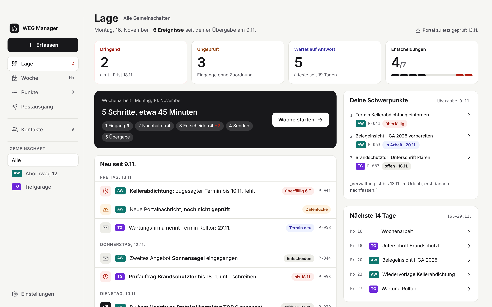
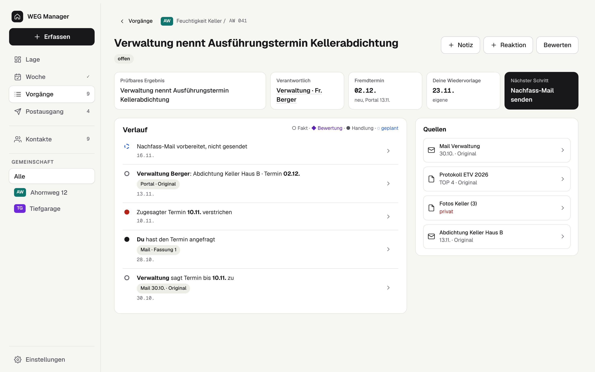
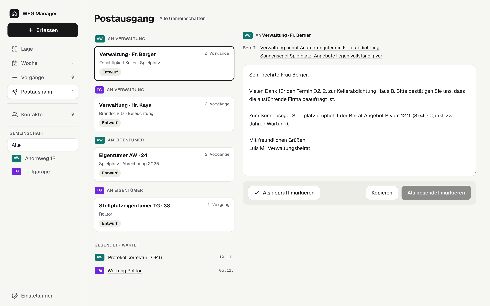
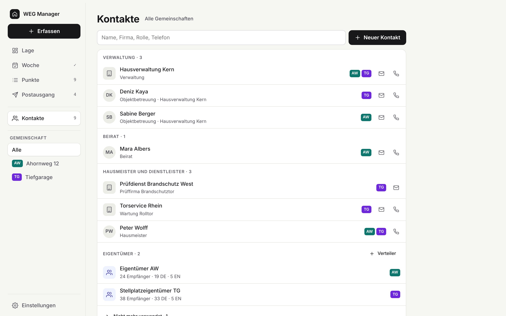
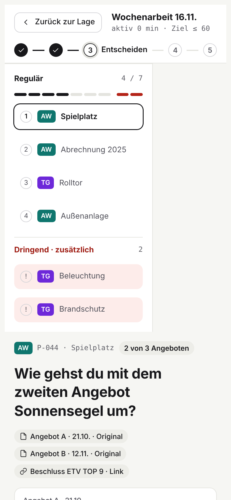
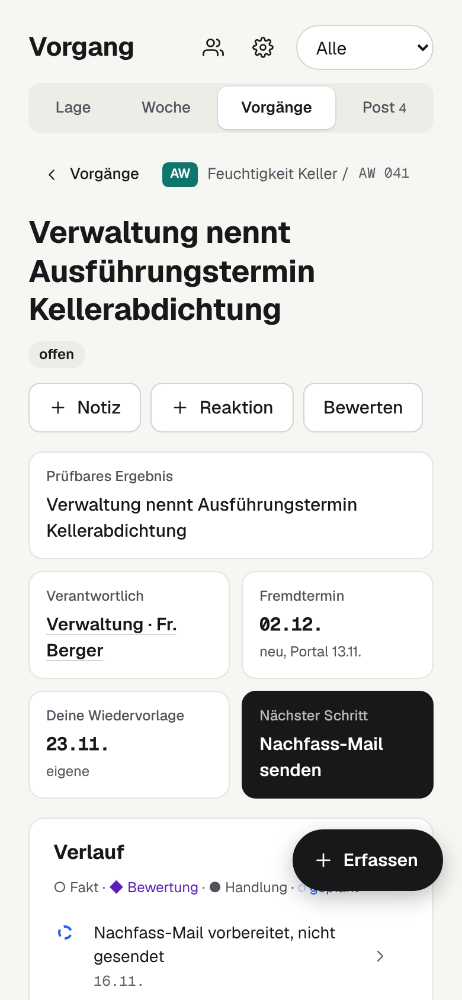

# The Obsidian WEG Manager Plugin

> **In English.** WEG Manager is an Obsidian plugin for the voluntary advisory boards (Verwaltungsbeiräte) of German condominium owners' associations (WEG). It keeps open items visible with their source, owner and next step, guides a bounded weekly review, and leaves every message under human control. All data stays local as Markdown notes with frontmatter in your own vault; it works without an account, network access or AI. The project is in its concept phase: so far the plugin does one thing, it manages the communities (one association per Markdown note, created, edited, deleted and switched in one view). Everything else is design and prototype. It is desktop only and not listed in the community plugin directory. The rest of this README and the product documentation are in German; the developer documentation under `docs/engineering/` is in English.

Ein Obsidian-Plugin für Verwaltungsbeiräte, die eine oder mehrere Wohnungseigentümergemeinschaften (WEG) begleiten. Offene Anliegen bleiben mit Quelle, Zuständigkeit und nächstem Schritt sichtbar, die Wochenarbeit ist geführt und begrenzt, Nachrichten bleiben unter menschlicher Kontrolle. Alle Daten liegen lokal als Markdown-Notizen mit Frontmatter im eigenen Vault, nutzbar ohne Konto, Netz und KI.

> **Stand:** Konzeptphase. Anforderungen, Design und ein klickbarer Prototyp liegen vor. Das Plugin hat ein lauffähiges technisches Grundgerüst und bisher eine einzige Fachfunktion: die Gemeinschaften (anlegen, bearbeiten, löschen, wechseln). Punkte, Lage, Wochenarbeit, Postausgang und Kontakte sind noch nicht umgesetzt; die Abschnitte zu Kernreise und Prototyp beschreiben das Ziel, nicht das Plugin von heute.

## Installation

Das Plugin ist noch nicht im Community-Plugin-Verzeichnis von Obsidian gelistet. Bis dahin wird es von Hand aus einem GitHub-Release installiert:

1. Im neuesten [Release](https://github.com/Luis85/weg-manager/releases) die Dateien `main.js`, `manifest.json` und `styles.css` herunterladen.
2. Im Vault den Ordner `<vault>/.obsidian/plugins/weg-manager/` anlegen und die drei Dateien hineinkopieren.
3. Obsidian neu laden, unter *Einstellungen → Community-Plugins* den eingeschränkten Modus ausschalten und **WEG Manager** aktivieren.

Für ein Update die drei Dateien ersetzen und das Plugin neu laden. Später ist die Installation für Testende auch über das Plugin [BRAT](https://tfthacker.com/BRAT) vorgesehen (siehe [Releasing](docs/engineering/releasing.md#beta-testing-with-brat)). Das Plugin läuft derzeit nur in Obsidian für Desktop (`isDesktopOnly`).

## Benutzung

- **Ansicht öffnen:** über das Symbol *WEG Manager* in der linken Seitenleiste oder den Befehl **WEG Manager: Ansicht öffnen** in der Befehlspalette.
- **Gemeinschaften:** die Ansicht öffnet mit deinen Gemeinschaften; du legst sie an, bearbeitest sie und löschst sie (Löschen fragt nach und legt die Notiz in den Papierkorb, den du in Obsidian eingestellt hast). Jede ist eine Notiz unter `WEG Manager/Gemeinschaften/` mit Name, Kürzel, Farbe, Art und Einheitenbezeichnung; der Dateivertrag steht in [`docs/contracts/DV-01 - Gemeinschaft v1.md`](docs/contracts/DV-01%20-%20Gemeinschaft%20v1.md), nach ihm lassen sich die Notizen auch ohne das Plugin anlegen und ändern. Das Plugin zeigt Notizen mit Problemen an, statt sie still zu reparieren, und überschreibt keine Änderung, die du außerhalb des Formulars gemacht hast, ohne dass du wählst. Im Rahmen der Ansicht wählst du die Gemeinschaft, in der du arbeitest; die Wahl gilt für alle offenen Ansichten und bleibt auf diesem Gerät gespeichert.
- **Einstellungen:** unter *Einstellungen → WEG Manager* (Abschnitt Community-Plugins) lässt sich die Protokollstufe für die Entwicklerkonsole einstellen.
- **Diagnose:** der Befehl **WEG Manager: Diagnose kopieren** legt einen Bericht mit Plugin-Version, Obsidian-API, Einstellungen und den letzten Protokolleinträgen in die Zwischenablage, zum Einfügen in eine Support-Anfrage. Notizinhalte, Dateinamen und Pfade kommen darin nicht vor.

Die Befehle haben keine voreingestellten Tastenkürzel; eigene lassen sich unter *Einstellungen → Tastenkürzel* vergeben.

## Kernreise (Ziel, noch nicht im Plugin)

1. Gemeinschaften getrennt einrichten und vorhandene Registerpunkte übernehmen.
2. Nachrichten, Unterlagen und einzelne erledigbare Vorgänge mit Quelle erfassen.
3. In der **Lage** sehen, was seit der letzten Übergabe passiert ist, was drängt und welche Fristen anstehen.
4. Die **Wochenarbeit** in fünf Schritten erledigen: Eingänge zuordnen, Zusagen prüfen, Entscheidungen treffen, Nachrichten prüfen und senden, Schwerpunkte für nächste Woche festlegen.
5. Nachrichten bewusst außerhalb des Plugins senden und den tatsächlichen Versand dokumentieren.
6. Ausgewählte Sachstände und Quellen verständlich weitergeben.

## Prototyp

Der klickbare Prototyp zeigt den abgestimmten Designstand mit synthetischen Daten (WEG Ahornweg 12 und Tiefgarage). Er läuft ohne Installation im Browser: [`docs/design/prototype/WEG-Manager-Prototyp.html`](docs/design/prototype/WEG-Manager-Prototyp.html). Stand, Inhalte und alle Bildschirme: [Prototyp – Stand Pilot](docs/design/prototype/Prototyp%20-%20Stand%20Pilot.md).

### Lage

Was ist neu, was drängt, was steht in den nächsten 14 Tagen an, welche Schwerpunkte hat die letzte Übergabe gesetzt.



### Wochenarbeit

Geführter Ablauf in fünf Schritten. Eingänge werden Vorgängen zugeordnet, erkannte Termine bewusst übernommen.


Höchstens sieben reguläre Entscheidungen pro Woche, Dringendes zusätzlich. Bestätigen erzeugt Entwürfe und Aufgaben; gesendet wird nichts automatisch.


### Vorgangsakte

Ein Vorgang mit Fakten, Fremdtermin und Wiedervorlage, Verlauf und Quellen an einem Ort.



### Postausgang

Entwürfe je Gemeinschaft und Empfänger, Eigentümer-Infos auf Deutsch und Englisch, Versand wird dokumentiert.



### Kontakte

Personen, Firmen und Eigentümer-Verteiler, gruppiert nach Rolle und zuständig für eine oder mehrere Gemeinschaften.



### Mobil (geplant)

Geplant ist, dass die vollständige Wochenarbeit auch auf dem Handy funktioniert ([K-09](docs/decisions/K-09%20-%20Vollst%C3%A4ndige%20mobile%20Wochenarbeit%20unterst%C3%BCtzen.md)). Die Bildschirme unten sind Entwürfe des Prototyps; das Plugin selbst läuft derzeit nur auf dem Desktop und wird erst nach einer Prüfung in Obsidian Mobile dafür freigegeben.

| Lage | Entscheiden | Vorgangsakte | Zusage erfassen |
| --- | --- | --- | --- |
|  |  |  |  |

## Dokumentation

| Einstieg | Inhalt |
| --- | --- |
| [Produktvision](docs/01-Produktvision.md) | Zielgruppe, Problem, Nutzenversprechen |
| [MVP-PRD](docs/02-MVP-PRD.md) | Umfang, funktionale und nichtfunktionale Anforderungen, Abnahmefälle |
| [Dokumentationsstruktur](docs/README_DOCS.md) | Ordner, Notiztypen und Konventionen |
| [Sitemap](docs/design/sitemap/00%20-%20Sitemap.md) | Ansichten und Navigation (VIEW-01 bis VIEW-08) |
| [Handoff](docs/design/handoff/00%20-%20Handoff%20%C3%9Cbersicht.md) | Umsetzungspaket: Tokens, Komponenten, Zustände, Texte, Abnahme, offene Punkte |

Die Dokumentation ist als Obsidian-Vault mit verknüpften Notizen angelegt. Anforderungen (Epics, Features, PBIs) liegen unter `docs/requirements`, Fachregeln unter `docs/business-rules`, Entscheidungen unter `docs/decisions`; die Übersichten liefert `docs/Product Backlog.base`.

## Entwicklung

Voraussetzung: Node 24 (`.nvmrc`) und npm 11.

```sh
npm ci            # installiert und setzt den pre-push-Hook (Qualitätstor; nur Dokumente: Formatprüfung)
npm run dev:ui    # Browser-Harness, ?scenario=loaded|empty|invalid|readonly|failure
npm run dev       # Watch-Build; mit OBSIDIAN_PLUGIN_DIR in .env.local direkt in einen Test-Vault
npm run verify    # Qualitätstor: Format, Lint, Typen, Tests mit Coverage, Analyse, Build, dist-Prüfung
```

| Skript | Zweck |
| --- | --- |
| `format:check`, `lint`, `typecheck`, `analyze` | Prettier, oxlint und ESLint, vue-tsc, fallow (Schichten und Module) |
| `test`, `test:coverage` | Vitest (Projekte `unit` und `dom`) |
| `test:mutation`, `test:mutation:full`, `verify:full` | Stryker auf Domain und Application; `verify:full` ist das Qualitätstor mit Mutationstest |
| `vault:reference`, `lint:scanner` | Referenz-Vault (2.000 Notizen) für die Zeitprüfungen; Annäherung an die Quellprüfung des Community-Verzeichnisses (nur Hinweis) |
| `test:e2e` | End-to-End-Tests im echten Obsidian (WebdriverIO, lädt Obsidian beim ersten Lauf herunter; unter Linux ohne Display: `xvfb-run -a npm run test:e2e`) |
| `build`, `check:dist` | `dist/main.js`, `styles.css`, `manifest.json` und ihre Invarianten |
| `version`, `release:package` | Versionssprung und Release-Paket, siehe Releasing |

Für die eigene Vault-Konfiguration: `node_modules/`, `dist/`, `reports/`, `release/`, `.stryker-tmp/`, `.obsidian-cache/` und `.fallow/` unter *Einstellungen → Dateien und Links → Ausgeschlossene Dateien* eintragen, da der Vault die Repo-Wurzel ist.

Entwicklerdokumentation (englisch): [Architektur](docs/engineering/architecture.md) · [Feature hinzufügen](docs/engineering/adding-a-feature.md) · [Tests](docs/engineering/testing.md) · [Fehlerbehandlung](docs/engineering/error-handling.md) · [Releasing](docs/engineering/releasing.md) · [GitHub-Einrichtung](docs/engineering/github-setup.md) · [ADRs](docs/adr/) · [Glossar](GLOSSARY.md). Regeln für Agenten und Mitwirkende: [AGENTS.md](AGENTS.md).

## Repository

| Ort | Inhalt |
| --- | --- |
| `src/` | Plugin-Quellcode in vier Schichten (`domain`, `application`, `infrastructure`, `presentation`), jede in Module gegliedert: `shell`, `notes`, `communities` |
| `tests/harness/` | Browser-Harness für UI-Arbeit ohne Obsidian |
| `docs/` | Produktkonzept, Anforderungen, Design, Prototyp, Dateiverträge der Notizen (`contracts/`), Architekturentscheidungen (`adr/`), Entwicklerdokumentation (`engineering/`) |
| `.github/` | CI-Workflows, Dependabot, Vorlage für Pull Requests |
| `scripts/` | Build-, Prüf- und Release-Skripte des Plugins |
| `configs/` | Konfiguration von Vite, Vitest, Stryker, fallow und TypeScript (Begründung in `docs/engineering/architecture.md`) |
| `tests/` | Plugin-Tests (`unit`, `dom`, `e2e`, Obsidian-Testdouble) |

## Lizenz

[MIT](LICENSE)

Die Lizenzen der Pakete von Dritten, die in `main.js` und `styles.css` stecken, stehen in [THIRD-PARTY-NOTICES.txt](THIRD-PARTY-NOTICES.txt). Die Datei wird mit `npm run notices` erzeugt und liegt jedem GitHub-Release bei.
