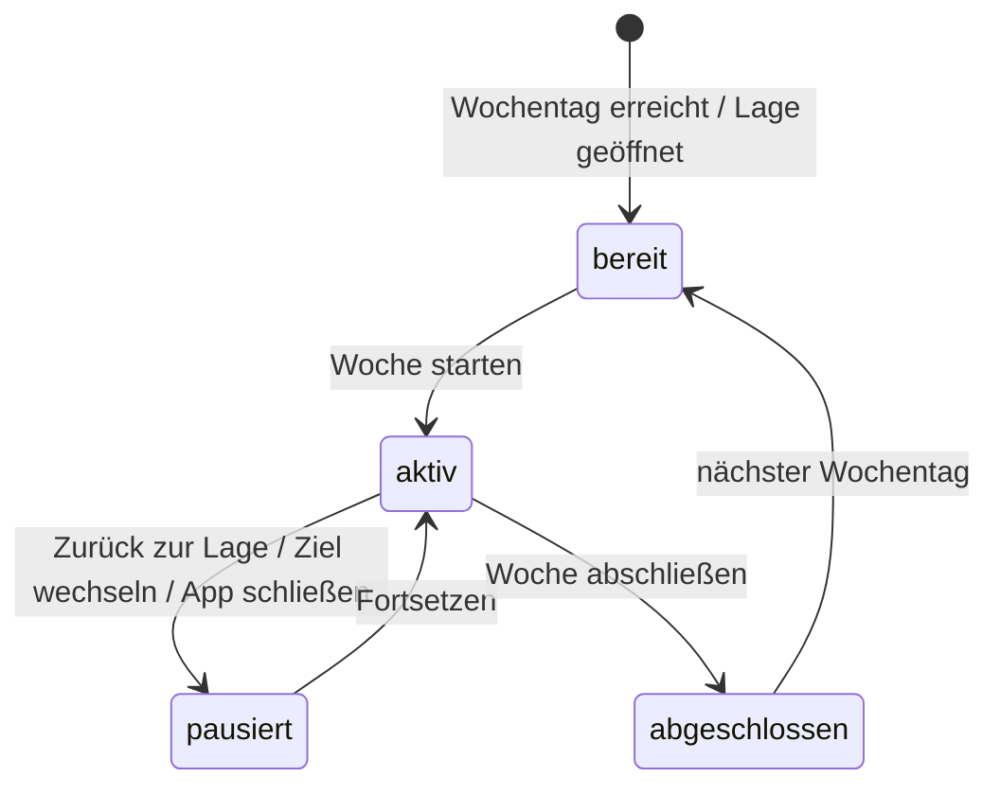
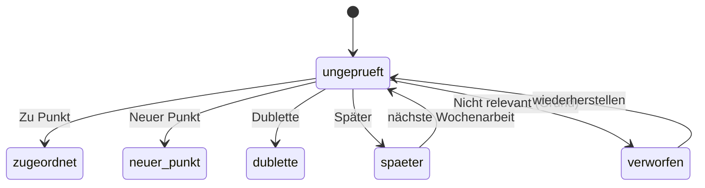
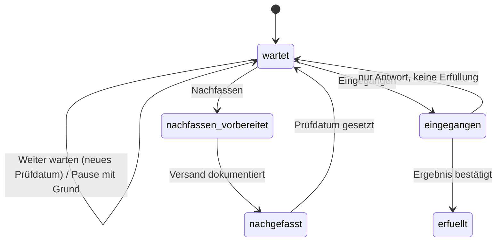
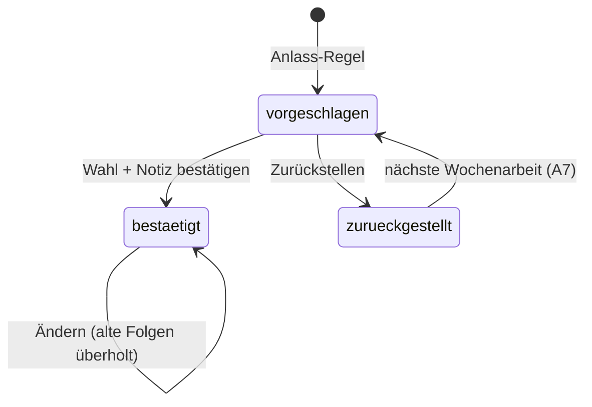
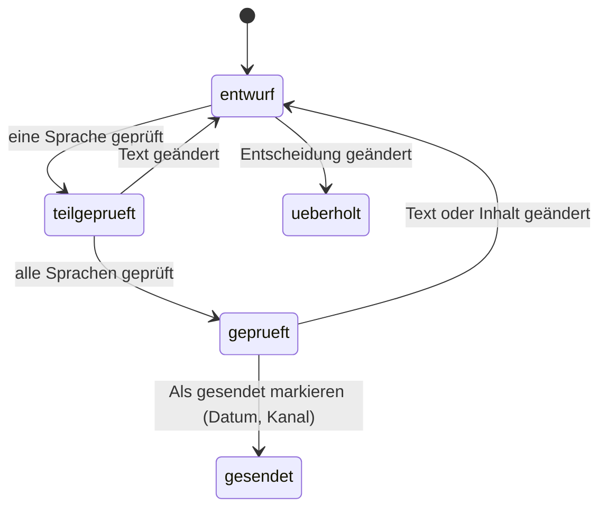

# Handoff · Zustände und Abläufe

Zustandsnamen sind fachliche Vorschläge; das technische Schema folgt in der technischen Konzeption. Jeder Übergang erzeugt ein Ereignis (ENT-06) mit Ereignis- und Erfassungszeit.

## Wochensitzung

Gespeichert: Schritt (1–5), Position im Schritt, aktive Minuten (nur bei sichtbarer View gezählt), Doppelpflege-Minuten, Ergebnisse je Schritt. Ein zweites Gerät übernimmt eine pausierte Sitzung; eine aktive Sitzung auf zwei Geräten zeigt Konflikt (O-D3).

## Eingang

`ungeprueft` und `spaeter` zählen als Datenlücke (Lage-Kachel „Ungeprüft“). Die Karte „Termin im Text“ bietet „Als Fremdtermin übernehmen“ oder „Nicht übernehmen“; Übernehmen legt beim Zuordnen einen Termin mit Herkunft an; der alte bleibt im Verlauf.

## Zusage und Nachfassen (DF-03–06)

Stufe (1 Termin erfragen → 2 Antwortfrist → 3 förmlich → 4 Bericht/ETV) wird nur nach dokumentiertem Versand und Ablauf der kommunizierten Frist vorgeschlagen. Ein Entwurf startet keinen Zeitanker.

## Arbeitsentscheidung

Bestätigen erzeugt Folgen idempotent: Schlüssel (Entscheidung, Option, Empfänger, Sprache) für Entwürfe; (Entscheidung, Option) für Aufgaben.

## Nachricht (gebündelter Entwurf)

- Platzhalter `[…]` verhindern „geprüft“.
- Änderung in einer Sprache setzt alle Sprachen auf ungeprüft (DF-07: gleicher freigegebener Inhalt).
- `gesendet` ist endgültig; spätere Änderungen erzeugen eine neue Fassung. Kopieren ändert keinen Zustand.

## Speichern und Fehler

- Jede bestätigende Aktion speichert sofort (Ziel < 500 ms, B-NFR-05). Fehlschlag: Eingabe bleibt, Alert am Element mit Handlung („Erneut speichern“).
- Externe Dateiänderung während der Bearbeitung: Alert „Geändert außerhalb des Plugins“ mit „Vergleichen“; nie still überschreiben (DF-23).
