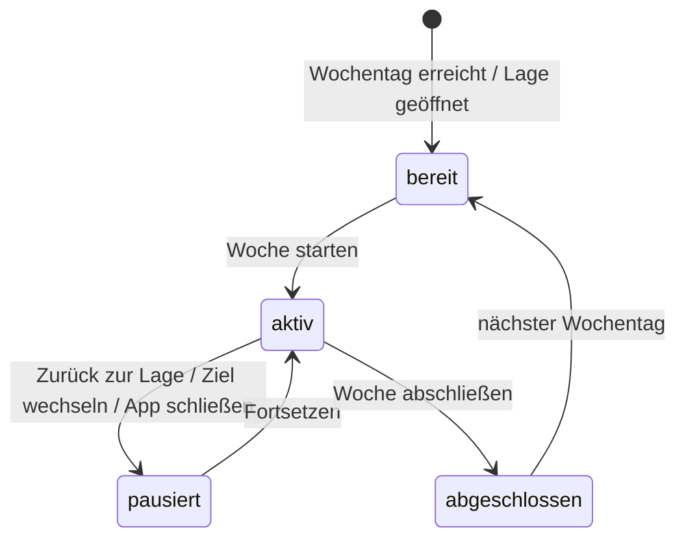
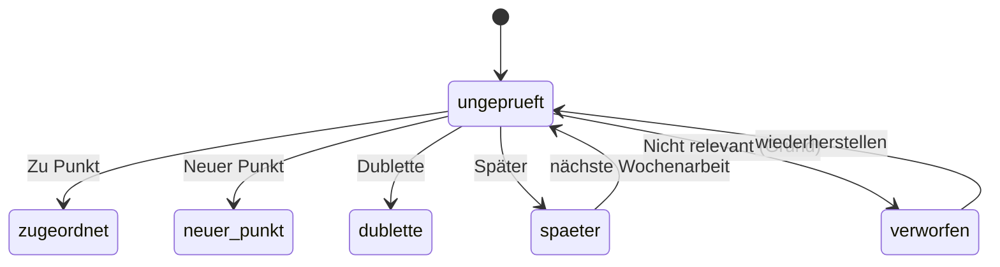
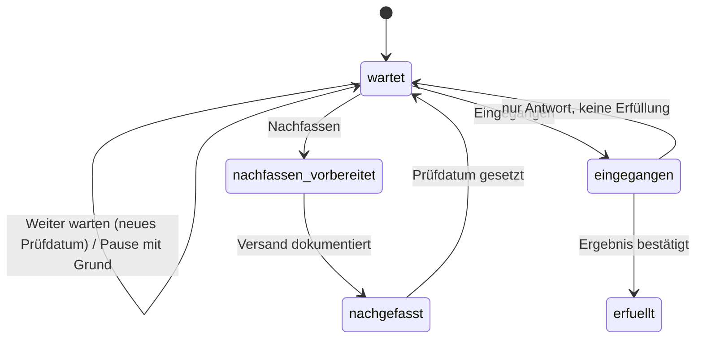
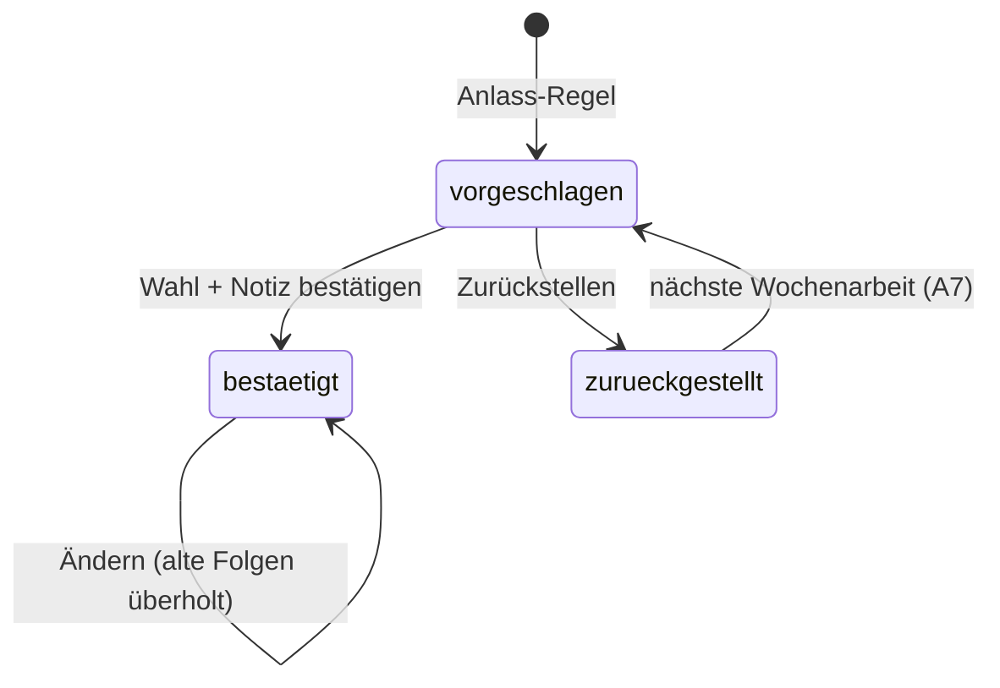
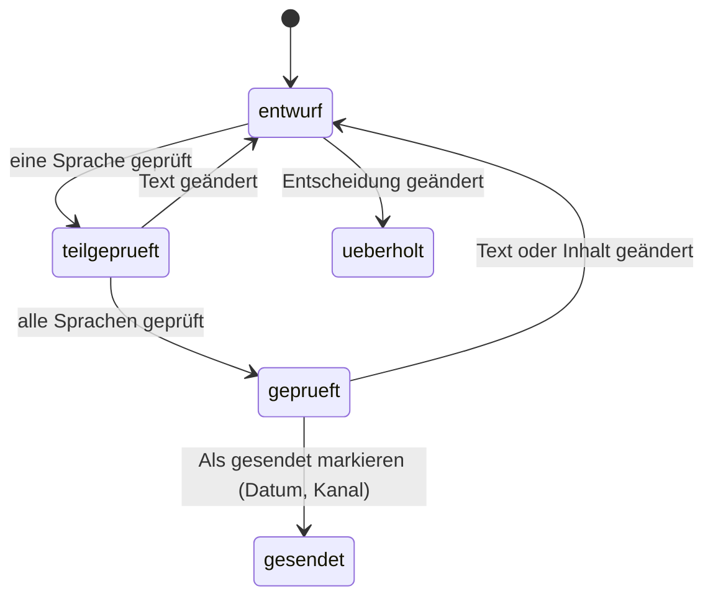

# Handoff · Zustände und Abläufe

**Auf den Stand vom 22.11.2026 gebracht** nach [ADR 0007](../../adr/0007-vault-data-access.md) (Notizen als Datensätze, Speichern je Feld, Konflikt) und den Entscheidungen vom 22.11.2026. Keiner der Zustandsautomaten unten ist gebaut; sie gelten wie geplant. Gebaut ist nur der Abschnitt „Speichern und Fehler“.

Zustandsnamen sind fachliche Vorschläge. Das technische Schema folgt je Datensatz mit seinem Dateivertrag (`docs/contracts/`): Schlüssel und Wertcodes sind englisch, ein Zustand steht als Code in einem flachen Schlüssel der Notiz (ADR 0007). Jeder Übergang erzeugt ein Ereignis (ENT-06) mit Ereignis- und Erfassungszeit.

## Wochensitzung

Gespeichert: Schritt (1–5), Position im Schritt, aktive Minuten (nur bei sichtbarer View gezählt), Doppelpflege-Minuten, Ergebnisse je Schritt. Ein zweites Gerät übernimmt eine pausierte Sitzung; eine aktive Sitzung auf zwei Geräten zeigt Konflikt (O-D3).

## Eingang

`ungeprueft` und `spaeter` zählen als Datenlücke (Lage-Kachel „Ungeprüft“). Die Karte „Termin im Text“ bietet „Als Fremdtermin übernehmen“ oder „Nicht übernehmen“; Übernehmen legt beim Zuordnen einen Termin mit Herkunft an; der alte bleibt im Verlauf.

## Zusage und Nachfassen (DF-03–06)

Stufe (1 Termin erfragen → 2 Antwortfrist → 3 förmlich → 4 Bericht/ETV) wird nur nach dokumentiertem Versand und Ablauf der kommunizierten Frist vorgeschlagen. Ein Entwurf startet keinen Zeitanker.

## Arbeitsentscheidung

Bestätigen erzeugt Folgen idempotent: Schlüssel (Entscheidung, Option, Empfänger, Sprache) für Entwürfe; (Entscheidung, Option) für Aufgaben.

## Nachricht (gebündelter Entwurf)

- Platzhalter `[…]` verhindern „geprüft“.
- Änderung in einer Sprache setzt alle Sprachen auf ungeprüft (DF-07: gleicher freigegebener Inhalt).
- `gesendet` ist endgültig; spätere Änderungen erzeugen eine neue Fassung. Kopieren ändert keinen Zustand.

## Speichern und Fehler

- Jede bestätigende Aktion speichert sofort (Ziel < 500 ms, B-NFR-05). Gebaut: Eine Notiz speichert über `vault.process` und ändert nur die Zeilen der Felder, die der Mensch geändert hat; fremde Schlüssel, Kommentare, Zeilenenden und der Text darunter bleiben. Eine Notiz, deren Frontmatter das Plugin so nicht ändern kann, schreibt es nicht und sagt es.
- Fehlschlag: Die Eingabe bleibt, ein Alert nennt Ursache und Handlung („Notiz nicht gespeichert“, „Erneut versuchen“). Nach einem Erfolg meldet eine Notice den Namen („Name“ gespeichert).
- Änderung außerhalb des Formulars während der Bearbeitung (Sync, ein anderes Gerät, ein Agent): Das Plugin führt je Feld zusammen. Ein Feld, das nur eine Seite geändert hat, gilt. Haben beide Seiten dasselbe Feld verschieden geändert, schreibt das Plugin nichts und zeigt je Feld drei Werte (beim Öffnen, Deine Eingabe, jetzt in der Notiz); der Mensch wählt und speichert („Notiz geändert, während du bearbeitet hast“). Nie still überschreiben (DF-23).
