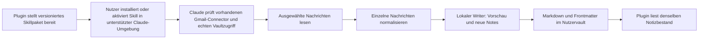

# Integrationskonzept · Gmail-Eingang mit Claude Skill

## Gewählter MVP-Weg

[[K-16 - Gmail-Eingang im MVP über Claude Skill bereitstellen]] legt einen lesenden Weg über die bereits von den Piloten verwendete Claude-Umgebung fest. Das Plugin stellt einen Skill bereit; Claude nutzt seinen vorhandenen Gmail-Connector und den freigegebenen Dateizugriff. Eine eigene Gmail-OAuth- oder MCP-Serverimplementierung im Plugin ist hierfür nicht erforderlich.

Der letzte Pfeil ist eine noch zu implementierende Produktintegration, kein heute getesteter Pluginlauf. Der Skill selbst einschließlich eines deterministischen Writers ist bereits erstellt.

## Ausführungsgrenze

Eine Skilldatei gewährt keine Connector- oder Dateirechte. Gmail-Lesetools und realer Zugriff auf denselben Nutzervault müssen in derselben verwendeten Claude-Sitzung vorhanden sein. Ein normaler Chat-Artefaktordner ist nicht ohne Weiteres der lokale Vault. Ein manueller Download ist ein anderer, ausdrücklich zu benennender Übergabeweg.

Der vorhandene Connector kann selbst MCP verwenden. „Ohne eigenen MCP-Server“ meint hier das WEG-Manager-Feature, nicht ein Verbot des Transportprotokolls eines vorhandenen Claude-Connectors. Auch Claude Code übernimmt nicht ungeprüft die Konto-/Connectorverbindung einer anderen Claude-Oberfläche.

## Paket und Installation

| Bestandteil | Vorhandenes Artefakt / Bedeutung |
| --- | --- |
| Skillquelle | [SKILL.md](../../../skills/weg-gmail-to-vault/SKILL.md) mit begrenztem Such-/Lese-/Schreibablauf. |
| Notizvertrag | [Schema v1](../../../skills/weg-gmail-to-vault/references/email-note-schema.md), Quelle für Felder, Identität und Unvollständigkeit. |
| Laufzeitbeschreibung | [Installation und Fähigkeiten](../../../skills/weg-gmail-to-vault/references/runtime-and-installation.md). |
| Writer | [import_messages.py](../../../skills/weg-gmail-to-vault/scripts/import_messages.py), Python 3.10+, Standardbibliothek, keine Netzwerkaufrufe. |
| Verteilbares Paket | [ZIP 0.1.0](../../../skills/dist/weg-gmail-to-vault-0.1.0.zip), ein oberster Skillordner, alle Runtime-Ressourcen enthalten. |
| Installationsmanifest | [manifest.json](../../../skills/manifest.json), Version, Paketpfad, Prüfsumme, Größe und benötigte Fähigkeiten. Prüfsumme ist Integritätsvergleich, keine Signatur oder Identitätsprüfung des Herausgebers. |
| Reproduzierbarer Build | [package_claude_skills.py](../../../scripts/package_claude_skills.py). Baut das Paket, installiert aber nichts. |

Die spätere Plugininstallation bietet entweder den unterstützten lokalen Claude-Code-Projektpfad `.claude/skills/weg-gmail-to-vault/` an oder stellt das ZIP für Claudes Skillimport bereit. Zielpfad und vorhandene Version werden sichtbar; vorhandene Nutzeranpassungen nicht blind überschreiben. Archive nur unter dem gewählten Ziel entpacken, keine absoluten Pfade/Traversal/Symlinks aus einem Paket akzeptieren. Die noch nicht implementierte Installation muss zusätzlich zum Paketstand geprüft werden.

Ein Paketupdate migriert keine bestehenden E-Mail-Notizen. Konkrete Konten, Suchkriterien und Nutzervaultpfade werden beim Auftrag bestimmt und sind nicht in das verteilte Paket eingebrannt. Autorisierung bleibt in Claude; keine Google-Tokens im Pluginpaket oder Fachnotizbestand.

## Datenvertrag und Scope

Eine E-Mail ist eine [[ENT-21 - E-Mail-Quellnotiz]], keine automatisch angelegte Aufgabe oder Erfüllung. Konto + Gmail-Nachrichten-ID bestimmen Identität; Thread und Betreff reichen nicht. Die erste Version legt neue Notes an und erhält bestehende Notes unverändert. Bei abweichender neuer Quellfassung wird Klärungsbedarf gemeldet; eine bewusste Aktualisierung ist ein gesonderter Arbeitsauftrag.

Die öffentliche Claude-Hilfe nennt Anhangsmetadaten, nicht Anhangsinhalte. Der erste Skill dokumentiert daher nur bekannte Metadaten und markiert fehlende Inhalte ausdrücklich. Weder ein Dateiname noch eine Snippetkopie ist ein Originalbeleg. Der Notiztext bleibt als Datenblock gekennzeichnet; Anweisungen aus E-Mails werden nicht als neue Agentenaufträge behandelt.

Läufe sind auf einen bestimmten Suchumfang begrenzt. Pagination, doppelte Treffer, fehlende Volltexte und Abbruch bleiben sichtbar. Der Writerbericht umfasst nur die ihm übergebenen Datensätze; der Claude-Workflow muss die Abfragegrenzen und nicht verarbeiteten Connectorergebnisse ergänzen. Kein „alles synchronisiert“ ohne belegten Umfang.

## Quellen und aktueller Teststand

Offizielle Quellen, geprüft 15.11.2026:

- [Claude Google Workspace connectors](https://support.claude.com/en/articles/10166901-use-google-workspace-connectors): Suchen/Lesen und zusätzlich schreibende Fähigkeiten; dieser Skill beschränkt sich auf Lesen. Anhangsinhalte sind laut dieser Hilfe nicht Teil des Gmail-Metadatenzugriffs.
- [Custom Skills erstellen](https://support.claude.com/en/articles/12512198-how-to-create-custom-skills) und [Skills verwenden](https://support.claude.com/en/articles/12512180-use-skills-in-claude): Paketstruktur und ZIP-Verteilung; konkrete Aktivierung hängt von der Claude-Umgebung ab.
- [Claude Code Skills](https://code.claude.com/docs/en/skills): Projektpfad für lokale Skills. Keine pauschale Aussage, dass dort jeder Claude-Connector automatisch verfügbar ist.

[[Skill-Evaluation - Gmail-Import]] dokumentiert synthetische Prüfungen. Noch offen: tatsächlicher Claude-/Gmail-End-to-End-Test mit Testpostfach, freigegebenem Vault und passender Laufzeit; Installation aus dem späteren Plugin; Verhalten auf dem festzulegenden Pilotgerät. Der Produktpilot nach Veröffentlichung wird dadurch nicht durch einen neuen Vorabpilot ersetzt.

[[PBI-46 - Gmail-Nachrichten mit Claude als Vault-Notizen übernehmen]], [[DF-26 - Gmail-Nachrichten eindeutig und quellentreu übernehmen]], [[F-18 - Integrationen]], [[F-22 - Offene Notizen und direkter Agentenzugriff]].
