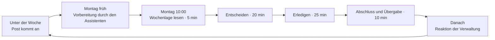

# Research · IST-Ablauf des Pilot-Beirats als Storymap

**Ergebnis:** Der Pilot-Beirat arbeitet heute ohne das Plugin, mit einem KI-Assistenten und allgemeinen Werkzeugen (Mail, Tabelle, Cloud-Ablage, eine selbst gebaute Arbeitsseite). Der Assistent bereitet Montag früh alles vor; der Beirat entscheidet in einer festen Wochenstunde an einer Stelle und sendet selbst. Die größte Reibung liegt nicht im Entscheiden, sondern im Übergang von der Entscheidung zum Versand und im Nachfassen von Zusagen ohne Termin.

## Auftrag, Methode und Evidenzgrenze

Erbeten von Luis am 17.11.2026, um den Anwendungsfall des Piloten zu verstehen. Grundlage ist die Selbstbeschreibung des Piloten und seine Ablaufnotiz, Stand 17.11.2026; keine Beobachtung durch Dritte, keine Zeitmessung über mehrere Wochen. Ein Pilot, zwei Gemeinschaften (eine WEG und die zugehörige Tiefgarage). Die Note enthält keine echten Namen, Adressen, Beträge oder Inhalte von Punkten. **Beobachtung** steht für das, was der Pilot heute tut; **Ableitung** für ein vorgeschlagenes Produktverständnis, das keine Vorgabe ist.

## Ablauf im Überblick

## Storymap

Jede Zeile ist ein Schritt des Ablaufs von links nach rechts in der Woche. Die Spalten trennen, was der Beirat tut, was der Assistent oder eine Automatik tut, welche Werkzeuge im Spiel sind und wo es heute hakt.

| Schritt | Beirat (Beobachtung) | Assistent / Automatik (Beobachtung) | Werkzeuge | Reibung heute |
| --- | --- | --- | --- | --- |
| **Unter der Woche: Post kommt an** | Bekommt eine Push-Nachricht bei neuer Mail im Beirats-Postfach. Startet bei Bedarf einen Lagecheck, sonst bleibt es bis Montag liegen. | Ein Skript legt Anhänge in einen Eingangsordner der Ablage. Lagecheck: Wo war ich? Was ist passiert? Kann es bis Montag warten? | Mail-Postfach des Beirats, Skript, Assistent | Der Posteingang wurde ungewollt zur Aufgabenliste. |
| **Montag früh: Vorbereitung** | Nichts zu tun. | Liest Mails, Register und Arbeitsseite. Pflegt das Register, legt Dateien ab, schiebt Nachfassschritte eine Stufe weiter. Schreibt die Wochenlage, höchstens sieben Entscheidungsvorlagen mit Empfehlung und fertigem Entwurf, dazu Folgeaufgaben. Räumt das Postfach auf. | Geplanter Lauf, Tabelle (Register), Ablage, Mail, Arbeitsseite | Lief anfangs nur als Vorschlag statt als Tat: die Ablage staute sich wochenlang. Fehler sieht man nur, wenn man die Wochenlage liest. |
| **Montag 10:00: Wochenlage lesen (5 min)** | Öffnet die Arbeitsseite: Modus der Woche, Neuigkeiten, Fristen, Stand der Nachfassschritte. | Wochenlage, Fristen und Notiz zum Nachfassen kommen fertig aus dem Morgenlauf. | Arbeitsseite | Die Lage ist ein Stand vom frühen Morgen; was danach kam, fehlt. |
| **Entscheiden (20 min)** | Wählt je Vorlage eine Option, optional mit Kontextnotiz (z. B. „als Verständnisfrage formulieren“). Schickt die Wahl ab. | Macht aus Wahl und Notiz Entwürfe (einer je Gemeinschaft und Empfänger), Eigentümer-Infos auf Deutsch und Englisch und Folgeaufgaben. | Vorlagen auf der Arbeitsseite, Mail-Entwürfe | Der automatische Start nach dem Abschicken ist noch nicht verlässlich. Notizen verweisen oft auf ein Gespräch außerhalb der Arbeitsseite. |
| **Erledigen (25 min)** | Arbeitet Folgeaufgaben ab: Entwurf öffnen, Absender auf die Beirats-Adresse stellen, senden. Texte für Messenger kopieren. Vor Ort prüfen. Den Rest im Postfach ansehen. | Liefert je Aufgabe den Link zum Entwurf oder den Text zum Kopieren. Sendet nie selbst. | Mail, Messenger, Ablage, Register | Absender jedes Mal von Hand umstellen. Viele Kanäle. Aufgaben ohne Rückmeldung bleiben liegen. |
| **Abschluss und Übergabe (10 min)** | Wählt bis zu drei Schwerpunkte für die Woche und schreibt die Übergabe („wo war ich“). | Die Übergabe ist der Startpunkt für den nächsten Lagecheck und den nächsten Montag; Registerzeilen bekommen einen Vermerk. | Arbeitsseite, Register | Wissen verteilt sich auf Arbeitsseite, Register, Projektdokumente und persönliche Notizen. |
| **Danach: Reaktion der Verwaltung** | Antwort kommt, Push-Nachricht, Lagecheck oder bis Montag parken. | Gleicht die Antwort mit dem Register ab. Zusagen ohne Termin steigen jede Woche eine Stufe: Termin erfragen, Frist setzen, förmlich erinnern, im Bericht an die Eigentümer vormerken. | Register, Nachfassschritte auf der Arbeitsseite | Viele Zusagen ohne Termin; das Nachfassen ist der größte Aufwand. |

## Begriffe: IST-Ablauf und WEG Manager

Der Pilot hat für seine Werkzeuge eigene Namen. Die Tabelle ordnet sie den Begriffen zu, die das Repo in Produktdokumenten und im [Glossar](../../../GLOSSARY.md) verwendet. Wo das Glossar noch keinen englischen Begriff hat, steht der deutsche aus den Konzeptnotes.

| Im IST-Ablauf des Piloten | Im WEG Manager | Hinweis |
| --- | --- | --- |
| WEG und Tiefgarage | Gemeinschaft (Community), Art „WEG“ bzw. „Tiefgarage“ | Formal getrennt, aber ein gemeinsames Postfach. |
| Arbeitsseite mit Datenbank („Mappe“) | Plugin-Ansichten: Lage, Wochenarbeit, Postausgang | Heute eine selbst gebaute Seite statt Vault. |
| Register (Tabelle, eine Zeile je Zusage) | Registerbestand, einzelne Punkte | Eine Zeile ist ein einzeln erledigbarer Punkt. |
| Morgenlauf des Assistenten | Wochenpaket vorbereiten | Im Plugin ohne KI-Pflicht vorgesehen (H-06). |
| Lage | Wochenlage (Lage) | |
| Entscheidungskarte mit Empfehlung und Entwurf | Entscheidungsvorlage, Arbeitsentscheidung | Höchstens sieben je Woche (H-04). |
| Notiz zur Wahl | Kontextnotiz | |
| „Entscheidungen abschicken“ | Wahl bestätigen, Folgearbeit vorbereiten | |
| To-do mit Entwurfslink oder Kopiertext | Folgeaufgabe, Entwurf im Postausgang | Versand bleibt beim Menschen. |
| Nachfass-Leiter (Stufen 1 bis 4) | Nachfassschritte und -stufen | Verwaltungszusagen nachfassen. |
| Lagecheck | Lagecheck und Wiedereinstieg | |
| Übergabe („wo war ich“), Schwerpunkte | Übergabe, nächste Wochenarbeit vorbereiten | |
| Eingangsordner der Ablage | Eingang, Quellen zuordnen | |

## Ableitungen für das Produkt

- **Ableitung:** Der Engpass liegt zwischen Bestätigen und Versand. Ein Postausgang, der Absender und Empfänger je Gemeinschaft vorbelegt und den tatsächlichen Versand mit einem Klick erfasst, spart dem Piloten am meisten Zeit.
- **Ableitung:** Die Wochenstunde passt in den heutigen Ablauf, aber nur, weil die Vorbereitung vorher stattfindet. Ohne vorbereitetes Wochenpaket ist H-03 für diesen Piloten nicht zu halten.
- **Ableitung:** Kontext, der heute im Gespräch mit dem Assistenten steckt, sollte in der Kontextnotiz oder im Verlauf des Punkts landen, sonst ist eine Übergabe ohne Hintergrundwissen nicht verständlich.
- **Ableitung:** Nachfassen ist wiederkehrende Hauptarbeit. Stufen und Fristen je Punkt sichtbar zu machen ist für diesen Piloten wichtiger als neue Erfassungswege.
