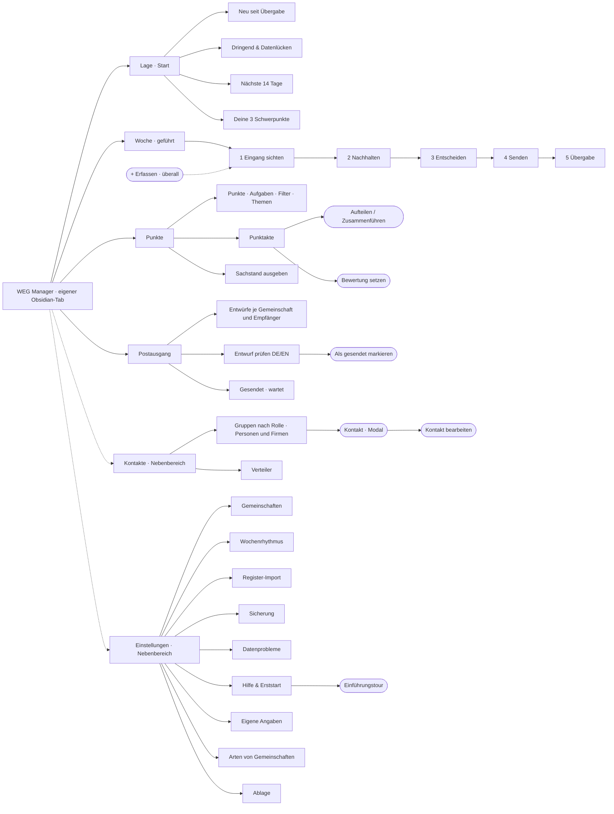

# Sitemap

Vier Ziele, eine Detailebene. Bearbeitung passiert im Kontext (Seitenpanel, Sheet, geführter Schritt), nicht auf eigenen Seiten.

![[v2-Sitemap.png]]

Aktueller Stand aller Ansichten im klickbaren Prototyp: [[Prototyp - Stand Pilot]] (gilt bei Abweichung vor den Mockups).

## Struktur

Runde Knoten sind Sheets oder Dialoge, eckige Knoten Ansichten oder Bereiche.

## Navigationsmodell

| Ziel | Rolle | Desktop | Mobil |
| --- | --- | --- | --- |
| Lage | Startpunkt, Lagecheck zwischendurch | Sidebar, Badge = Anzahl dringend | Segment oben |
| Woche | geführter Ablauf, blendet Navigation aus | Sidebar, Badge = Wochentag | Segment oben |
| Punkte | Register, Aufgaben, Akte | Sidebar, Badge = Anzahl | Segment oben |
| Postausgang | Entwürfe und Versanddokumentation | Sidebar, Badge = offene Entwürfe | Segment „Post“ |
| Kontakte | Adressbuch, Nebenbereich | Sidebar unter den Zielen, Badge = Anzahl | Personen-Symbol im Kopf |
| Einstellungen | Stammdaten, Nebenbereich | Sidebar unten | Zahnrad im Kopf |

**Immer erreichbar:** „+ Erfassen“ (Sidebar-Button, Befehl, mobil schwebender Button), Suche und Befehle ⌘K, Gemeinschaftsfilter (Alle · AW · TG). Der Filter ist nie ein stiller Kontextwechsel: Jede Bearbeitung, Nachricht und Ausgabe hat genau eine Gemeinschaft (DF-12).

**Querwege:** Jede Zeile in Lage und Woche öffnet die Punktakte im Seitenpanel; Zurück landet an derselben Stelle. Entscheiden erzeugt Entwürfe im Postausgang und eigene Aufgaben. „Als gesendet markieren“ plant die Prüfung in Nachhalten. „Verantwortlich“ in der Punktakte und „An“ im Postausgang öffnen den Kontakt als Modal über der Ansicht.
