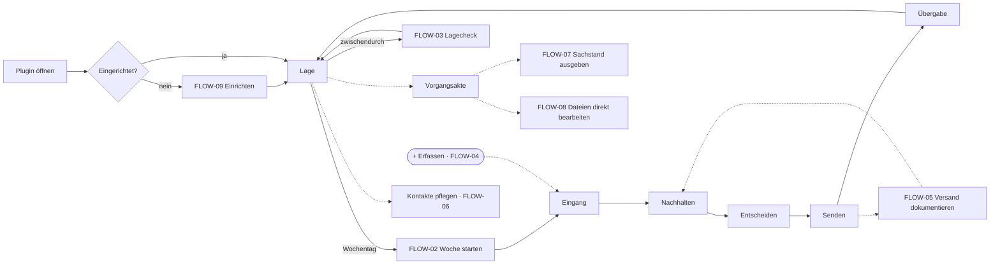

# FLOW-01 · Gesamtfluss des Beirats-MVP (v2)

**Designstand:** 15.11.2026

**Stand 21.11.2026:** Die mobile Bedienung dieser Abläufe ([[PBI-33 - Wochenarbeit auf dem Handy abschließen]], FLOW-03 am Handy) folgt nach dem MVP, siehe [[K-09 - Vollständige mobile Wochenarbeit unterstützen]]. Im MVP laufen sie auf dem Desktop.

Drei Rhythmen tragen das Produkt: **einmal pro Woche** geführt arbeiten, **zwischendurch** kurz die Lage prüfen, **jederzeit** etwas erfassen. Alles andere ist Kontext.

![[v2-Flows.png]]

## Prinzipien

- Jede Handlung hat eine Gemeinschaft (DF-12); „Alle“ ist nur Übersicht.
- Entscheidung, Entwurf, Versand, Antwort und Erfüllung sind getrennte Verlaufseinträge (DF-07).
- Unterbrechen ist überall erlaubt; Rückkehr an dieselbe Stelle.
- Keine automatische Aktion nach außen.
