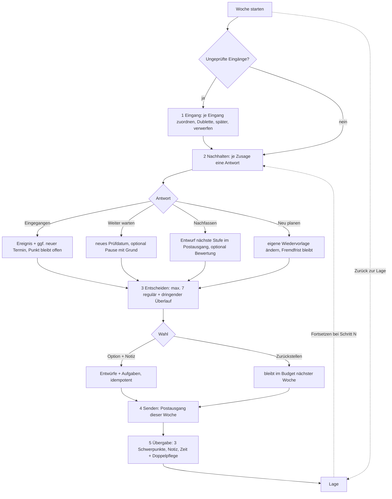

# FLOW-02 · Wochenarbeit geführt

**Auslöser:** Wochentag laut Rhythmus oder „Woche starten“ in der Lage. **Ziel:** alle wartenden Zusagen beurteilt, bis zu 7 Entscheidungen getroffen, Nachrichten vorbereitet, Übergabe gespeichert – in ≤ 60 min aktiver Zeit (H-03).

**Stand 21.11.2026:** Die mobile Bedienung ([[PBI-33 - Wochenarbeit auf dem Handy abschließen]]) folgt nach dem MVP, siehe [[K-09 - Vollständige mobile Wochenarbeit unterstützen]]. Im MVP läuft die Wochenarbeit auf dem Desktop.

## Abbrüche und Sonderfälle

| Fall | Verhalten |
| --- | --- |
| „← Zurück zur Lage“ (pausiert) / App schließen | Schritt, Position, Eingaben gespeichert; Lage zeigt „Fortsetzen“. |
| Mehr als 7 Entscheidungen | Budgetleiste voll; weitere bleiben sichtbar für nächste Woche; Dringendes zusätzlich. |
| Bestätigen zweimal | keine doppelten Entwürfe oder Aufgaben; alte Fassung „überholt“. |
| Neue Eingänge während der Arbeit | Hinweis, kein stiller Listenumbau. |
| Keine Anlässe | Woche kann mit „Nichts zu tun“ abgeschlossen werden; zählt nicht als Abbruch. |
