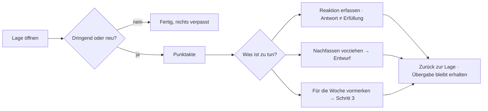

# FLOW-03 · Lagecheck unterwegs

**Auslöser:** kurzer Blick am Handy zwischen zwei Wochenterminen. **Ziel:** in 2–5 Minuten wissen, ob etwas nicht bis zur nächsten Wochenarbeit warten kann.

Kein Zwang zur Bearbeitung: Vormerken ist eine vollwertige Antwort. Die Übergabe-Schwerpunkte werden nicht verändert.
