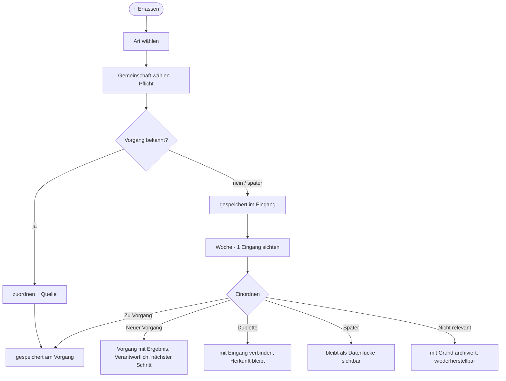

# FLOW-04 · Schnell erfassen und Eingang sichten

Erkannte Termine werden nur nach Bestätigung (Checkbox) als Zusage übernommen; die Quelle bleibt als Original oder ausdrücklich als Link gekennzeichnet (DF-08).
