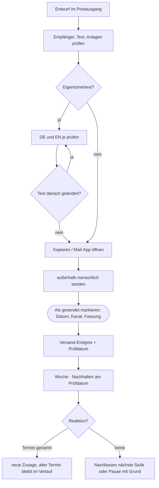

# FLOW-05 · Senden, dokumentieren und nachhalten

Testfall aus dem PRD (AT-B09): Versand 16.11., Antworttermin 30.11., eigene Prüfung 23.11. → am 23.11. kein Stufenwechsel; erst nach dem 30.11. wird Nachfassen vorgeschlagen.
