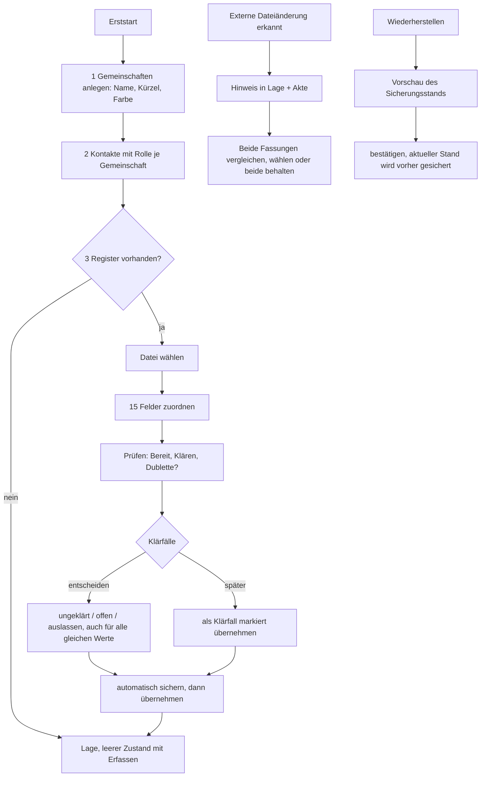

# FLOW-06 · Einrichten, Import und Datenerhalt

Wiederholter Import erkennt Zeilen über Gemeinschaft + Altnummer + Herkunft und aktualisiert statt zu verdoppeln. Unterbrechen ist in jedem Schritt möglich.

## Kontakte pflegen

Im laufenden Betrieb über [[VIEW-08 - Kontakte]]: Kontakt suchen oder aus Punktakte bzw. Postausgang öffnen (Modal) → Bearbeiten → Speichern, zurück im Kontakt-Modal; neue Entwürfe nutzen die geänderten Daten, gesendete Nachrichten bleiben unverändert. Ein ausgeschiedener Kontakt wird auf „nicht mehr verwendet“ gesetzt statt gelöscht.

## Einführungstour

Nach dem Erststart öffnet die Lage einmalig den Willkommensdialog: „Tour starten“ führt durch 7 Schritte (Kennzahlen, Wochenarbeit, Erfassen, Navigation, Gemeinschaftsfilter, Kontakte, Einstellungen), „Überspringen“ beendet sie. Neustart über Einstellungen › Hilfe oder den Befehl „Einführungstour starten“ ([[VIEW-07 - Einstellungen und Einrichtung]]).
