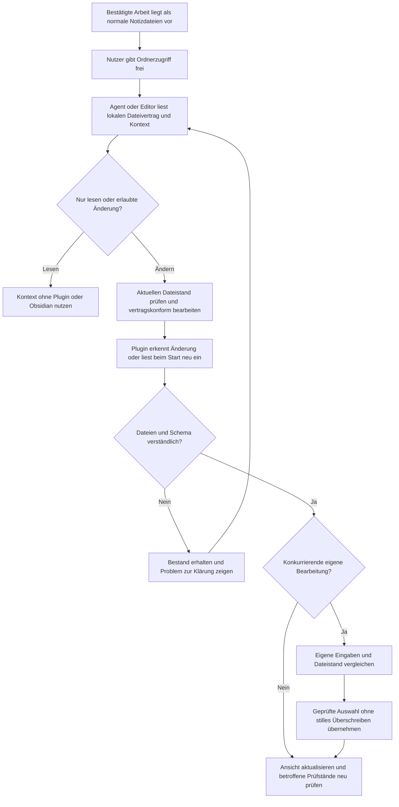

# FLOW-08 · Zwischen Plugin und direkter Dateibearbeitung wechseln

## Ziel und Voraussetzungen

Der Nutzer arbeitet wahlweise im Plugin oder mit einem Editor beziehungsweise freigegebenen AI-Agent direkt auf demselben Notizbestand. Der lokal verfügbare Dateivertrag erklärt Lesen, Beziehungen und zulässige Änderungen. MCP ist nicht erforderlich. Direkter Zugriff kann jederzeit auch ohne laufendes Obsidian beginnen; der Einstieg im folgenden Diagramm ist nur ein möglicher Wechselpunkt.

## Ablauf

## Übergänge und Ansichten

| Schritt | Kontext | Ergebnis |
| --- | --- | --- |
| Datenvertrag verstehen | [[VIEW-07 - Einstellungen und Einrichtung]] oder lokal verfügbare Dokumentation außerhalb der App | Dateien, Beziehungen und Grenzen ohne laufendes Plugin verständlich. |
| Kontext lesen oder ändern | Gewöhnlicher Dateieditor oder [[ACT-09 - AI-Agent mit direktem Dateizugriff]] | Dieselben fachlichen Notizen statt eines separaten Agentenexports. |
| Gültige Änderungen einlesen | [[VIEW-03 - Punkte und Punktakte]] (Akte und Quellen) | Aktueller Fachstand, Herkunft und erforderliche erneute Prüfung sichtbar. |
| Konflikt klären | [[VIEW-07 - Einstellungen und Einrichtung]] | Eigene Eingaben und externer Dateistand bleiben bis zur geklärten Übernahme erhalten. |
| Bestand erhalten | [[VIEW-07 - Einstellungen und Einrichtung]] | Vollständige normale Dateien und Originale bleiben übertragbar; kein Datenverlust durch fehlenden Cache. |

## Abzweigungen und Grenzen

- Ohne Plugin kann der Agent weiterhin lesen und vertragskonform schreiben; nur die Pluginansicht fehlt. Keine vorgeschaltete Verbindung zu Obsidian oder MCP.
- Noch ungespeicherte Formularinhalte werden nicht als bereits im Ordner verfügbar behauptet.
- Ungültige, unvollständige oder unbekannte Dateien werden nicht still verworfen. Beim erneuten Einlesen nach Korrektur keine doppelten Fachobjekte.
- Ändert sich die Datei erneut während der Konfliktklärung, erneut gegen diesen Stand prüfen; keine blinde Übernahme einer veralteten Lösung.
- Eigene Dateirechte und Modellzugriff werden vom Nutzer beziehungsweise seiner Umgebung vergeben. Keine neue Kontoverwaltung oder automatische externe Übertragung des Plugins.
- Normale Dateiänderung ist keine tatsächlich erfolgte menschliche Freigabe oder Sendung. Geänderte Grundlagen können bestehende Prüfstände erneut prüfbedürftig machen.

## Ende und Review

Ergebnis ist ein weiter nutzbarer gemeinsamer Dateibestand, eine bewusst erhaltene offene Klärung oder reine Kontextnutzung ohne Änderung. Der technische Zugriff und die Konflikterkennung sind noch nicht implementiert. Als Reviewfälle gelten [[PBI-41 - Vorgänge ohne Plugin und Obsidian nutzen]], [[PBI-42 - AI-Agent direkt mit den Notizen arbeiten lassen]] und [[Datenkonzept - Offene Notizen und Agentenzugriff]].
