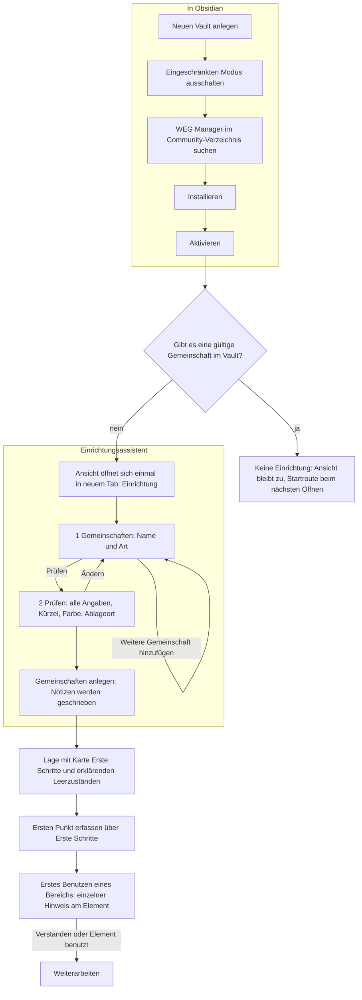
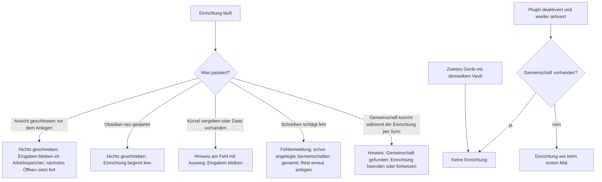
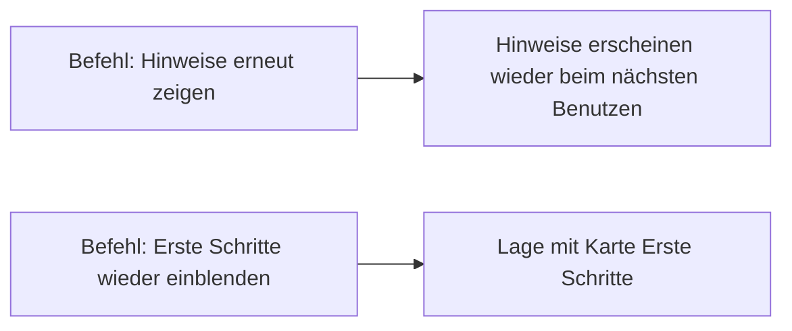

# FLOW-09 · Erststart, Einrichtung und Einführung

Vom leeren Vault bis zur ersten Arbeit, nach [[K-19 - Onboarding über Einrichtungsassistent, Erste Schritte und Hinweise im Kontext]]. Ersetzt den Abschnitt „Erststart“ in [[FLOW-06 - Einrichten, Import und Datenerhalt]]; Import und Datenerhalt bleiben dort.

## Hauptablauf

Bis die Lage existiert ([[PBI-13 - Aktuelle Wochenlage öffnen]]), führt das Anlegen in die Gemeinschaftsverwaltung; die Karte „Erste Schritte“ folgt mit der Lage. Die Hinweise im Kontext folgen nach dem MVP ([[PBI-72 - Beim ersten Benutzen eines Bereichs einen Hinweis erhalten]]). Es gibt keine Tour ([[K-19 - Onboarding über Einrichtungsassistent, Erste Schritte und Hinweise im Kontext]]).

## Abbrüche und Sonderfälle

## Hinweise und Erste Schritte zurückholen

## Zustände

| Zustand | Wo gespeichert | Wirkung |
| --- | --- | --- |
| Einrichtung nötig | nicht gespeichert, abgeleitet: keine gültige Gemeinschaft im Vault | Ansicht zeigt die Einrichtung |
| Eingaben im Assistenten | nur im Arbeitsspeicher | bleiben bis zum Neustart von Obsidian; nichts im Vault, nichts in den Plugin-Daten |
| Gemeinschaften | Notizen unter `WEG Manager/Gemeinschaften/` | maßgeblich ([[DF-22 - Notizen als maßgeblicher Datenbestand]]) |
| Erste Schritte erledigt | abgeleitet aus dem Vault (etwa: Es gibt einen Punkt) | Haken in der Karte |
| Erste Schritte ausgeblendet | je Gerät (`DeviceStore`, K-19 O-19b) | Karte erscheint auf diesem Gerät nicht |
| Hinweis gesehen | je Gerät (`DeviceStore`, K-19 O-19b) | dieser Hinweis erscheint auf diesem Gerät nicht wieder |

## Bezüge

[[F-25 - Onboarding und Einführung]] · [[FLOW-01 - Gesamtfluss des Beirats-MVP]] · [[FLOW-06 - Einrichten, Import und Datenerhalt]] · [[Onboarding-Research - Erststart, Einrichtung und Einführung]].
