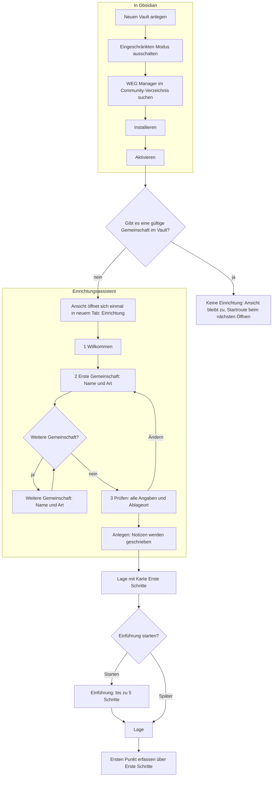
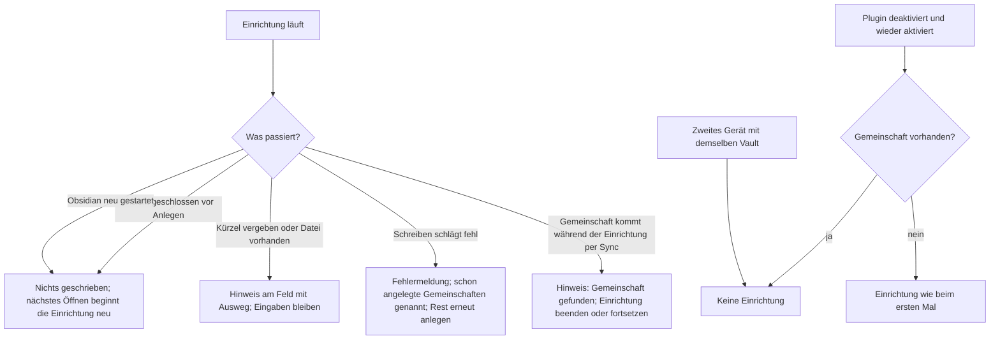
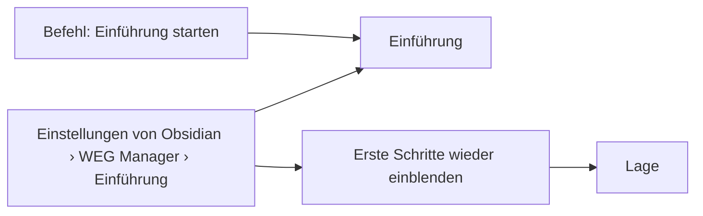

# FLOW-09 · Erststart, Einrichtung und Einführung

Vom leeren Vault bis zur ersten Arbeit, nach [[K-19 - Onboarding über Einrichtungsassistent, Erste Schritte und kurze Tour]]. Ersetzt den Abschnitt „Erststart“ in [[FLOW-06 - Einrichten, Import und Datenerhalt]]; Import und Datenerhalt bleiben dort.

## Hauptablauf

Bis die Lage existiert ([[PBI-13 - Aktuelle Wochenlage öffnen]]), führt „Anlegen“ in die Gemeinschaftsverwaltung; Karte „Erste Schritte“ und Einführung folgen mit der Lage.

## Abbrüche und Sonderfälle

## Einführung neu starten

## Zustände

| Zustand | Wo gespeichert | Wirkung |
| --- | --- | --- |
| Einrichtung nötig | nicht gespeichert, abgeleitet: keine gültige Gemeinschaft im Vault | Ansicht zeigt die Einrichtung |
| Eingaben im Assistenten | nur im Arbeitsspeicher | gehen beim Schließen verloren; nichts im Vault |
| Gemeinschaften | Notizen unter `WEG Manager/Gemeinschaften/` | maßgeblich ([[DF-22 - Notizen als maßgeblicher Datenbestand]]) |
| Erste Schritte erledigt | abgeleitet aus dem Vault (etwa: Es gibt einen Punkt) | Haken in der Karte |
| Erste Schritte ausgeblendet | Plugin-Daten | Karte erscheint nicht |
| Einführung angeboten, beendet oder übersprungen | Plugin-Daten (Vorschlag, K-19 O-19b) | Angebot erscheint nicht mehr von selbst |

## Bezüge

[[F-25 - Onboarding und Einführung]] · [[FLOW-01 - Gesamtfluss des Beirats-MVP]] · [[FLOW-06 - Einrichten, Import und Datenerhalt]] · [[Onboarding-Research - Erststart, Einrichtung und Einführung]].
