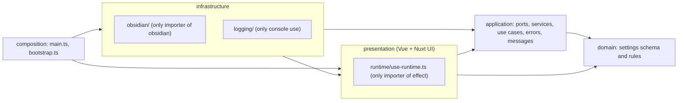
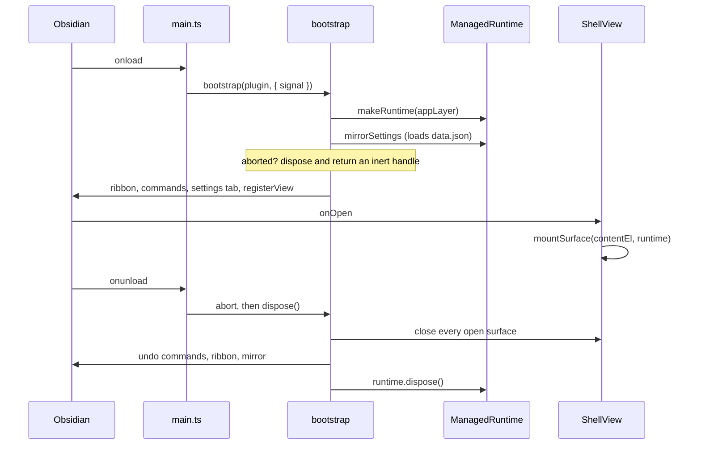

# Architecture

The plugin is layered as ports and adapters, and dependencies point inward only. Tools enforce the boundaries, not convention: oxlint `no-restricted-imports` (`.oxlintrc.json`) and fallow `boundaries` (`.fallowrc.json`). Decision record: [ADR 0002](../adr/0002-architecture.md).

| Layer | Imports | Owns |
| --- | --- | --- |
| `src/domain` | `effect` | Pure rules: `decodeSettings`, `validatePatch`, defaults |
| `src/application` | `effect`, domain | Ports (`SettingsStore`, `Notifier`, `VaultReader`, `Logger`, `Incidents`, `Clipboard`, `HostInfo`), `SettingsService`, `EventBus` and the `AppEvent` vocabulary, use cases, tagged errors, the German message catalog |
| `src/infrastructure/obsidian` | `obsidian`, application, presentation | Adapter Layers (including `hostEventsLayer`), commands, ribbon, settings tab, `ShellView` |
| `src/presentation` | `vue`, `@nuxt/ui`, `@tanstack/vue-form`, application, domain | Vue surfaces. Components never see an Effect value; they call use cases through `useEffectAction` |
| `harness/` | everything except `obsidian` | Browser stand-in for Obsidian with scenario Layers |

`infrastructure` may import `presentation` only because `ShellView` mounts the surface (handoff ruling 14).

## Runtime

One `ManagedRuntime` exists per plugin load (`makeRuntime(appLayer(plugin))`). Every surface, command and settings control runs effects through it. Module-level mutable state is not allowed in `src/**`; state belongs to the runtime or is persisted in `data.json`.

## Events

Decision record: [ADR 0004](../adr/0004-event-system.md).

- `AppEvent` (`src/application/events.ts`) is one tagged union of plain data for host and domain events. Switch on `_tag`.
- `EventBus` publishes them through an unbounded PubSub: `on(tag)` gives a narrowed stream, `subscribe` subscribes at once for forked consumers.
- `hostEventsLayer` maps Obsidian's `vault`, `metadataCache` and `workspace` events at the edge. It publishes nothing until the layout is ready, then `LayoutReady`, then file events. Folders are not published.
- Its listeners and the PubSub belong to the runtime: `runtime.dispose()` removes every listener with `offref` and ends every stream, also after a failed or aborted bootstrap.

## Lifecycle

- `dispose` undoes in reverse order. Closing every surface runs first, so no Vue app outlives the runtime.
- If a registration throws, bootstrap undoes what it created, reports the defect and rethrows.
- `registerView` and `addSettingTab` run last, because Obsidian cannot unregister them one by one.

## A surface

`mountSurface(root, runtime)` creates one Vue app per view:

- The app mounts into an element appended to `root`, beside a portal element for modals and popovers. Both live in `root.ownerDocument`, so a pop-out window keeps its dialogs.
- `bindHostTheme(root)` mirrors `theme-dark`/`theme-light` from the owner document's body to `dark`/`light` on `root`.
- `app.config.errorHandler` routes render errors to `reportDefect`.
- The returned close is idempotent. It runs every release even if one throws, then rethrows the first error.

## CSS ownership

- `dist/styles.css` is scoped under `.weg-manager-root` by `scripts/scope-css.mjs`. It has no Tailwind preflight, no surviving `@layer`, and prefixed `@keyframes` and `@property` names. `check:dist` verifies all of this.
- Mounting adds nothing to `document.head`. Nuxt UI's runtime `colors` and `head` plugins are replaced by sha256-pinned no-ops (`scripts/no-head-plugins.mjs`); the colour roles live in `src/styles/bridge.css`.
- Tailwind scans only `src/presentation` and an explicit list of Nuxt UI component themes in `src/styles/app.css`. A newly used Nuxt UI component has to be added there.
- Icons are bundled offline. Add new `lucide:*` names to `SHELL_ICONS` in `vite.shared.ts`.
