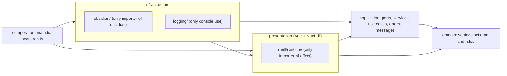
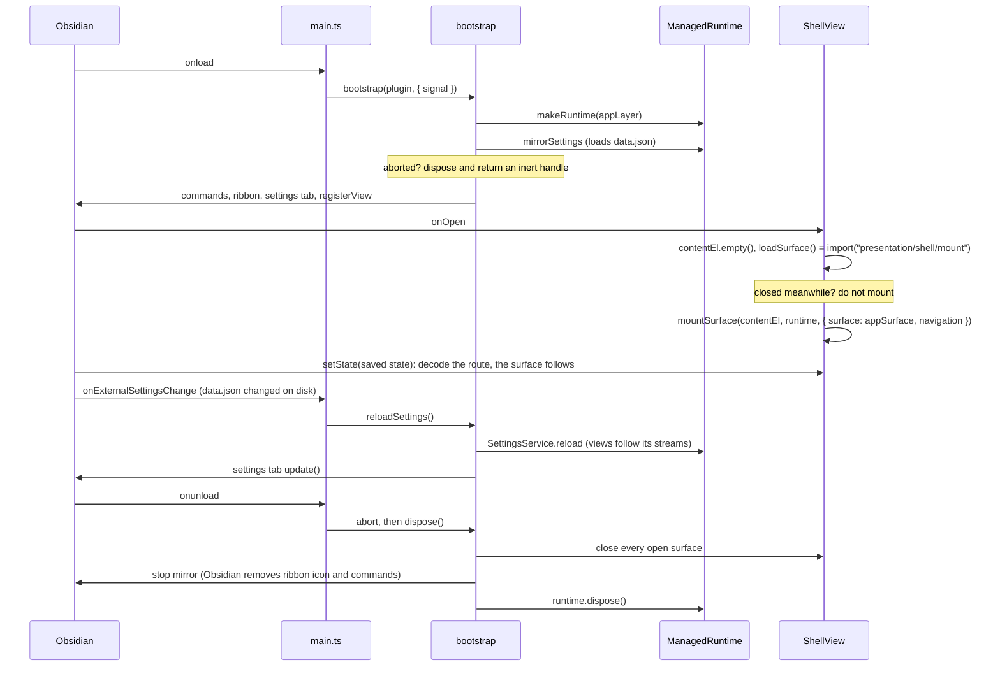

# Architecture

The plugin is layered as ports and adapters, and dependencies point inward only. Each layer is sliced into modules (see [Modules](#modules)). Tools enforce the boundaries, not convention: oxlint `no-restricted-imports` (`.oxlintrc.json`) for layers, ESLint `no-restricted-imports` (`eslint.config.mjs`) for modules, and fallow `boundaries` (`configs/fallow.json`) for both. Decision record: [ADR 0002](../adr/0002-architecture.md).



| Layer | Imports | Owns |
| --- | --- | --- |
| `src/domain` | `effect` | Pure rules: `decodeSettings`, `validatePatch`, `encodeSettings`, defaults (`shell/settings.ts`, built by `shell/settings-codec.ts`); what makes a note a record and a usable note name (`notes/`) |
| `src/application` | `effect`, domain | Ports (`SettingsStore`, `Notifier`, `VaultReader`, `Logger`, `Incidents`, `Clipboard`, `HostInfo`, `Messages`, `NoteStore`), `SettingsService`, `EventBus` and the `AppEvent` vocabulary, use cases, tagged errors, the German and English message catalogs (`<module>/i18n/`, composed in `messages.ts`) |
| `src/infrastructure/obsidian` | `obsidian`, application, presentation | Adapter Layers (including `hostEventsLayer` and the `NoteStore` adapter), commands, ribbon, settings tab, `ShellView` (`shell/`), `appLayer` |
| `src/infrastructure/memory` | application, domain | In-memory adapters for tests and the harness (`notes/`). Nothing in `src/` imports them, so they never reach `main.js` |
| `src/presentation` | `vue`, `@nuxt/ui`, `@tanstack/vue-form`, application, domain | Vue surfaces. Components never see an Effect value. They run reads through `useQuery` and state changes through `useCommand` |
| `harness/` | everything except `obsidian` | Browser stand-in for Obsidian with scenario Layers |

`infrastructure` may import `presentation` only because `ShellView` mounts the surface (handoff ruling 14). It imports only the Vue-free `presentation/shell/host` and loads `presentation/shell/mount` through `loadSurface`, a dynamic `import()` in `src/presentation/shell/surface.ts`; nothing that runs at plugin load may import a module that pulls in Vue (see [Lazy presentation](#lazy-presentation)).

## Modules

Decision record: [ADR 0006](../adr/0006-module-structure.md). Each layer is sliced into module folders. The modules are `shell` and `notes` (vault data access, see [Vault notes](#vault-notes)).

| Layer | Module folders | Files at the layer root (composition only) |
| --- | --- | --- |
| domain | `src/domain/<module>/` | none |
| application | `src/application/<module>/` | `errors.ts` (`AppError`), `events.ts` (`AppEvent`), `app-services.ts` (`AppServices`, `AppRuntime`), `messages.ts` (`Catalog`, `de`, `en`, `catalogFor`, `languageFromCode`, `messagesLayer`), `user-messages.ts` (`describeError`) |
| infrastructure | `src/infrastructure/obsidian/<module>/`, `src/infrastructure/memory/<module>/` | `obsidian/app-layer.ts` (`appLayer`), plus `logging/` and `runtime.ts`, which are not Obsidian adapters and stay where they were |
| presentation | `src/presentation/<module>/` | none |

- **Public face.** Each module folder has an `index.ts`. Code outside the folder imports only that, also the same module from another layer (`../../../application/shell`, never `…/shell/ports`). The one exception is `presentation/shell`, which also has `host.ts` (see *Presentation entries* below). Tests may import a module's files directly.
- **Direction.** feature → `notes` → `shell`. `shell` imports no other module; `notes` imports only `shell`; feature modules may import each other's index, acyclically.
- **Composition.** A root file composes module parts and holds no rule of its own: `AppError = ShellError | NotesError`, `AppEvent = Data.TaggedEnum<ShellEvents>`, `AppServices = ShellServices | NotesServices`, `Catalog = { shell: ShellCatalog; notes: NotesCatalog }`, `appLayer` = `shellLayer` merged with `notesLayer`. A new module adds its part to each. `notes` has no events yet.
- **`describeError`** hands an error to its module's describer with that module's part of the catalog: `isNotesError(error) ? describeNotesError(error, messages.notes) : describeShellError(error, messages.shell)`. An error union added to `AppError` without its describer does not compile.
- **`Messages`** stays one service holding the whole `Catalog`; module code reads its own part (`(yield* Messages).shell`). The shell's catalog part carries `language`.
- **Type-only edges to the root.** `EventBus` and `Messages` live in the shell but carry the composed types, so `src/application/shell/` imports `AppEvent` and `Catalog` from the root as types only. Runtime imports go the other way only, so there is no runtime cycle.
- **Presentation entries** ([ADR 0006](../adr/0006-module-structure.md), amendment). `presentation/shell` has two public files:
  - `index.ts` is the interface for feature components and loads Vue: `useQuery`, `useCommand`, `useStream`, `useSettings`, `useSettingsStatus`, `useAppEvents`, `useMessages`, `useRoute`, `useNavigate`, `useHistory`, `ErrorNotice`, `NotFoundState`, `shellScreens` and `mountSurface`.
  - `host.ts` is Vue-free, for code at plugin load (`bootstrap`, the Obsidian adapters, `app-surface.ts`): `releaseAll`, `loadSurface`, `memoryNavigation` and the types `SurfaceDefinition`, `ViewNavigation`, `MemoryNavigation`, `ScreenLoader`, `SurfaceLoader`. `tests/unit/presentation/shell/host.test.ts` fails if loading it evaluates Vue.

### Enforcement

| Rule | Tool |
| --- | --- |
| Layers (which packages and layers a folder may import) | oxlint `no-restricted-imports` overrides in `.oxlintrc.json`, path-based; fallow zone rules |
| Import a module only through its `index.ts` (and `presentation/shell` also through `host.ts`) | ESLint `no-restricted-imports` (`eslint.config.mjs`, every file in `src/`); fallow `publicFiles: ["index.ts"]` on every discovered module zone, and an explicit `presentation/shell` zone with `index.ts` and `host.ts` |
| Code at plugin load never imports the Vue-loading `presentation/shell/index.ts`, except as types | ESLint `@typescript-eslint/no-restricted-imports` on `main.ts`, `bootstrap.ts`, `src/infrastructure/**` and `src/presentation/*.ts`; `tests/dom/lazy-presentation.test.ts` at runtime |
| Direction between modules | ESLint, from the ordered module list `CORE_MODULES` (`shell`, `notes`) and `FEATURE_MODULES` (`communities`); fallow rules keep each `shell` zone to the shell and the composition files |
| Every `src/` file belongs to a zone | fallow `boundaries.coverage.requireAllFiles` |

- The module rules live in ESLint, not oxlint: an oxlint override replaces the `no-restricted-imports` options of an earlier matching override instead of adding to them, so a module rule there would switch off the layer rule for the same files. The ESLint block comes after `oxlint.buildFromOxlintConfigFile`, which turns the rule off in ESLint.
- fallow discovers one zone per module and layer (`autoDiscover`): `domain/<module>`, `application/<module>`, `adapters/<module>` (`src/infrastructure/obsidian/<module>/`), `memory/<module>` (`src/infrastructure/memory/<module>/`), `presentation/<module>`. The application root files are the zone `application-composition`; `logging/`, `runtime.ts` and `app-layer.ts` the zone `infrastructure`. A discovered zone may not import a sibling zone unless a rule names it, so the layer rules name `<layer>/shell` and `<layer>/notes`.
- **In-memory adapters stay out of the plugin.** No fallow rule allows a `src/` zone to import `memory`, ESLint rejects a `memory/` import anywhere in `src/`, and `npm run check:dist` rejects a `main.js` that holds the marker every made-up failure of those adapters carries (`TEST_ONLY_MARKER`). Only `tests/` and `harness/` import them.
- **Adding a module:** add its name to `CORE_MODULES` or `FEATURE_MODULES` in `eslint.config.mjs`. Its folders become fallow zones by themselves and may import `shell`. A module that other modules import (`notes`) is also added to the `allow` lists of the layer rules in `configs/fallow.json`, next to `<layer>/shell`; fallow refuses a rule that names a zone with no folder yet, so `presentation/notes` is added with the first notes component.
- Proved on 2026-11-21 with planted violations (each failed, then was removed): an import of `../shell/ports` from a throwaway module folder (ESLint and fallow), `obsidian` in `src/application/shell/` (oxlint), `effect` in a component (oxlint), presentation → infrastructure (oxlint and fallow), `shell` → `notes` (ESLint and fallow), and one plant per oxlint override.
- Proved again when `notes` was added (each failed, then was removed): `shell` → `notes` in application and in the adapters, `notes` → `../shell/services` past the index (ESLint and fallow each); `notes` → `../shell` through the index passes both. `src/infrastructure/obsidian/app-layer.ts` and `src/application/notes/` importing the in-memory adapter fail ESLint and fallow, and with the import in `appLayer` the built `main.js` fails `check:dist`.

## Vault notes

Decision record: [ADR 0007](../adr/0007-vault-data-access.md). Module `notes` gives every feature one way to the vault: the `NoteStore` port (`src/application/notes/ports.ts`). It speaks plain data, never `TFile`.

| Call | Does |
| --- | --- |
| `list` | Every record: a Markdown note whose frontmatter `schema` starts with `weg-manager.`, anywhere in the vault, sorted by path. Read from the metadata cache, no file contents. |
| `read(path)` | One note; `{}` for a note without frontmatter or with broken YAML. |
| `create({ folder, name, frontmatter, body? })` | Creates missing folders and the note in one `vault.create`; a taken name gets ` (2)`, ` (3)`, … up to 100 tries (see name clashes below). |
| `update(path, change)` | `change` gets the current frontmatter inside `fileManager.processFrontMatter` and returns a patch (`set`, `remove`) or a typed failure that aborts the write. Untouched keys, unknown keys, key order and the body stay. A patch that changes nothing writes nothing. |
| `trash(path)` | `fileManager.trashFile`, so the user's *Deleted files* setting applies. |
| `rename(path, newName)` | `fileManager.renameFile` in the same folder, so Obsidian updates links. Another note's name is `NotePathTakenError`; the note's own name in another case is allowed. |

- **A note is `{ path, frontmatter }`.** The frontmatter is also how a caller detects a change: the per-field merge of ADR 0007 compares values, and a body edit or a sync that only touches the file's time is no change to the record. An mtime or revision was not added: it changes on body edits and needs a clock in the in-memory adapter.
- **The metadata cache lags.** Obsidian indexes a write a moment after it (a few milliseconds), then fires `changed`. Right after `create`, `getFileCache` is `null`; right after an update it still holds the old frontmatter. So every write returns the note as written, and `list`/`read` show what the cache holds. The index of a later step follows `MetadataChanged`.
- **Name clashes** follow Windows and macOS, the product's platforms, whatever the disk does: two names clash when their `clashKey` (`src/domain/notes`) is equal, `name.normalize("NFC").toLowerCase()`. NFC first, because macOS writes umlauts decomposed (NFD) and the others composed; `toLowerCase`, not `toLocaleLowerCase` or `localeCompare`, because it is Unicode's default case mapping and gives the same key in every locale and engine, while collation also equates characters that file systems keep apart. The store compares a candidate with every file and folder in the target folder (`TFolder.children`), because Obsidian's lookups by path are case-sensitive and a Linux disk would take both names. Windows itself keeps NFC and NFD names apart; the store refuses them anyway, so Sync between devices never has to merge two such files.
- **Writes are commands.** `writeCommand` (`src/application/notes/command.ts`) runs the vault calls in `Effect.uninterruptible`: once started they complete, also when the caller is interrupted, as `SettingsService` does for `saveData`. Checks that write nothing (name, free path, note exists) run before it.
- **Errors** (`src/application/notes/errors.ts`): `NoteNotFoundError`, `NotePathTakenError`, `InvalidNoteNameError` (issue `empty`, `forbidden-character`, `leading-dot`), `NoteUnreadableError` (broken YAML on update), `NoteWriteError`; reads fail with the shell's `VaultReadError`. None carries a path; texts are in `notes/i18n/`.
- **Adapters.** `src/infrastructure/obsidian/notes/note-store.ts` is the only code that changes vault files: `vault.create`, `vault.createFolder`, `fileManager.processFrontMatter`, `fileManager.trashFile`, `fileManager.renameFile`, every path through `normalizePath`. `src/infrastructure/memory/notes/` keeps notes in memory for tests and the harness; both pass the same contract suite (see [Testing](testing.md)).
- **Body changes** (`vault.process`) are not offered yet: ADR 0007 lets the plugin change a body only where a type's contract defines a section, and no type does so far.

## Runtime

One `ManagedRuntime` exists per plugin load (`makeRuntime(appLayer(plugin))`). Every surface, command and settings control runs effects through it. Module-level mutable state is not allowed in `src/**`; state belongs to the runtime or is persisted in `data.json`.

## UI language

Decision record: [ADR 0005](../adr/0005-ui-language.md).

- `hostLanguage()` (`src/infrastructure/obsidian/shell/language.ts`) reads Obsidian's `getLanguage()` once per load: `de` and `de-*` give German, everything else English.
- `obsidianLayer(plugin, language)` provides the `Messages` service, the catalog of that language. Use cases take it with `yield* Messages`, bootstrap for commands and settings tab, components with `useMessages()`. Nuxt UI's locale follows it.
- The domain returns issue codes; `describeIssue` words them. The greeting is `null` while not customised and then shows the language's default.

## Events

Decision record: [ADR 0004](../adr/0004-event-system.md).

- `AppEvent` (`src/application/events.ts`) is one tagged union of plain data for host and domain events, built from the modules' event records (the shell's are in `src/application/shell/events.ts`). Switch on `_tag`.
- `EventBus` publishes them through an unbounded PubSub: `on(tag)` gives a narrowed stream, `subscribe` subscribes at once for forked consumers.
- `hostEventsLayer` maps Obsidian's `vault`, `metadataCache` and `workspace` events at the edge. It publishes nothing until the layout is ready, then `LayoutReady`, then file events. Folders are not published.
- Its listeners and the PubSub belong to the runtime: `runtime.dispose()` removes every listener with `offref` and ends every stream, also after a failed or aborted bootstrap.
- Each listener is also passed to `plugin.registerEvent`, so Obsidian detaches it synchronously in `unload()`, before the asynchronous dispose has finished. Obsidian's `offref` removes a ref by identity and ignores one that is gone, so the second release does nothing.

## Lifecycle



- `dispose` undoes in reverse order. Closing every surface runs first, so no Vue app outlives the runtime.
- If a registration throws, bootstrap undoes what it created, reports the defect and rethrows. Only then does it remove its commands; on a normal unload Obsidian removes them, and removing by id could hit those of a quick re-enable.
- The ribbon icon comes after the commands, right before `addSettingTab` and `registerView`. Obsidian removes it on a normal unload but not after a failed `onload`, and there is no public API to remove it, so a bootstrap that fails earlier must not have added it. Its title is the product name in every language, because Obsidian keys the entry by `<plugin id>:<title>`.
- `registerView` and `addSettingTab` run last, because Obsidian cannot unregister them one by one.
- `onExternalSettingsChange` waits for a load still in progress, then reloads; after an unload or a failed load it does nothing. Obsidian calls it itself: its file watcher reports `data.json`, and Obsidian compares the file's modification time with the plugin's last `loadData`/`saveData` before it calls the method and then the tab's `update()`.

## Settings

Decode, patch validation and encode are driven by one declaration per setting (`FIELDS` in `src/domain/shell/settings.ts`). `makeSettingsCodec` (`settings-codec.ts`) turns the declarations, a version and a migration table into `decode`, `encode` and `validatePatch`; the shell's settings are one instance, tests build others.

- **A declaration** has four parts: the Effect Schema that reads a raw JSON value into the in-memory one (trimming and legacy values live in the schema), the default, the issue a rejected value produces, and `omitWhenDefault`. Example:

  ```ts
  rootFolder: {
    schema: RootFolder,
    default: DEFAULT_ROOT_FOLDER,
    issue: { code: "rootFolder.invalid", max: ROOT_FOLDER_MAX_LENGTH },
    omitWhenDefault: true,
  },
  ```

  A new setting also needs its key in `Settings`, its issue code in `SettingsIssue` with a text in both catalogs, and unit tests with the exact issues. The type `SettingsFields<EditableSettings, …>` fails typecheck for a missing or misspelled declaration.
- **Decode never throws.** A missing or `null` file gives defaults without an issue, a non-object gives `file.invalid`. A field the schema rejects falls back to its default alone and reports its issue; the other fields keep their values. Unknown keys are dropped. A newer `schemaVersion` gives defaults, `schema.newer` and a read-only status; a version that is not a positive integer gives `schema.invalid` and decoding goes on; a missing version counts as current.
- **Encode** writes the version and every declared field except a default that is marked `omitWhenDefault`. The greeting and the root folder stay out of the file while they are the default, so an older plugin version on another device reads the file without an issue.
- **Migrations.** `MIGRATIONS` is a table `{ [fromVersion]: (raw) => raw }`; entry `n` lifts a file from version `n` to `n + 1`. Decode applies the steps in order from the file's version up to `SETTINGS_VERSION`, before the field decode, and only in memory: the file is rewritten by the next save and not by loading it, because an older plugin on another device would otherwise see a file it takes for newer ([ADR 0005](../adr/0005-ui-language.md)). A version without an entry needs no change. A step that throws or returns something other than an object gives defaults and the issue `migration.failed` with the step's version, and the file becomes read-only (`readOnlyReason: "unreadable"`): its old values stay on disk until a fixed version reads them, and no save replaces them with defaults. Today `SETTINGS_VERSION` is 1 and the table is empty. To bump the version, raise `SETTINGS_VERSION`, add the step for the old version, and test it with real-shaped old files; a bump that older versions cannot read makes them treat the file as newer and go read-only, so prefer a change that needs no bump.
- **Root folder.** `rootFolder` is the vault-relative folder of the plugin's notes (default `WEG Manager`, [ADR 0007](../adr/0007-vault-data-access.md)). It has no interface: it is decoded, validated and encoded, and read through `SettingsService.current` and `changes`. Stored normalised: trimmed, no leading or trailing slash, `/` between names, at most 100 characters; no empty, `.` or `..` name, none of `* " \ < > : | ?` and no control character in a name. A broken value reports `rootFolder.invalid`.
- `SettingsService` holds the settings and their status (writable, issues, read-only reason) in two `SubscriptionRef`s: `changes` and `statusChanges` emit the current value, then every change.
- `reload` reads `data.json` again and decodes it as on load: a newer or unreadable file switches to read-only and is never written, a valid one switches back. Unchanged values publish nothing, and a notice appears only when the status changes. Reloads and updates are serialised.
- `plugin.saveData` cannot be cancelled, so an update that has started its save always sets the settings too, even when interrupted. A reload, once it has read the file, sets status, notice and settings together. Waiting for an earlier update or reload stays interruptible.
- `useSettings` and `useSettingsStatus` follow both streams in a surface through `useStream`. The settings tab reads a mirror of both, because Obsidian reads control values synchronously.

## Lazy presentation

- Vue, Nuxt UI, reka-ui, VueUse and TanStack Form are evaluated on the first `import("presentation/shell/mount")`, which `ShellView.onOpen` starts through `loadSurface`, not in `onload`. `bootstrap` imports only the Vue-free `presentation/shell/host` and `presentation/app-surface.ts`, whose screens are `import()` calls too: a screen's module is evaluated the first time a view shows its route.
- The bundle stays one CommonJS file (`codeSplitting: false`): rolldown wraps the dynamically imported modules in a lazy init function inside `main.js`.
- `tests/dom/lazy-presentation.test.ts` fails if loading the plugin evaluates `vue` or `presentation/shell/mount`.
- Measured on 2026-11-21 in Node 24 on the built `main.js` with a stubbed `obsidian` and `document` (41 alternating runs each, compile included; not an Obsidian startup number): Vue's runtime-dom no longer runs at `require` but when the view opens, and the median `require` time fell from 43 ms to 38 ms. The init wrappers grew `main.js` from 541 KB to 550 KB.

## A surface

`mountSurface(root, runtime, { surface, navigation })` creates one Vue app per view. `surface` is a `SurfaceDefinition` (`appSurface` in the plugin), `navigation` the view's route (see [Navigation](#navigation)); tests pass `content` to mount a single component instead of the frame.

- The app mounts into an element appended to `root`, beside a portal element for modals and popovers. Both live in `root.ownerDocument`, so a pop-out window keeps its dialogs.
- `bindHostTheme(root)` mirrors `theme-dark`/`theme-light` from the owner document's body to `dark`/`light` on `root`.
- `app.config.errorHandler` routes render errors to `reportDefect`.
- The returned close is idempotent. It runs every release even if one throws, then rethrows the first error.

## Navigation

Decision record: [ADR 0008](../adr/0008-navigation-and-view-state.md). One registered view type; each open view has its own Vue app and its own route.

- **Routes are data.** A route is a plain object with a `name` and the parameters its screen needs. Each module contributes a schema (`ShellRoute` in `src/application/shell/routes.ts`); `src/application/routes.ts` composes `Route = Schema.Union([ShellRoute])` and `appRoutes = routesOf(Route, start)`. `decode` never throws: an unknown name, a missing or broken parameter or no object at all gives the start route. `equals` compares by value. The shell's only route, `welcome`, is the demo panel and the start until the first feature slice.
- **The surface definition.** `src/presentation/app-surface.ts` composes `appSurface`: `appRoutes`, a screen loader per route name (`import("./shell").then(({ shellScreens }) => shellScreens.welcome)`), the navigation entries (label from the catalog, icon) and, later, the frame's context area. The screen record is typed by `Route["name"]`, so a route without a screen fails typecheck. A route whose `screen` returns `undefined` shows `NotFoundState`; a screen shows it too when its record is gone. Tests build their own definition with test routes (`tests/support/surface.ts`).
- **The view owns the route.** `ShellView.getState()` returns `{ route }`, so the route is in `workspace.json`; `setState()` decodes it. The surface gets a `ViewNavigation` (`current`, `history`, `navigate`, `back`, `forward`, `onChange`) and never imports `obsidian`. `useRoute()`, `useNavigate()` and `useHistory()` (`canGoBack`, `canGoForward`, `back`, `forward`) read and change it.
- **A fixed tab with its own history** ([ADR 0008](../adr/0008-navigation-and-view-state.md), amendment). `ShellView.navigation` is `false`, so a file opened while the plugin tab is active (`getLeaf(false)`, a plain click in the file explorer) opens in another tab. Obsidian's leaf history records only navigable views, so each view keeps its own history in memory: `RouteHistory` and its steps `historyAt`, `visit`, `stepBack`, `stepForward` in `src/application/shell/history.ts` (plain data, at most `HISTORY_LIMIT` = 50 steps back), held by `memoryNavigation` (`src/presentation/shell/routing.ts`). A navigation pushes the current route onto the back stack and clears the forward stack; one to the current route pushes nothing. Every change of the route asks Obsidian to save the layout. The history is not saved: a restored view starts with an empty one.
- **A route set from outside.** The first state Obsidian sets on a view (a restored layout, `openRoute` on a new view) is where its history starts. A state set later on the open view (`openRoute` on it) is a navigation, so the frame's back control returns from it.
- **Opening from outside.** `openRoute(workspace, route?)` (`src/infrastructure/obsidian/shell/open-route.ts`) sets the route in the first open view or in a new tab, and reveals it. Without a route an open view keeps its own. The `open-view` command and the ribbon use it; a feature command passes its route.
- **Restore order.** Obsidian calls `onOpen` before `setState`, so a restored view mounts on the start route and switches to the saved one in the same task, before the next paint.
- **The frame.** `AppFrame.vue` holds a labelled `<nav>` (back and forward icon buttons named from the catalog and disabled when there is nothing to go to, the context slot, one button per entry with `aria-current="page"` on the current one) and a labelled `<section>` with the route outlet. It is a size container: from 860 px of its own width (handoff 07) the navigation is a sidebar, below it a row above the content. The window width plays no part.

## Device storage

`DeviceStore` (`src/application/shell/ports.ts`) keeps small JSON values per device and vault, never in `data.json`, so Sync does not carry them to another device. The community selection is the first user.

- The Obsidian adapter (`src/infrastructure/obsidian/shell/device-store.ts`) uses `app.loadLocalStorage`/`saveLocalStorage` under `weg-manager/<key>`. It stores `{ value }`, because Obsidian clears a key saved with a falsy value; an entry it did not write reads as `undefined`.
- Neither call fails: Obsidian swallows its own storage errors, and a lost value only costs a choice the user makes again. A caller decodes what it reads with its schema.
- `deviceStoreInMemory()` (`src/application/shell/device-store.ts`) serves the tests and the harness.

## CSS ownership

- `dist/styles.css` is scoped under `.weg-manager-root` by `scripts/scope-css.mjs`. It has no Tailwind preflight, no surviving `@layer`, and prefixed `@keyframes` and `@property` names. `check:dist` verifies all of this.
- Mounting adds nothing to `document.head`. Nuxt UI's runtime `colors` and `head` plugins are replaced by sha256-pinned no-ops (`scripts/no-head-plugins.mjs`); the colour roles live in `src/styles/bridge.css`.
- Tailwind scans only `src/presentation` and an explicit list of Nuxt UI component themes in `src/styles/app.css`. A newly used Nuxt UI component has to be added there.
- Icons are bundled offline. Add new `lucide:*` names to `SHELL_ICONS` in `configs/vite.shared.ts`.

## Repository layout

| Where | What |
| --- | --- |
| `src/`, `harness/`, `tests/` | plugin code, the browser harness, tests (`unit`, `dom`, `e2e`, `support`) |
| `scripts/` | build, check and release scripts run by npm scripts |
| `configs/` | tool configs that take an explicit path: Vite (plugin, harness, shared), Vitest (+ Stryker variant), Stryker, fallow, `tsconfig.{app,node,base}.json`. Each resolves paths from the repository root. |
| root | files a tool or Obsidian only finds there |

These files stay at the root on purpose:
- `manifest.json` and `versions.json`: Obsidian reads them there.
- `package.json` and `.npmrc`: npm reads them there.
- `.nvmrc`, `.editorconfig`, `.gitattributes`, `.gitignore`: tools and git read them there.
- `tsconfig.json`: editors look for it there. It references the configs in `configs/`.
- `eslint.config.mjs`: flat-config file patterns resolve from its own folder, and editors look for it at the root.
- `.prettierrc.json` and `.prettierignore`: editors search upward from each file.
- `.oxlintrc.json`: oxlint resolves `ignorePatterns` and per-path `overrides` relative to its config file. Moved into `configs/`, the layer import bans silently stopped applying; a planted violation passed.

