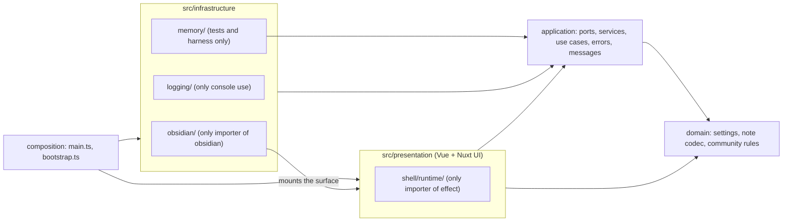
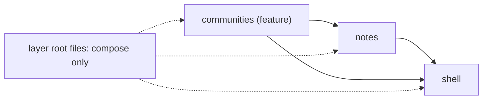
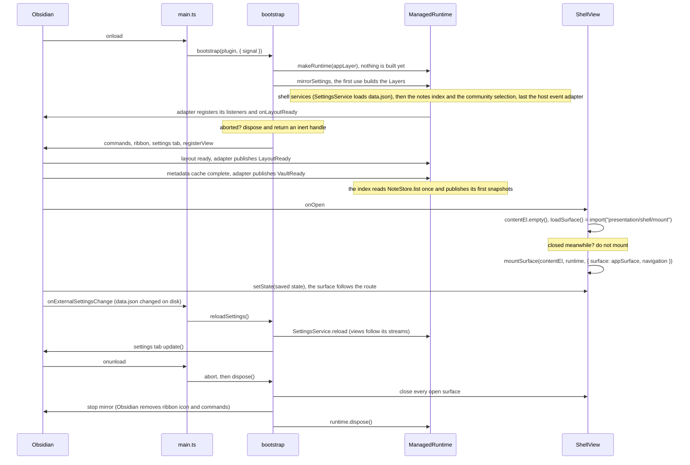
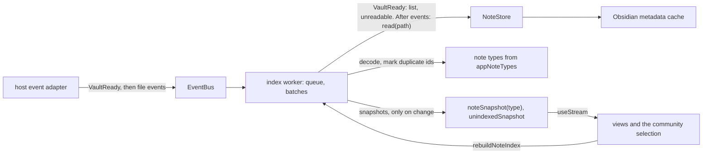
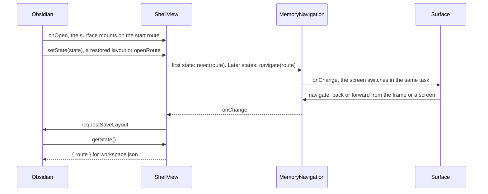

# Architecture

The plugin is layered as ports and adapters, and dependencies point inward only. Each layer is sliced into modules. Tools enforce both, not convention (see [Enforcement](#enforcement)). Decision records: [ADR 0002](../adr/0002-architecture.md) (layers), [ADR 0006](../adr/0006-module-structure.md) (modules), [ADR 0007](../adr/0007-vault-data-access.md) (vault notes), [ADR 0008](../adr/0008-navigation-and-view-state.md) (navigation).

Read top to bottom: layers, modules, runtime and lifecycle, events, language, settings, vault notes, presentation, the communities slice, repository layout. To add code, start with [adding-a-feature.md](adding-a-feature.md).

## Layers



| Layer | Imports | Owns |
| --- | --- | --- |
| `src/domain` | `effect` | Pure rules: `decodeSettings`, `validatePatch`, `encodeSettings`, defaults (`shell/settings.ts`, built by `shell/settings-codec.ts`); the note codec, what makes a note a record and a usable note name (`notes/`); the community note type and its rules (`communities/`) |
| `src/application` | `effect`, domain | Ports (`SettingsStore`, `Notifier`, `Logger`, `Incidents`, `Clipboard`, `HostInfo`, `Messages`, `NoteStore`, `IdGenerator`, `DeviceStore`), the service graph over the host's adapters (`appServicesLayer`), `SettingsService`, the community selection service, `EventBus` and the `AppEvent` vocabulary, routes (`routesOf`, composed in `routes.ts`), use cases, tagged errors, the German and English message catalogs (`<module>/i18n/`, composed in `messages.ts`) |
| `src/infrastructure/obsidian` | `obsidian`, application, presentation | The adapters of every port, one record per module (`shellAdapters` with `hostEventsLayer`, `notesAdapters` with the `NoteStore` adapter), commands, ribbon, `openRoute`, settings tab, `ShellView` (all in `shell/`), `appLayer` |
| `src/infrastructure/memory` | application, domain | In-memory adapters for tests and the harness (`notes/`, `shell/`). Nothing in `src/` imports them, so they never reach `main.js` |
| `src/presentation` | `vue`, `@nuxt/ui`, `@tanstack/vue-form`, application, domain | Vue surfaces: the app frame, the route outlet and the screens (`appSurface` in `app-surface.ts` composes them). Components never see an Effect value. They run reads through `useQuery`, state changes through `useCommand` (whose `run` resolves to a `RunOutcome`: `success`, `failure`, `defect` or `interrupted`) and follow streams through `useStream` |
| `harness/` | everything except `obsidian` | Browser stand-in for Obsidian with scenario Layers (see [testing.md](testing.md#browser-harness)) |

`infrastructure/obsidian` may import `presentation` only because `ShellView` mounts the surface (ADR 0002; a mount port would remove the edge). It imports only the Vue-free `presentation/shell/host` and loads `presentation/shell/mount` through `loadSurface`. Nothing that runs at plugin load may import a module that pulls in Vue (see [Lazy presentation](#lazy-presentation)).

## Modules

Each layer is sliced into module folders. The modules are `shell` (what every module needs), `notes` (vault data access, see [Vault notes](#vault-notes)) and the first feature module, `communities` (see [Communities](#communities)).



| Layer | Module folders | Files at the layer root (composition only) |
| --- | --- | --- |
| domain | `src/domain/<module>/` | none |
| application | `src/application/<module>/` | `errors.ts` (`AppError`), `events.ts` (`AppEvent`), `app-services.ts` (`AppServices`, `AppRuntime`), `app-services-layer.ts` (`appServicesLayer`, `AppAdapters`), `messages.ts` (`Catalog`, `de`, `en`, `catalogFor`, `languageFromCode`, `messagesLayer`), `user-messages.ts` (`describeError`), `routes.ts` (`Route`, `appRoutes`), `note-types.ts` (`appNoteTypes`), `commands.ts` (`appCommands`, `AppCommand`) |
| infrastructure | `src/infrastructure/obsidian/<module>/`, `src/infrastructure/memory/<module>/` | `obsidian/app-layer.ts` (`appLayer`: `appServicesLayer` over the Obsidian adapters), plus `logging/` and `runtime.ts`, which are not Obsidian adapters and stay where they were |
| presentation | `src/presentation/<module>/` | `app-surface.ts` (`appSurface`: routes, screens, navigation entries) |

- **Public face.** Each module folder has an `index.ts`. Code outside the folder imports only that, also the same module from another layer (`../../../application/shell`, never `…/shell/ports`). Two modules have a second entry: `presentation/shell` has `host.ts` (see [Lazy presentation](#lazy-presentation)), and `application/notes` has `adapter.ts`, the kit of the `NoteStore` adapters (`writeCommand`, `createNote`, `asDefect`, `copyFrontmatter`, `recordNotes`, `newNoteText`, `updateNoteText`, `pathsInFolder`, `planRename`), which only `src/infrastructure/**` imports: a feature reaches the vault through `NoteStore` alone. The notes `index.ts` keeps what a feature needs (the port, its errors and types, the index, `editChange`, `newRecordFrontmatter`, the pure `applyPatch` and `isInFolder`). Tests may import a module's files directly, which is how they reach constants kept off the index (`INDEX_BATCH_QUIET`, `INDEX_BATCH_MAX` from `index-batches.ts`).
- **Direction.** feature → `notes` → `shell`. `shell` imports no other module; `notes` imports only `shell`; feature modules may import each other's index, acyclically.
- **Composition.** A root file composes module parts and holds no rule of its own:
  - `AppError = ShellError | NotesError | CommunitiesError`;
  - `AppEvent = Data.TaggedEnum<ShellEvents>`;
  - `AppServices = ShellServices | NotesServices | CommunitiesServices`, where the communities part is `CommunitySelectionService` and the notes part `NoteStore | IdGenerator | NoteIndex`;
  - `Catalog = { shell; notes; communities }`, one `Messages` service holding the whole of it; module code reads its own part (`(yield* Messages).shell`);
  - `appServicesLayer(adapters, options)` (`app-services-layer.ts`) is the one service graph: the shell's services on the shell's ports (`SettingsService`, then `Logger` on it, `EventBus`), the notes module's on them (`NoteIndex` over the `NoteStore` adapter, for `appNoteTypes`), the feature modules' on both (`CommunitySelectionService`), the host event adapter last. It is typed `Layer<AppServices>`, so a missing service or one built before what it needs fails typecheck there. `AppAdapters` holds one adapter Layer per port; the plugin (`appLayer` = `appServicesLayer({ ...shellAdapters(plugin), ...notesAdapters(plugin) }, options)`), the harness (`harness/layers.ts`) and the tests (`tests/support/adapters.ts`) supply only adapters;
  - `appNoteTypes = [communityType]` (`note-types.ts`);
  - `appCommands = [...shellCommands]` (`commands.ts`): each module contributes `PluginCommand`s (`src/application/shell/commands.ts`) with an `id` without the plugin id, a `name` read from its part of the catalog, and an action, `{ _tag: "open", route? }` (a typed `Route`; none keeps an open view's route) or `{ _tag: "run", effect }` (a use case that handles its expected failures itself). `registerCommands` (`src/infrastructure/obsidian/shell/commands.ts`) adds each, without hotkeys; `communities` has none yet;
  - `Route = Schema.Union([CommunitiesRoute])`, and `appSurface` maps each route name to a module's screen and fills the frame's context area.

  A new module adds its part to each. `shell` and `notes` have no routes; no feature has domain events yet.
- **`describeError`** hands an error to its module's describer with that module's part of the catalog. Each module but the shell exports a type guard (`isNotesError`, `isCommunitiesError`) that `describeError` narrows with. An error union added to `AppError` without its describer does not compile.
- **Type-only edges to the root.** `EventBus` and `Messages` live in the shell but carry the composed types, so `src/application/shell/` imports `AppEvent` and `Catalog` from the root as types only. Runtime imports go the other way only, so there is no runtime cycle.

### Enforcement

| Rule | Tool |
| --- | --- |
| Layers (which packages and layers a folder may import) | oxlint `no-restricted-imports` overrides in `.oxlintrc.json`, path-based; fallow zone rules in `configs/fallow.json` |
| Import a module only through its `index.ts` (and `presentation/shell` also through `host.ts`) | ESLint `no-restricted-imports` (`eslint.config.mjs`, every file in `src/`); fallow `publicFiles: ["index.ts"]` on every discovered module zone, and an explicit `presentation/shell` zone with `index.ts` and `host.ts` |
| `application/notes/adapter.ts` only from `src/infrastructure/**` | ESLint (`kitOutside` everywhere but the infrastructure, `kitElsewhere` there); fallow: the kit (`adapter.ts`, `command.ts`, `frontmatter.ts`, `note-text.ts`, `paths.ts`) is the explicit zone `application/notes-adapter` with `adapter.ts` as its only public file, and only the rules `adapters`, `adapters/notes` and `memory` allow it; the kit imports the rest of the module through its `index.ts`, and the module's other files never import the kit |
| Code at plugin load never imports a Vue-loading presentation `index.ts` (the shell's or a feature's), except as types | ESLint `@typescript-eslint/no-restricted-imports` on `main.ts`, `bootstrap.ts`, `src/infrastructure/**` and `src/presentation/*.ts`, built from the module list; fallow lets the adapters import only `presentation/shell`; `tests/dom/lazy-presentation.test.ts` at runtime; `tests/unit/presentation/shell/host.test.ts` fails if `host.ts` evaluates Vue |
| Direction between modules | ESLint, from the ordered module list `CORE_MODULES` (`shell`, `notes`) and `FEATURE_MODULES` (`communities`); fallow rules keep each `shell` zone to the shell and each `notes` zone to `notes` and `shell`; features may import each other's index (fallow's cycle check keeps that acyclic) |
| In-memory adapters stay out of the plugin | ESLint rejects a `memory/` import anywhere in `src/`; no fallow rule allows a `src/` zone to import `memory`; `npm run check:dist` rejects a `main.js` that holds the marker every made-up failure of those adapters carries (`TEST_ONLY_MARKER`) |
| Every `src/` file belongs to a zone | fallow `boundaries.coverage.requireAllFiles` |

- **Why the module rules live in ESLint, not oxlint.** An oxlint override replaces the `no-restricted-imports` options of an earlier matching override instead of adding to them, so a module rule there would switch off the layer rule for the same files. The ESLint block comes after `oxlint.buildFromOxlintConfigFile`, which turns the rule off in ESLint.
- **fallow zones.** One zone per module and layer is discovered (`autoDiscover`): `domain/<module>`, `application/<module>`, `adapters/<module>` (`src/infrastructure/obsidian/<module>/`), `memory/<module>` (`src/infrastructure/memory/<module>/`), `presentation/<module>`. `presentation/shell` is declared by hand before the discovered zones, because it has two public files; so is `application/notes-adapter`, which takes the kit files out of the discovered `application/notes` zone. The application root files are the zone `application-composition`, the presentation root files `presentation-composition`; `logging/`, `runtime.ts` and `app-layer.ts` are the zone `infrastructure`. `user-messages.ts` (`describeError`) is a zone of its own, `application-describe-error`, because `presentation/shell` calls it at runtime while it may import the other root files only as types (`allowTypeOnly`), as `application/shell`, `application/notes` and `adapters/notes` do: those root files pull in the feature modules. A discovered zone may not import a sibling zone unless a rule names it, and a rule cannot name its own group as a whole, so the layer rules list every module (`<layer>/shell`, `<layer>/notes`, `<layer>/communities`), and `shell` and `notes` have rules of their own.
- **Adding a module** is a line in `eslint.config.mjs` and, if other modules import it, in `configs/fallow.json` (step 0 of [adding-a-feature.md](adding-a-feature.md)).
- **Proofs.** Each rule was proved with planted violations, each of which failed the tools and was then removed (all on 2026-11-21):
  - the module structure: an import of `../shell/ports` from a throwaway module folder (ESLint and fallow), `obsidian` in `src/application/shell/` (oxlint), `effect` in a component (oxlint), presentation → infrastructure (oxlint and fallow), `shell` → `notes` (ESLint and fallow), and one plant per oxlint override;
  - `notes` added: `shell` → `notes` in application and in the adapters, `notes` → `../shell/services` past the index (ESLint and fallow each); `notes` → `../shell` through the index passes both. `src/infrastructure/obsidian/app-layer.ts` and `src/application/notes/` importing the in-memory adapter fail ESLint and fallow, and with the import in `appLayer` the built `main.js` fails `check:dist`;
  - `communities` added: `application/communities` importing `../notes/ports`, `../shell/ports` and `../../infrastructure/memory/shell` (ESLint and fallow each); `application/notes`, `application/shell` and `domain/notes` importing `../communities` (ESLint and fallow each); `presentation/communities` importing `effect` (oxlint) and `../shell/runtime/use-runtime` (ESLint and fallow). The module's real imports of `../notes` and `../shell` through their indexes pass;
  - the rules aligned with ADR 0006 (2026-11-21): a throwaway feature folder importing `../communities` through its index in domain, application and presentation failed fallow before and passes after; `application/notes` importing `../note-types` and `../user-messages`, `adapters/notes` and `presentation/shell` importing `appRoutes` as values passed every tool before and fail fallow after (type-only imports of the root files pass); `adapters/communities` importing `presentation/communities` passed before and fails fallow after (as a type too) and ESLint (as a value), and `bootstrap.ts` importing it as a value fails ESLint; two features importing each other fail fallow's cycle check.
  - the adapter kit (22.11.2026): `application/communities` importing `writeCommand` from `../notes` passed ESLint and fallow before; after, the same import from `../notes/adapter` fails ESLint and fallow, as do `presentation/communities` importing `pathsInFolder` from `../../application/notes/adapter` and `application/notes` itself importing `./adapter` (fallow), while the import from `../notes` no longer typechecks. The two `NoteStore` adapters' imports of `notes/adapter` pass both.

## Runtime and lifecycle

One `ManagedRuntime` exists per plugin load (`makeRuntime(appLayer(plugin, options))`). Every surface, command and settings control runs effects through it. It builds its Layers when it is first used, which is in `mirrorSettings`. Module-level mutable state is not allowed in `src/**`; state belongs to the runtime or is persisted in `data.json`.



The ready edges can come before or after `registerView`: in an app that is already running they come while the runtime is built (the adapter's `onLayoutReady` fires at once); at Obsidian's start `LayoutReady` comes after `onload`, and on a cold vault `VaultReady` later still (see [Events](#events)). A view opened before `VaultReady` shows loading until the index is ready.

- `dispose` undoes in reverse order. Closing every surface runs first, so no Vue app outlives the runtime.
- If a registration throws, bootstrap undoes what it created, reports the defect and rethrows. Only then does it remove its commands (`registerCommands` returns the undo, and removes what it added itself when one `addCommand` throws; `tests/dom/lifecycle.test.ts` covers both); on a normal unload Obsidian removes them, and removing by id could hit those of a quick re-enable.
- The ribbon icon comes after the commands, right before `addSettingTab` and `registerView`. Obsidian removes it on a normal unload but not after a failed `onload`, and there is no public API to remove it, so a bootstrap that fails earlier must not have added it. Its title is the product name in every language, because Obsidian keys the entry by `<plugin id>:<title>`.
- `registerView` and `addSettingTab` run last, because Obsidian cannot unregister them one by one.
- `onExternalSettingsChange` waits for a load still in progress, then reloads; after an unload or a failed load it does nothing. Obsidian calls it itself: its file watcher reports `data.json`, and Obsidian compares the file's modification time with the plugin's last `loadData`/`saveData` before it calls the method and then the tab's `update()`.

## Events

Decision record: [ADR 0004](../adr/0004-event-system.md).

- `AppEvent` (`src/application/events.ts`) is one tagged union of plain data for host and domain events, built from the modules' event records (the shell's are in `src/application/shell/events.ts`). Switch on `_tag`.
- `EventBus` (`src/application/shell/event-bus.ts`) publishes them through an unbounded PubSub: `on(tag)` gives a narrowed stream, `subscribe` subscribes at once for forked consumers.
- `hostEventsLayer` (`src/infrastructure/obsidian/shell/events.ts`) maps Obsidian's `vault`, `metadataCache` and `workspace` events at the edge. It publishes nothing until the layout is ready, then `LayoutReady`, then file events. Folders are not published.
- Its listeners and the PubSub belong to the runtime: `runtime.dispose()` removes every listener with `offref` and ends every stream, also after a failed or aborted bootstrap. Each listener is also passed to `plugin.registerEvent`, so Obsidian detaches it synchronously in `unload()`, before the asynchronous dispose has finished. Obsidian's `offref` removes a ref by identity and ignores one that is gone, so the second release does nothing.

**`VaultReady`** means: the metadata cache holds the frontmatter of every Markdown file the vault has at this moment, so records read now are complete. It is published once per plugin load, always after `LayoutReady`. The file list is complete after `LayoutReady`; frontmatter is read after `VaultReady`.

| Situation | Obsidian (measured on the F-21 reference vault) | `VaultReady` |
| --- | --- | --- |
| Cold start (a vault Obsidian has never indexed) | The layout is ready after about 0.25 s, with 1 of 2,200 notes cached. Obsidian then indexes one note after the other (about 2 s more in this container) and fires `changed`, `resolve` and `resolved` for each. `resolved` fires about 2,150 times, the first one before the layout is ready. | on the `resolved` after the last note is indexed |
| Warm restart (same vault, cache built) | Every note is cached when the layout is ready. No `changed`; `resolve` for every note and one `resolved` about 25 ms later. | right after `LayoutReady` |
| Plugin enabled in a running app | Layout ready and cache complete; Obsidian fires nothing. | right after `LayoutReady` |

- **The signal.** `resolved` alone is not one: on a cold start it fires while most notes still wait, and in a running app it never comes. Obsidian has no public "resolved" state either. So the adapter asks the cache itself through the public API (`cacheCompleteness`, `src/infrastructure/obsidian/shell/cache-completeness.ts`): every Markdown file of `vault.getMarkdownFiles()` has a `metadataCache.getFileCache(file)` entry. It checks when the layout is ready and on every `resolved`, which Obsidian fires after every file it indexes and after a delete. A check costs a few lookups, not a scan: it remembers the files still waiting and goes on from the first one. A file deleted meanwhile no longer counts; a file created meanwhile is found by one last scan.
- **Using it.** A consumer that builds state from the vault (the index) subscribes while the runtime is built, so it sees both edges, and follows one rule:
  1. It builds its state from a read at `VaultReady`, not at `LayoutReady`.
  2. It drops every event it received before `VaultReady`. The adapter publishes in Obsidian's order and `VaultReady` last, so the read already holds their effect. On a cold start that is one `MetadataChanged` per Markdown file.
  3. It applies every event after `VaultReady` as an idempotent update keyed by path that reads the note's current state: `FileCreated` and `MetadataChanged` read the note and replace its entry, `FileDeleted` removes the entry, `FileRenamed` removes the old path and reads the new one. Never a delta such as a counter, because an event published between `VaultReady` and the read is both in the read and in the stream.
- **Limits.** A Markdown file that Obsidian never indexes would hold `VaultReady` back; none was seen, and there is no timeout fallback yet. Not measured: a note edited while Obsidian was closed may hold its old metadata at a warm `VaultReady`; when Obsidian re-indexes it, `MetadataChanged` brings the new state (rule 3).

## UI language

Decision record: [ADR 0005](../adr/0005-ui-language.md).

- `hostLanguage()` (`src/infrastructure/obsidian/shell/language.ts`) reads Obsidian's `getLanguage()` once per load: `de` and `de-*` give German, everything else English (`languageFromCode`, `src/application/messages.ts`).
- `appServicesLayer` provides the `Messages` service, the catalog of the language its host passes (`hostLanguage()` in the plugin). Use cases take it with `yield* Messages`, bootstrap for commands and settings tab, components with `useMessages()`. Nuxt UI's locale follows it.
- The domain returns issue codes; the catalogs word them (`describeIssue` for the settings, `describeNoteIssue` and `describeCommunityIssue` for notes). The diagnostics report stays German.

## Settings

Decode, patch validation and encode are driven by one declaration per setting (`FIELDS` in `src/domain/shell/settings.ts`). `makeSettingsCodec` (`settings-codec.ts`) turns the declarations, a version and a migration table into `decode`, `encode` and `validatePatch`; the shell's settings are one instance, tests build others.

- **A declaration** has four parts: the Effect Schema that reads a raw JSON value into the in-memory one (trimming and legacy values live in the schema), the default, the issue a rejected value produces, and `omitWhenDefault`. Example:

  ```ts
  rootFolder: {
    schema: RootFolder,
    default: DEFAULT_ROOT_FOLDER,
    issue: { code: "rootFolder.invalid", max: ROOT_FOLDER_MAX_LENGTH },
    omitWhenDefault: true,
  },
  ```

  A new setting also needs its key in `Settings`, its issue code in `SettingsIssue` with a text in both catalogs, and unit tests with the exact issues. The type `SettingsFields<EditableSettings, …>` fails typecheck for a missing or misspelled declaration.
- **Decode never throws.** A missing or `null` file gives defaults without an issue, a non-object gives `file.invalid`. A field the schema rejects falls back to its default alone and reports its issue; the other fields keep their values. Unknown keys are dropped, so the demo greeting of versions before the communities slice is dropped without an issue and the next save leaves it out. A newer `schemaVersion` gives defaults, `schema.newer` and a read-only status; a version that is not a positive integer gives `schema.invalid` and decoding goes on; a missing version counts as current.
- **Encode** writes the version and every declared field except a default that is marked `omitWhenDefault`. The root folder stays out of the file while it is the default, so an older plugin version on another device reads the file without an issue.
- **Migrations.** `MIGRATIONS` is a table `{ [fromVersion]: (raw) => raw }`; entry `n` lifts a file from version `n` to `n + 1`. Decode applies the steps in order from the file's version up to `SETTINGS_VERSION` (`runMigrations`, which the note codec shares), before the field decode, and only in memory: the file is rewritten by the next save and not by loading it, because an older plugin on another device would otherwise see a file it takes for newer ([ADR 0005](../adr/0005-ui-language.md)). A version without an entry needs no change. A step that throws or returns something other than an object gives defaults and the issue `migration.failed` with the step's version, and the file becomes read-only (`readOnlyReason: "unreadable"`): its old values stay on disk until a fixed version reads them, and no save replaces them with defaults. Today `SETTINGS_VERSION` is 1 and the table is empty. To bump the version, raise `SETTINGS_VERSION`, add the step for the old version, and test it with real-shaped old files; a bump that older versions cannot read makes them treat the file as newer and go read-only, so prefer a change that needs no bump.
- **Root folder.** `rootFolder` is the vault-relative folder of the plugin's notes (default `WEG Manager`, [ADR 0007](../adr/0007-vault-data-access.md)). It has no interface: it is decoded, validated and encoded, and read through `SettingsService.current` and `changes`. Stored normalised: trimmed, no leading or trailing slash, `/` between names, at most 100 characters; no empty name, no name that starts with a dot (Obsidian does not index hidden folders, so notes there would never be listed; this covers `.`, `..` and the config folder, whose override Obsidian also requires to start with a dot), none of `* " \ < > : | ?` and no control character in a name. A broken value reports `rootFolder.invalid`.
- `SettingsService` holds the settings and their status (writable, issues, read-only reason) in two `SubscriptionRef`s: `changes` and `statusChanges` emit the current value, then every change.
- `reload` reads `data.json` again and decodes it as on load: a newer or unreadable file switches to read-only and is never written, a valid one switches back. Unchanged values publish nothing, and a notice appears only when the status changes. Reloads and updates are serialised.
- `plugin.saveData` cannot be cancelled, so an update that has started its save always sets the settings too, even when interrupted. A reload, once it has read the file, sets status, notice and settings together. Waiting for an earlier update or reload stays interruptible.
- `useSettings` and `useSettingsStatus` follow both streams in a surface through `useStream`. The settings tab reads a mirror of both (`mirrorSettings`), because Obsidian reads control values synchronously. The tab holds only the log level; one setting has one place to edit it ([PBI-49](../requirements/PBI-49%20-%20Eine%20Einstellung%20hat%20genau%20einen%20Bearbeitungsort.md)).

## Vault notes

Module `notes` gives every feature one way to the vault: the `NoteStore` port (`src/application/notes/ports.ts`). It speaks plain data, never `TFile`.

| Call | Does |
| --- | --- |
| `list` | Every record: a Markdown note whose frontmatter `schema` starts with `weg-manager.`, anywhere in the vault, sorted by path. Read from the metadata cache, no file contents. |
| `read(path)` | One note; `{}` for a note without frontmatter or with broken YAML. |
| `unreadable(folder)` | The paths of the Markdown notes in `folder` or below whose frontmatter block cannot be read, sorted by path. `list` leaves them out and `read` gives `{}`, so the index finds them only this way. |
| `create({ folder, name, frontmatter, body? })` | Creates missing folders and the note in one `vault.create`; a taken name gets ` (2)`, ` (3)`, … up to 100 tries (see name clashes below). |
| `update(path, change)` | `change` gets the current frontmatter inside the atomic write (`vault.process`) and returns a patch (`set`, `remove`) or a typed failure that aborts the write. Only the lines of the keys the patch changes are rewritten; every other byte stays (see [Line edits](#line-edits)). A patch that changes nothing writes nothing. What `change` throws is a defect. |
| `trash(path)` | `fileManager.trashFile`, so the user's *Deleted files* setting applies. |
| `rename(path, newName)` | `fileManager.renameFile` in the same folder, so Obsidian updates links. Another note's name is `NotePathTakenError`; the note's own name in another case is allowed. |

- **A note is `{ path, frontmatter }`.** The frontmatter is also how a caller detects a change: the per-field merge of ADR 0007 compares values, and a body edit or a sync that only touches the file's time is no change to the record. An mtime or revision was not added: it changes on body edits and needs a clock in the in-memory adapter.
- **Unreadable frontmatter.** Measured in Obsidian 1.15.1 (`vaultFacts`, `tests/support/notes/fidelity.ts`): a block of broken YAML, or of YAML that is no map, leaves the cache without `frontmatter` and without `frontmatterPosition`, exactly like a note without a block. Only `sections` tells them apart: the block stays a section of type `yaml` (lines 0 to its closing fence), and a note without a block has none. The adapter reports a note whose cache has a `yaml` section but no `frontmatter`, unless the section is just the two fences (`---` and `---`), which hold nothing to read. A block of blank lines only is reported too; it is rare and harmless to show. The in-memory store reports the notes seeded as `"broken"`.
- **The metadata cache lags.** Obsidian indexes a write a moment after it (a few milliseconds), then fires `changed`. Right after `create`, `getFileCache` is `null`; right after an update it still holds the old frontmatter. So every write returns the note as written, and `list`/`read` show what the cache holds. The index follows `MetadataChanged` (see [The index](#the-index)).
- **Name clashes** follow Windows and macOS, the product's platforms, whatever the disk does: two names clash when their `clashKey` (`src/domain/notes`) is equal, `name.normalize("NFC").toLowerCase()`. NFC first, because macOS writes umlauts decomposed (NFD) and the others composed; `toLowerCase`, not `toLocaleLowerCase` or `localeCompare`, because it is Unicode's default case mapping and gives the same key in every locale and engine, while collation also equates characters that file systems keep apart. The store compares a candidate with every file and folder in the target folder (`TFolder.children`), because Obsidian's lookups by path are case-sensitive and a Linux disk would take both names. Windows itself keeps NFC and NFD names apart; the store refuses them anyway, so Sync between devices never has to merge two such files.
- **Writes are commands.** `writeCommand` (`src/application/notes/command.ts`, in the adapters' kit `notes/adapter`) runs the vault calls in `Effect.uninterruptible`: once started they complete, also when the caller is interrupted, as `SettingsService` does for `saveData`. Checks that write nothing (name, free path, note exists) run before it. Components run writes through `useCommand`.
- **Errors** (`src/application/notes/errors.ts`): `NoteNotFoundError` (also for a note deleted between the lookup and the write), `NotePathTakenError`, `InvalidNoteNameError` (issue `empty`, `forbidden-character`, `leading-dot`), `NoteUnreadableError` (broken YAML on update), `NoteWriteError` (the vault call failed; never for a throw of the plugin's own code, which `asDefect` turns into a defect), and the codec's `NoteEditConflictError` and `NoteWriteRefusedError` (see [The note codec](#the-note-codec); its reason `layout` comes from the adapter's [line edit](#line-edits)), and the index's `NoteIndexReadError`; reads fail with the shell's `VaultReadError`. None carries a path; only the conflict carries note content, for the form, and neither its text nor its message uses it. Texts are in `notes/i18n/`.
- **Adapters.** `src/infrastructure/obsidian/notes/note-store.ts` is the only code that changes vault files: `vault.create`, `vault.createFolder`, `vault.process`, `fileManager.trashFile`, `fileManager.renameFile`, every path through `normalizePath`. It no longer calls `fileManager.processFrontMatter`, which rewrites the whole block (ADR 0007, second amendment). `src/infrastructure/memory/notes/` keeps notes in memory for tests and the harness, as data: byte fidelity is the Obsidian adapter's concern. Both pass the same contract suite (see [testing.md](testing.md)).
- **Body changes** are not offered yet: ADR 0007 lets the plugin change a body only where a type's contract defines a section, and no type does so far. An update's `vault.process` leaves the body as it is.

### Line edits

An update changes only the lines of the top-level keys it sets or removes (DV-01). The Obsidian adapter runs `updateNoteText(text, change, parseYaml)` (`src/application/notes/note-text.ts`) inside `vault.process`, on the text Obsidian has in the file at that moment. The text work is pure and has no YAML parser: `src/domain/notes/note-text.ts` (`splitNoteText`, `editNoteText`, `newNoteText`) and `yaml-text.ts` (`yamlEntry`, the one serialiser, also for `create`).

1. **Split** where Obsidian's metadata cache does (measured in 1.15.1): after one BOM, a first line `---` (LF or CRLF), up to the next line that starts with `---`. No such line, or `--- ` with spaces, is no block. A closing `----` or `---  `, a first line `----`, lone carriage returns: Obsidian's readers disagree, so `layout`.
2. **Read** the block with `parseYaml`: broken YAML or YAML that is no map is `NoteUnreadableError`; no block or an empty one is `{}`. Then `change` decides on a copy.
3. **Edit** lines: each top-level key line (plain, `"quoted"` or `'quoted'`) and the lines that continue it (indented lines, block lists also at column 0, block scalars, blank and comment lines between them). A set key's lines are replaced in place, a new key is appended before the closing fence, a removed key's lines go, and a block left without any line goes with its fences, as Obsidian does. New lines take the opening fence's line break (or the file's first one). A key set to the value it has is left alone. Any other top-level line (a flow mapping, `? key`, `&anchor key`) is `layout`, and so are keys found by line that differ from the keys YAML read.
4. **Check** the edited text with `parseYaml`: it must read exactly what `applyPatch` makes of the frontmatter before, key order included, every value equal by `Object.is`. Otherwise nothing is written: `NoteWriteRefusedError`, reason `layout`.

The serialiser writes text plain only where YAML 1.2 (Obsidian) and YAML 1.1 (older tools an agent may use) read it back as that text; `01067`, `1.10`, `yes`, `12:30`, `""` and text with `: `, ` #`, an indicator first or spaces around are double-quoted, and characters that are not printable or that some reader takes as a line break (NEL, LS, PS, BOM) are escaped. Dates stay plain, as Obsidian writes them. A nested map or `undefined` is a defect: no record holds one.

### The note codec

One declaration per note type drives reading and writing, as `FIELDS` drives the settings (`src/domain/notes/`, ADR 0007). `defineNoteType` turns it into `decode`, `check`, `newFrontmatter` and `merge`. Everything is pure; nothing touches the vault.

- **The marker.** `schema: weg-manager.<type>/v<n>`: `<type>` is kebab-case letters, `<n>` a positive integer without a leading zero. `parseSchemaMarker` says `none` (no string with the prefix), `malformed` (the prefix, but not this form) or `record` with type and version. `isRecordFrontmatter` is "not `none`", so `list` also returns a note with a broken marker, to be shown with `schema.malformed`.
- **The id.** `<type>-<uuid>`, the UUID in lower case, any UUID version. `recordIdIssue(type, value)` gives `id.missing` (no value or `null`), `id.malformed` or `id.other-type`. A new id comes from the `IdGenerator` port: `crypto.randomUUID()` in the plugin (`src/infrastructure/obsidian/notes/id-generator.ts`, supplied by `notesAdapters`), `sequentialIdGenerator()` in tests and the harness (`src/infrastructure/memory/notes/`).
- **A declaration** names the type, the current version, the fields in the order a new note writes them, and the migration table:

  ```ts
  const testItem = defineNoteType({
    type: "test-item",
    version: 3,
    fields: {
      title: required(text()),
      short_code: text({
        schema: Schema.String.check(Schema.isMaxLength(5)),
        issue: "short-code.length",
      }),
      count: number(),
      done: checkbox(),
      due: date(),
      tags: list(),
    },
    migrations: {
      1: ({ name, ...rest }) => ({ ...rest, title: name }),
      2: (frontmatter) => ({ ...frontmatter, count: Number(frontmatter["count"]) }),
    },
  });
  ```

  This is the test-only type (`tests/support/notes/test-note-type.ts`, whose real step 2 also keeps a number). The real example is `communityType` (see [Communities](#communities)). Field kinds are what Obsidian's properties panel edits: `text`, `number` (finite), `checkbox`, `date` (a real day as `YYYY-MM-DD` text) and `list` (of text). Each reports `field.<kind>` for a value of the wrong kind; a narrower schema may bring its own code, which the feature words. `required` makes a missing value `field.missing`. An empty property (`null`, as Obsidian writes it) counts as unset.
- **Keys.** The record uses the file's keys, English snake_case (`short_code`). There is no mapping to camelCase: one name in the file, the contract page and the code, and nothing to keep in step.
- **Migrations** run in memory only, through `runMigrations` (shared with the settings codec): `migrations[n]` lifts version `n` to `n + 1`, an entry at or beyond the current version never runs, and a step that throws or returns no object fails with its version. The note on disk keeps its version until the user saves it.

`decode({ path, frontmatter })` never throws. Its outcomes:

| `kind` | When | Holds |
| --- | --- | --- |
| `not-this-type` | no `schema`, another type, or a malformed marker | the parsed `marker`; the index reports `malformed` as `schema.malformed` |
| `read-only` | a newer version (`schema.newer` with the version), a step that failed (`migration.failed` with its version), no valid id of this type (`id.*`), or a duplicate id (`id.duplicate`, added by `markDuplicateIds`) | `id` when valid; `values` of the valid fields, empty for a newer or unmigratable note, whose fields are not interpreted |
| `editable` | everything else, also with broken fields | `id`, the valid `values`, one `issues` entry per broken or missing field with its `code` and `key` |

Every outcome also holds `path` and the `frontmatter` as read; a record holds the file's `version` too. A note without identity is read-only, because a write could not be matched to the record it belongs to, and another device or a copy may carry the real one. A note with broken fields stays editable: the form marks each field named in `issues`, can show the raw value from `frontmatter`, and saving repairs it.

`markDuplicateIds(notes)` takes decoded notes of any types and turns every note that shares its id with another into a read-only one with `id.duplicate`. `check(values)` runs form values against the type's field rules, so a form's validators and the use cases share one rule. Issue texts come from `describeNoteIssue(issue, messages.notes, label)` (`src/application/notes/i18n/describe.ts`): `label(key)` is the field's label from the feature's catalog.

**Writing.**

- `newRecordFrontmatter(type, values)` (application) draws an id from `IdGenerator` and builds the frontmatter for `NoteStore.create`: `schema`, `id`, then each set field in declaration order.
- `NoteStore.update(path, editChange(type, base, edited))` saves a form: `base` is the frontmatter the form loaded, `edited` every field as saved (`undefined` for a cleared one). Inside the atomic write, `type.merge(base, edited, current)` decides per field (ADR 0007):
  - a field the user did not change keeps the note's current value;
  - a field the user changed is written while the note still has the loaded value (`undefined` removes the key);
  - a field both sides changed to different values is a `NoteEditConflictError` listing each such field with `key`, `base`, `edited` and `current`, and nothing is written; both sides changing it to the same value is no conflict.
- Values compare structurally (lists, dates as text), and `null` equals unset. A broken value the user did not touch stays as it is. Unknown keys are never written.
- **Guards.** The write is refused with `NoteWriteRefusedError` when `current` is no longer a record of this type (`other-type`), is of a newer version (`newer-version`), has no valid id or another id than `base` (`identity`), or cannot be migrated (`migration-failed`). The Obsidian adapter adds `layout` for a note it cannot edit line by line (see [Line edits](#line-edits)).
- **An older version** is written in the current one by the same patch: `schema` and whatever the migration changed in `current`, then the user's fields on top. Both sides are compared after migration, so a conflict shows values in the current form.

### The index

Decision record: [ADR 0007](../adr/0007-vault-data-access.md), section *The index*. `NoteIndex` (`src/application/notes/note-index.ts`) holds the decoded records of every registered note type, built from the notes alone. Nothing is persisted.



- **Registry.** `notes` may not import a feature module, so the application root composes the types: `appNoteTypes` in `src/application/note-types.ts` (composition only, like `routes.ts`). `appServicesLayer` builds the index for it over the host's `NoteStore` adapter (tests may pass other types). A registry entry is any `defineNoteType` result (`IndexedType`: `type` and `decode`). One type name twice is a defect at build. The registry holds `communityType`.
- **What it holds.** Per type, the `editable` and `read-only` outcomes of the codec with their issues, keyed by path, after `markDuplicateIds` over the records of every type (an id is unique across types). Beside them, the notes that belong to no registered type but must be shown (`UnindexedNote`, issue `UnindexedIssue` from `src/domain/notes`):

  | Issue | When | Where |
  | --- | --- | --- |
  | `schema.malformed` | `schema` has the `weg-manager.` prefix but not the form `<type>/v<n>` | anywhere |
  | `schema.unknown-type` (with `type`) | a valid marker of a type no feature registered | anywhere |
  | `frontmatter.unreadable` | the frontmatter block cannot be parsed (`NoteStore.unreadable`) | under the `rootFolder` setting only |

  `describeUnindexedIssue(issue, messages.notes)` words them in both languages.
- **Reading.** For a type: `noteSnapshot(type)` (now, never suspends) and `noteChanges(type)` (the current snapshot first, then each change), the pair `useStream` takes. `unindexedSnapshot` and `unindexedChanges` do the same for the other notes. A snapshot is `{ ready, failure, notes }`: `ready` turns true once `VaultReady` was seen and a build succeeded, so a view shows loading until then; `notes` are sorted by path in code-unit order. A snapshot whose status and notes did not change is not published again: an unchanged note keeps its object, so the comparison is by reference except for duplicates, which compare structurally. A type that is not registered is a defect.
- **Build.** The index subscribes to the bus while the runtime is built. `appServicesLayer` builds the other modules' services after the shell's and before the host event adapter, which may publish `LayoutReady` and `VaultReady` while it is built itself. At `VaultReady` the index reads `NoteStore.list` and `NoteStore.unreadable(rootFolder)` once, decodes, marks duplicates and publishes. Every command before `VaultReady` is dropped: the read holds its effect (rule 2 of [Events](#events)).
- **Follow.** After the build, a worker fiber takes the file events from a queue as paths to read again. `MetadataChanged` and `FileDeleted` of a Markdown file ask for their path, `FileRenamed` for both paths. `FileCreated` and `FileModified` ask for nothing: they come before the metadata cache holds the new state, and `MetadataChanged` follows each. Each path is re-read through `NoteStore.read`: a record replaces its entry, a note that is gone (`NoteNotFoundError`) or no record loses it, and a path under the root folder that reads as no record is checked against `unreadable`. Never a delta, so an event that is also in the build's read changes nothing.
- **Batches.** A batch closes when the vault has been quiet for `INDEX_BATCH_QUIET` (100 ms) or `INDEX_BATCH_MAX` (1 s) after its first event (`src/application/notes/index-batches.ts`). A burst, such as a sync of many files, becomes one publish; a long sync still shows progress once a second. Duplicates are re-marked after each batch. The delay is set against B-NFR-04's 300 ms for an interaction: a write reaches its view after the cache catches up (about 3 ms measured) plus 100 ms plus the batch's work (2 to 5 ms for one note in 2,000).
- **The writer's own write.** The store's writes do not notify the index; the writer's view waits for the event, like every other view. One path for own writes and outside edits, and no stale read can overwrite a written note: the read happens after `MetadataChanged`, when the cache holds what was written. A form uses the note the write returned meanwhile. The in-memory store publishes the same file events for its writes and seeds when it is built where an `EventBus` is (`tests/support/notes/store-events.ts`), so tests and the harness follow it the same way.
- **Rebuild.** `rebuildNoteIndex` reads everything again and resolves once the new snapshots are published; a rebuild asked before `VaultReady` waits for the first build. A change of `rootFolder` rebuilds too. A rebuild ends the batch that is collecting, because it reads every note anyway.
- **Failure.** A failing `list`, `read` or `unreadable` (`VaultReadError`) never stops the index. The snapshot keeps the notes read last and sets `failure` to `NoteIndexReadError`; only a rebuild that succeeds clears it. A failed first build is `ready: false` with `failure` set and no notes. A view renders the failure with `ErrorNotice` and `describeError`; its `retry` action runs `rebuildNoteIndex` (see `tests/dom/presentation/notes/index-failure.test.ts`). The texts are `errors.indexRead` in the notes catalog. A defect in a build or a batch goes to `reportDefect` once, and the index goes on with the next batch.
- **Lifecycle.** The queue, the fibers and the subscription live in the runtime's scope. `runtime.dispose()` stops them: nothing is read or published after, a pending rebuild is interrupted, and a later one returns at once.
- **Logs.** `notes.index.built` (`info`, `records`, `unindexed`), `notes.index.build.failed` (`warn`) and `notes.index.read.failed` (`warn`, `notes`): counts only.
- **Budgets** (B-NFR-04, F-21 reference vault). `tests/unit/application/notes/note-index-budget.test.ts` builds the 2,000 records in Node over the in-memory store within 1 s (measured 30 to 160 ms in this container) and asserts that the median of five single edits stays under 50 ms and under half a rebuild (measured 6 to 10 ms with the test's clock, 2 to 5 ms of that the index's work). `tests/e2e/specs/note-index.e2e.ts` measures in Obsidian through the probe plugin: from `VaultReady` to the first published build on a cold start and a warm restart (bound 1 s each), and from an outside edit to the snapshot (bound 1 s). Measured in this container over three runs, Obsidian 1.15.1: 40 to 49 ms from `VaultReady` to the first build on a cold start (`VaultReady` itself after 2.8 to 3.4 s), 29 to 46 ms on a warm restart, and 106 to 124 ms for an outside edit, most of it the batch delay. The bounds are generous because this container is not the reference machine; the numbers land in `reports/e2e/note-index-timings.json`.

## Presentation

### Lazy presentation

- Vue, Nuxt UI, reka-ui, VueUse and TanStack Form are evaluated on the first `import("presentation/shell/mount")`, which `ShellView.onOpen` starts through `loadSurface` (`src/presentation/shell/surface.ts`), not in `onload`. `bootstrap` imports only the Vue-free `presentation/shell/host` and `presentation/app-surface.ts`, whose screens are `import()` calls too: a screen's module is evaluated the first time a view shows its route.
- The bundle stays one CommonJS file (`codeSplitting: false`): rolldown wraps the dynamically imported modules in a lazy init function inside `main.js`.
- Measured on 2026-11-21 in Node 24 on the built `main.js` with a stubbed `obsidian` and `document` (41 alternating runs each, compile included; not an Obsidian startup number): Vue's runtime-dom no longer runs at `require` but when the view opens, and the median `require` time fell from 43 ms to 38 ms. The init wrappers grew `main.js` from 541 KB to 550 KB.
- **Two entries** ([ADR 0006](../adr/0006-module-structure.md), amendment). `presentation/shell` has two public files because it serves two kinds of caller:
  - `index.ts` is the interface for feature components and loads Vue: `useQuery`, `useCommand`, `useStream`, `useSettings`, `useSettingsStatus`, `useAppEvents`, `useMessages`, `useRoute`, `useNavigate`, `useHistory`, `ErrorNotice`, `NotFoundState` and `mountSurface`.
  - `host.ts` is Vue-free, for code at plugin load (`bootstrap`, the Obsidian adapters, `app-surface.ts`): `releaseAll`, `loadSurface`, `memoryNavigation` and the types `SurfaceDefinition`, `ViewNavigation`, `MemoryNavigation`, `ScreenLoader`, `SurfaceLoader`.

### A surface

`mountSurface(root, runtime, { surface, navigation })` creates one Vue app per view. `surface` is a `SurfaceDefinition` (`appSurface` in the plugin), `navigation` the view's route (see [Navigation](#navigation)); tests pass `content` to mount a single component instead of the frame.

- The app mounts into an element appended to `root`, beside a portal element for modals and popovers. Both live in `root.ownerDocument`, so a pop-out window keeps its dialogs.
- `bindHostTheme(root)` mirrors `theme-dark`/`theme-light` from the owner document's body to `dark`/`light` on `root`.
- `app.config.errorHandler` routes render errors to `reportDefect`.
- The returned close is idempotent. It runs every release even if one throws, then rethrows the first error.

### Navigation

Decision record: [ADR 0008](../adr/0008-navigation-and-view-state.md). One registered view type; each open view has its own Vue app and its own route.



- **Routes are data.** A route is a plain object with a `name` and the parameters its screen needs. Each feature module contributes a schema (`CommunitiesRoute` in `src/application/communities/routes.ts`); `src/application/routes.ts` composes `Route = Schema.Union([CommunitiesRoute])` and `appRoutes = routesOf(Route, start)`. `decode` never throws: an unknown name, a missing or broken parameter or no object at all gives the start route. `equals` compares by value. The only route, `{ name: "settings", section: "communities" }`, is the start until the overview exists; the shell has no screen of its own.
- **The surface definition.** `src/presentation/app-surface.ts` composes `appSurface`: `appRoutes`, a screen loader per route name (`import("./communities").then(({ communitiesScreens }) => communitiesScreens.settings)`), the navigation entries (label from the catalog, icon) and the frame's context area (`communitiesFrame.context`, the community switch). The screen record is typed by `Route["name"]`, so a route without a screen fails typecheck. A route whose `screen` returns `undefined` shows `NotFoundState`; a screen can show it too (it is exported) when its record is gone. Tests build their own definition with test routes (`tests/support/surface.ts`).
- **The view owns the route.** `ShellView.getState()` returns `{ route }`, so the route is in `workspace.json`; `setState()` decodes it. The surface gets a `ViewNavigation` (`current`, `history`, `navigate`, `back`, `forward`, `onChange`) and never imports `obsidian`. `useRoute()`, `useNavigate()` and `useHistory()` (`canGoBack`, `canGoForward`, `back`, `forward`) read and change it.
- **A fixed tab with its own history** ([ADR 0008](../adr/0008-navigation-and-view-state.md), amendment). `ShellView.navigation` is `false`, so a file opened while the plugin tab is active (`getLeaf(false)`, a plain click in the file explorer) opens in another tab. Obsidian's leaf history records only navigable views, so each view keeps its own history in memory: `RouteHistory` and its steps `historyAt`, `visit`, `stepBack`, `stepForward` in `src/application/shell/history.ts` (plain data, at most `HISTORY_LIMIT` = 50 steps back), held by `memoryNavigation` (`src/presentation/shell/routing.ts`). A navigation pushes the current route onto the back stack and clears the forward stack; one to the current route pushes nothing. Every change of the route asks Obsidian to save the layout. The history is not saved: a restored view starts with an empty one. Obsidian's own back and forward buttons in the view header do nothing for in-plugin navigation; the frame's controls do.
- **A route set from outside.** The first state Obsidian sets on a view (a restored layout, `openRoute` on a new view) is where its history starts. A state set later on the open view (`openRoute` on it) is a navigation, so the frame's back control returns from it.
- **Opening from outside.** `openRoute(workspace, route?)` (`src/infrastructure/obsidian/shell/open-route.ts`) sets the route in the first open view or in a new tab, and reveals it. Without a route an open view keeps its own. The `open-view` command and the ribbon use it; a feature command passes its route (`{ _tag: "open", route }` in `appCommands`).
- **Restore order.** Obsidian calls `onOpen` before `setState`, so a restored view mounts on the start route and switches to the saved one in the same task, before the next paint.
- **The frame.** `AppFrame.vue` holds a labelled `<nav>` (back and forward icon buttons named from the catalog and disabled when there is nothing to go to, the context slot, one button per entry with `aria-current="page"` on the current one) and a labelled `<section>` with the route outlet. It is a size container: from 860 px of its own width (design handoff 07) the navigation is a sidebar, below it a row above the content. The window width plays no part.

### Device storage

`DeviceStore` (`src/application/shell/ports.ts`) keeps small JSON values per device and vault, never in `data.json`, so Sync does not carry them to another device. The community selection is the first user (see [Communities](#communities)).

- The Obsidian adapter (`src/infrastructure/obsidian/shell/device-store.ts`) uses `app.loadLocalStorage`/`saveLocalStorage` under `weg-manager/<key>`. It stores `{ value }`, because Obsidian clears a key saved with a falsy value; an entry it did not write reads as `undefined`.
- Neither call fails: Obsidian swallows its own storage errors, and a lost value only costs a choice the user makes again. A caller decodes what it reads with its schema.
- `deviceStoreInMemory()` (`src/infrastructure/memory/shell/`) serves the tests and the harness; like every in-memory adapter, nothing in `src/` imports it.

### CSS ownership

- `dist/styles.css` is scoped under `.weg-manager-root` by `scripts/scope-css.mjs`. It has no Tailwind preflight, no surviving `@layer`, and prefixed `@keyframes` and `@property` names. `check:dist` verifies all of this, and the size budgets (`main.js` 1.5 MB, `styles.css` 250 KB).
- Mounting adds nothing to `document.head`. Nuxt UI's runtime `colors` and `head` plugins are replaced by sha256-pinned no-ops (`scripts/no-head-plugins.mjs`); the colour roles live in `src/styles/bridge.css`.
- Tailwind scans only `src/presentation` and an explicit list of Nuxt UI component themes in `src/styles/app.css`. A newly used Nuxt UI component has to be added there.
- **Base reset** (`src/styles/bridge.css`). Obsidian's element rules reach every element on the page. Inside the root, `ol`/`ul`, headings, `p`, `fieldset` and `legend` start from zero and buttons drop Obsidian's chrome (`button:not(svg)`, which weighs (0,1,2) once scoped: above Obsidian's button rules, below every utility). Do not raise these selectors: a utility has to keep winning.
- **Colour tokens** (`src/styles/tokens.css`, [ADR 0002](../adr/0002-architecture.md), amendment 21.11.2026). Components never use a host hue raw for text or a fill. They use Nuxt UI's roles, which `bridge.css` maps to derived tokens:

  | Token | Formula | Nuxt UI role |
  | --- | --- | --- |
  | `--wm-primary-fg`, `--wm-warn-fg`, `--wm-bad-fg`, `--wm-ok-fg` | `color-mix(in oklab, <hue> 55%, var(--text-normal))`, hue `--interactive-accent`, `--text-warning`, `--text-error`, `--text-success` | `--ui-primary`/`secondary`/`info`, `--ui-warning`, `--ui-error`, `--ui-success` |
  | `--wm-primary-fill`, `--wm-warn-fill`, `--wm-bad-fill`, `--wm-ok-fill` | `color-mix(in oklab, <hue> 60%, black)` | the same roles on an element with `wm:text-inverted` (solid variants) |
  | `--wm-on-fill` | `var(--text-on-accent)` | `--ui-text-inverted` |
  | `--wm-line-strong` | `color-mix(in oklab, var(--text-muted) 70%, var(--background-primary))` | `--ui-border-accented` (field and outline-button boundaries) |

  In Obsidian's default theme every text then reaches 4.5:1 on its background (tints and the 75 % hover of a solid button included) and a field boundary 3:1, light and dark; `tests/e2e/specs/appearance.e2e.ts` measures it. `--wm-accent` (the raw accent) is for focus outlines only. Neutral solid (`bg-inverted`) is not covered.
- **Layout.** A flex child that truncates needs `min-w-0` up its chain; long user text wraps (`wrap-break-word`, `hyphens-auto`; the frame sets `lang` to the UI language). The selected community and the current page are marked by shape too (check mark, bar).
- Icons are bundled offline. Add new `lucide:*` names to `SHELL_ICONS` in `configs/vite.shared.ts`.

## Communities

The tracer slice (PBI-56): module `communities` in every layer. The worked example in [adding-a-feature.md](adding-a-feature.md) walks through its files.

- **The note type** (`src/domain/communities/community-type.ts`): `weg-manager.community/v1` with `name`, `short_code`, `color`, `kind`, `unit_label`, all required. Each broken value has its own issue code (`name.invalid`, `short-code.invalid`, `color.unknown`, `kind.invalid`, `unit-label.invalid`). The contract page is `docs/contracts/DV-01 - Gemeinschaft v1.md`.
- **Rules** (pure, `src/domain/communities/`): `validateCommunity(input, { others, loaded })` runs the type's field rules through the codec's `check`, then `short-code.taken` and `color.taken`; a value the record already had is not checked, so a duplicate made outside the plugin does not block a save. `duplicateShortCodes` marks such duplicates (`short-code.duplicate`, added by `toCommunityList`). `normalizeShortCode` upper-cases. `kindSuggestions` gives the built-in pairs (from the catalog) and the pairs other communities use. `selectedCommunity` is the selection rule.
- **File name.** `communityFileName(name, shortCode)`: the name, each run of `\ / : * ? " < > | # ^ [ ]` and control characters replaced by one hyphen, white space collapsed, leading and trailing dots and spaces dropped, the short code when nothing is left. The `name` field keeps the user's text. On a name change the file is renamed while `followsName` holds (the file name is the old name's, also with a clash suffix ` (n)`, compared by `clashKey`); a name the user gave the file stays. A taken name gets ` (2)` up to ` (100)`. A rename that fails keeps the saved note and logs `communities.rename.failed` (`warn`, no data).
- **Use cases** (`src/application/communities/use-cases.ts`): `communityList`/`communityListChanges` (the index's snapshot, sorted by name with German collation and numbers by value, path second), `createCommunity(input)` into `<rootFolder>/Gemeinschaften/`, `updateCommunity(community, input)` (per-field merge through `editChange`; the short code stays as loaded unless it is missing, broken or duplicated, `canChangeShortCode`; a field whose input is still the loaded text keeps the note's valid value as written, surrounding spaces included, `editedValues`; the save and the rename that follows it run uninterruptibly as one command, so an unload during the save does not leave the file on the old name), `deleteCommunity(community)` to the trash. Update and delete find a note renamed meanwhile by its id; while another note carries the same id (a copy made while the form or dialog was open), both are read-only and update and delete fail with `NoteWriteRefusedError { reason: "identity" }`. Their failures are `InvalidCommunityError { issues }` and the notes module's errors.
- **Selection** (`selection.ts`): `CommunitySelectionService` with `current`, `changes` and `select(id)`; use cases `communitySelection`, `communitySelectionChanges`, `selectCommunity`. It follows the index and applies the rule: the stored community while it exists; otherwise the only one, else none, and `choiceNeeded` when two or more exist. It stores under `community-selection` in the `DeviceStore` the user's choice, and a community the rule selected by itself when no community's id is stored (`isCommunityChoice`), once the index read the vault without a failure, so a second community added later does not drop the selection. A stored community that is gone stays stored, also while the rule selects the only other one, and counts again when its note returns (Sync re-creating the file, broken YAML for a moment); only the user's choice replaces it. Not ready until the index is.
- **Presentation** (`src/presentation/communities/`): `CommunitySettings.vue` (the screen), `CommunityForm.vue` (create and edit, TanStack Form), `ConflictChoice.vue`, `DeleteCommunityDialog.vue`, `CommunityCard.vue`, `CommunityBadge.vue`, `ColorField.vue`, and `CommunitySwitch.vue` in the frame's context area. Colours are custom properties per theme in `src/styles/communities.css`, set by `data-community-color`.

## Repository layout

| Where | What |
| --- | --- |
| `src/`, `harness/`, `tests/` | plugin code, the browser harness, tests (`unit`, `dom`, `e2e`, `support`) |
| `scripts/` | build, check and release scripts run by npm scripts |
| `configs/` | tool configs that take an explicit path: Vite (plugin, harness, probe, shared), Vitest (+ Stryker variant), Stryker, fallow, the scanner lint, `tsconfig.{app,node,base}.json`. Each resolves paths from the repository root. |
| `docs/` | product concept, backlog, contracts, ADRs and these guides (see `docs/README_DOCS.md`) |
| `skills/` | the distributable Claude skills, not part of the plugin |
| root | files a tool or Obsidian only finds there |

These files stay at the root on purpose:
- `manifest.json` and `versions.json`: Obsidian reads them there.
- `package.json` and `.npmrc`: npm reads them there.
- `.nvmrc`, `.editorconfig`, `.gitattributes`, `.gitignore`: tools and git read them there.
- `tsconfig.json`: editors look for it there. It references the configs in `configs/`.
- `eslint.config.mjs`: flat-config file patterns resolve from its own folder, and editors look for it at the root.
- `.prettierrc.json` and `.prettierignore`: editors search upward from each file.
- `.oxlintrc.json`: oxlint resolves `ignorePatterns` and per-path `overrides` relative to its config file. Moved into `configs/`, the layer import bans silently stopped applying; a planted violation passed.
