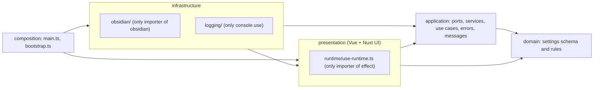
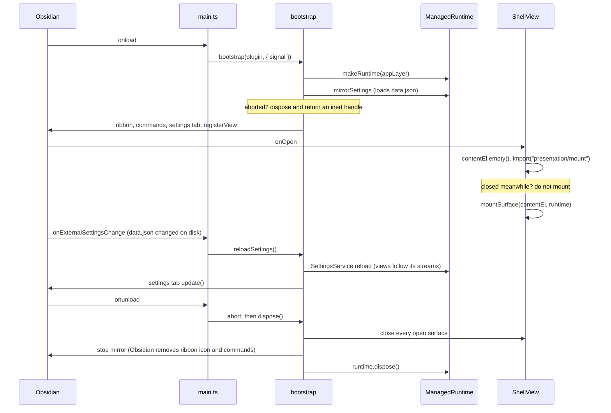

# Architecture

The plugin is layered as ports and adapters, and dependencies point inward only. Tools enforce the boundaries, not convention: oxlint `no-restricted-imports` (`.oxlintrc.json`) and fallow `boundaries` (`configs/fallow.json`). Decision record: [ADR 0002](../adr/0002-architecture.md).

| Layer | Imports | Owns |
| --- | --- | --- |
| `src/domain` | `effect` | Pure rules: `decodeSettings`, `validatePatch`, defaults |
| `src/application` | `effect`, domain | Ports (`SettingsStore`, `Notifier`, `VaultReader`, `Logger`, `Incidents`, `Clipboard`, `HostInfo`), `SettingsService`, `EventBus` and the `AppEvent` vocabulary, use cases, tagged errors, the German message catalog |
| `src/infrastructure/obsidian` | `obsidian`, application, presentation | Adapter Layers (including `hostEventsLayer`), commands, ribbon, settings tab, `ShellView` |
| `src/presentation` | `vue`, `@nuxt/ui`, `@tanstack/vue-form`, application, domain | Vue surfaces. Components never see an Effect value; they call use cases through `useEffectAction` |
| `harness/` | everything except `obsidian` | Browser stand-in for Obsidian with scenario Layers |

`infrastructure` may import `presentation` only because `ShellView` mounts the surface (handoff ruling 14). It loads `presentation/mount` with a dynamic `import()`; nothing that runs at plugin load may import a module that pulls in Vue (see [Lazy presentation](#lazy-presentation)).

## Runtime

One `ManagedRuntime` exists per plugin load (`makeRuntime(appLayer(plugin))`). Every surface, command and settings control runs effects through it. Module-level mutable state is not allowed in `src/**`; state belongs to the runtime or is persisted in `data.json`.

## Events

Decision record: [ADR 0004](../adr/0004-event-system.md).

- `AppEvent` (`src/application/events.ts`) is one tagged union of plain data for host and domain events. Switch on `_tag`.
- `EventBus` publishes them through an unbounded PubSub: `on(tag)` gives a narrowed stream, `subscribe` subscribes at once for forked consumers.
- `hostEventsLayer` maps Obsidian's `vault`, `metadataCache` and `workspace` events at the edge. It publishes nothing until the layout is ready, then `LayoutReady`, then file events. Folders are not published.
- Its listeners and the PubSub belong to the runtime: `runtime.dispose()` removes every listener with `offref` and ends every stream, also after a failed or aborted bootstrap.
- Each listener is also passed to `plugin.registerEvent`, so Obsidian detaches it synchronously in `unload()`, before the asynchronous dispose has finished. Obsidian's `offref` removes a ref by identity and ignores one that is gone, so the second release does nothing.

## Lifecycle

- `dispose` undoes in reverse order. Closing every surface runs first, so no Vue app outlives the runtime.
- If a registration throws, bootstrap undoes what it created, reports the defect and rethrows. Only then does it remove its ribbon icon (through `leftRibbon.removeRibbonAction`, as Obsidian does on unload) and its commands; on a normal unload Obsidian removes them, and removing by id could hit those of a quick re-enable.
- `registerView` and `addSettingTab` run last, because Obsidian cannot unregister them one by one.
- `onExternalSettingsChange` waits for a load still in progress, then reloads; after an unload or a failed load it does nothing. Obsidian calls it itself: its file watcher reports `data.json`, and Obsidian compares the file's modification time with the plugin's last `loadData`/`saveData` before it calls the method and then the tab's `update()`.

## Settings

- `SettingsService` holds the settings and their status (writable, issues, read-only reason) in two `SubscriptionRef`s: `changes` and `statusChanges` emit the current value, then every change.
- `reload` reads `data.json` again and decodes it as on load: a newer or unreadable file switches to read-only and is never written, a valid one switches back. Unchanged values publish nothing, and a notice appears only when the status changes. Reloads and updates are serialised.
- `useSettings` and `useSettingsStatus` follow both streams in a surface. The settings tab reads a mirror of both, because Obsidian reads control values synchronously.

## Lazy presentation

- Vue, Nuxt UI, reka-ui, VueUse and TanStack Form are evaluated on the first `import("presentation/mount")` in `ShellView.onOpen`, not in `onload`. `bootstrap` imports only the Vue-free `presentation/release`.
- The bundle stays one CommonJS file (`codeSplitting: false`): rolldown wraps the dynamically imported modules in a lazy init function inside `main.js`.
- `tests/dom/lazy-presentation.test.ts` fails if loading the plugin evaluates `vue` or `presentation/mount`.
- Measured on 2026-11-21 in Node 24 on the built `main.js` with a stubbed `obsidian` and `document` (41 alternating runs each, compile included; not an Obsidian startup number): Vue's runtime-dom no longer runs at `require` but when the view opens, and the median `require` time fell from 43 ms to 38 ms. The init wrappers grew `main.js` from 541 KB to 550 KB.

## A surface

`mountSurface(root, runtime)` creates one Vue app per view:

- The app mounts into an element appended to `root`, beside a portal element for modals and popovers. Both live in `root.ownerDocument`, so a pop-out window keeps its dialogs.
- `bindHostTheme(root)` mirrors `theme-dark`/`theme-light` from the owner document's body to `dark`/`light` on `root`.
- `app.config.errorHandler` routes render errors to `reportDefect`.
- The returned close is idempotent. It runs every release even if one throws, then rethrows the first error.

## CSS ownership

- `dist/styles.css` is scoped under `.weg-manager-root` by `scripts/scope-css.mjs`. It has no Tailwind preflight, no surviving `@layer`, and prefixed `@keyframes` and `@property` names. `check:dist` verifies all of this.
- Mounting adds nothing to `document.head`. Nuxt UI's runtime `colors` and `head` plugins are replaced by sha256-pinned no-ops (`scripts/no-head-plugins.mjs`); the colour roles live in `src/styles/bridge.css`.
- Tailwind scans only `src/presentation` and an explicit list of Nuxt UI component themes in `src/styles/app.css`. A newly used Nuxt UI component has to be added there.
- Icons are bundled offline. Add new `lucide:*` names to `SHELL_ICONS` in `configs/vite.shared.ts`.

## Repository layout

| Where | What |
| --- | --- |
| `src/`, `harness/`, `tests/` | plugin code, the browser harness, tests (`unit`, `dom`, `e2e`, `support`) |
| `scripts/` | build, check and release scripts run by npm scripts |
| `configs/` | tool configs that take an explicit path: Vite (plugin, harness, shared), Vitest (+ Stryker variant), Stryker, fallow, `tsconfig.{app,node,base}.json`. Each resolves paths from the repository root. |
| root | files a tool or Obsidian only finds there |

These files stay at the root on purpose:
- `manifest.json` and `versions.json`: Obsidian reads them there.
- `package.json` and `.npmrc`: npm reads them there.
- `.nvmrc`, `.editorconfig`, `.gitattributes`, `.gitignore`: tools and git read them there.
- `tsconfig.json`: editors look for it there. It references the configs in `configs/`.
- `eslint.config.mjs`: flat-config file patterns resolve from its own folder, and editors look for it at the root.
- `.prettierrc.json` and `.prettierignore`: editors search upward from each file.
- `.oxlintrc.json`: oxlint resolves `ignorePatterns` and per-path `overrides` relative to its config file. Moved into `configs/`, the layer import bans silently stopped applying; a planted violation passed.

