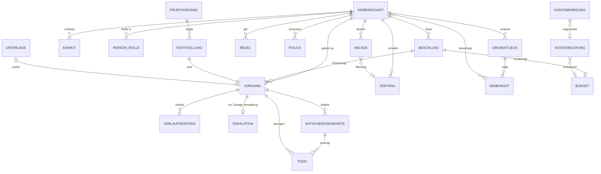

# Fachliches Domänenmodell

Diese Note ist der Einstieg in `docs/entities`. Sie legt die gemeinsame Sprache und die Datenobjekte des Beirats-Moduls fest. Grundlage ist das Data-Dictionary des WEG Control System (WCS), der Ist-Lösung des Beirats ([[K-20 - WCS-Datenmodell als fachliche Grundlage]]). Jedes Datenobjekt hat eine eigene Entity-Note mit Feldern, Wertelisten, Beziehungen, Regeln und Datenschutz.

Die englischen Begriffe für den Code stehen in `GLOSSARY.md` im Wurzelverzeichnis.

## Lesehilfe

- **Stammdaten** ändern sich selten und beschreiben den Bestand: Gemeinschaften, Grundstücke, Einheiten, Personen, Verträge, Policen, Regeln, Anlagen.
- **Bewegungsdaten** entstehen laufend im Betrieb: Vorgänge, Verlauf, Eskalationen, Entscheidungskarten, To-dos, Übergaben, Feststellungen, Buchungen.
- **`scope`** sagt, ob das Objekt zum geplanten MVP gehört (`mvp`) oder zum späteren Ausbau (`spaeter`). Er folgt dem Backlog.
- **`wcs`** sagt, welchen Status das Objekt im WCS hat:
  - `v1`: im PRD-Datenmodell spezifiziert.
  - `v1-should`: als Should spezifiziert.
  - `v1-offen`: Aufnahme offen.
  - `spaeter`: Vorschlag aus der Roadmap-Vision.
  - `keine`: nur in unserem Modell.
- **Pflicht** in den Feldtabellen: P = Pflichtfeld, O = optional, A = vom System berechnet.
- **Schlüssel** sind die vorgeschlagenen englischen Frontmatter-Schlüssel. Verbindlich sind sie erst mit einem Dateivertrag in `docs/contracts`. Heute gibt es nur einen, `docs/contracts/DV-01 - Gemeinschaft v1.md`.
- **Identität:** Jede Notiz hat eine technische `id` `<type>-<uuid>` und ein `schema` ([[docs/adr/0007-vault-data-access.md|ADR 0007]]). Fachliche Nummern wie die Vorgangsnummer oder die Nummer laut Beschlusssammlung sind eigene Felder.

## Zwei Kernobjekte

Die **Gemeinschaft** grenzt jeden Datensatz ab. Gemeinschaften bleiben strikt getrennt ([[DF-12 - Gemeinschaftstrennung]]). Der **Vorgang** bündelt alles, was im Betrieb passiert. Die meisten Bewegungsdaten verweisen auf ihn.

## Stammdaten

| Note | Objekt | scope | WCS |
| --- | --- | --- | --- |
| [[ENT-01 - Gemeinschaft]] | Gemeinschaft (WEG, Tiefgarage, Viertel als Vorschlag) | mvp | v1 |
| [[ENT-02 - Person und Rolle]] | Person mit Rolle in einer Gemeinschaft | mvp | v1-offen (im WCS Text in `wer`) |
| [[ENT-23 - Grundstück]] | Grundstück, Flurstück | spaeter | spaeter |
| [[ENT-24 - Einheit]] | Wohnung, Stellplatz oder Gewerbe mit MEA | spaeter | spaeter |
| [[ENT-25 - Beschluss]] | Beschluss mit Umsetzungsstatus | spaeter | v1-should |
| [[ENT-26 - Budget]] | Beschlossener Betrag je Jahr mit Ermächtigung | spaeter | spaeter |
| [[ENT-27 - Gemeingut]] | Von mehreren genutzte Fläche oder Anlage | spaeter | spaeter |
| [[ENT-28 - Regel]] | Regel aus Gemeinschaftsordnung, Urkunde oder Beschluss | spaeter | spaeter |
| [[ENT-29 - Vertrag]] | Verwalter-, Hausmeister-, Wartungs- und Energievertrag | spaeter | spaeter |
| [[ENT-30 - Police]] | Versicherungsvertrag der Gemeinschaft | spaeter | spaeter |
| [[ENT-31 - Anlage]] | Wartungspflichtige technische Anlage | spaeter | spaeter |
| [[ENT-32 - Unterlage]] | Soll-Unterlage je Gemeinschaftsart (Unterlagen-Inventar) | spaeter | spaeter |
| [[ENT-03 - Thema]] | Zusammenhang mehrerer Vorgänge | mvp | keine (Feld `thema`) |
| [[ENT-08 - Dokument]] | Erhaltenes Original in der Ablage | mvp | keine |

## Bewegungsdaten

| Note | Objekt | scope | WCS |
| --- | --- | --- | --- |
| [[ENT-04 - Vorgang]] | Einzeln erledigbarer Vorgang: Zusage, Frist, Frage oder Aufgabe | mvp | v1 |
| [[ENT-06 - Verlaufseintrag]] | Datierter Eintrag im Verlauf eines Vorgangs | mvp | v1 |
| [[ENT-13 - Eskalation]] | Stufe der Eskalationsleiter einer Verwaltungszusage | mvp | v1 |
| [[ENT-09 - Entscheidungskarte]] | Eine Entscheidung im Wochenlauf mit Optionen | mvp | v1 |
| [[ENT-12 - To-do]] | Konkrete Handlung des Beirats | mvp | v1 |
| [[ENT-14 - Übergabe]] | Abschluss einer Stunde mit Schwerpunkten und Notiz | mvp | v1 |
| [[ENT-16 - Beiratsbewertung]] | Bewertungsschicht: nur für Beirat und Vertretung | mvp | v1 (Bewertungsschicht) |
| [[ENT-05 - Termin]] | Zeitliche Aussage mit Herkunft | mvp | keine (Felder `zugesagtAm`, `bisWann`) |
| [[ENT-07 - Quelle]] | Herkunft einer Aussage | mvp | keine (Felder `quelle`, `link`) |
| [[ENT-10 - Nachrichtenentwurf]] | Prüfbare Fassung einer Nachricht | mvp | keine |
| [[ENT-11 - Versanddokumentation]] | Vom Menschen erfasster Versand | mvp | keine |
| [[ENT-15 - Ausgabestand]] | Geprüfte Zusammenstellung für Empfänger | mvp | keine |
| [[ENT-22 - AI-Gespräch]] | Gespräch im nativen Chat | mvp | keine |
| [[ENT-33 - Vorbereitete Aktion]] | Vom Lauf vorbereitete Aktion mit Nachprüfung | spaeter | v1-offen |
| [[ENT-34 - Prüfvorgang]] | Jahresprüfung je Gemeinschaft und Jahr | spaeter | v1-offen |
| [[ENT-35 - Feststellung]] | Auffälligkeit aus der Jahresprüfung | spaeter | v1-offen |
| [[ENT-36 - Kostenbuchung]] | Gemeinschaftsweite Kostenbuchung | spaeter | spaeter |
| [[ENT-37 - Kontobewegung]] | Bewegung auf Giro- oder Rücklagenkonto | spaeter | spaeter |
| [[ENT-17 - Produktfeedback]] | Beobachtung zur Produktnutzung | spaeter | keine |
| [[ENT-18 - Angebot]] | Angebotsfassung eines Anbieters | spaeter | keine |
| [[ENT-19 - Rechnung]] | Rechnungsdokument und Betragsbasis | spaeter | keine |
| [[ENT-20 - Zahlungseintrag]] | Manuell dokumentierte Zahlung | spaeter | keine |

Die entschiedenen Abweichungen stehen unten. Die genaue Abgrenzung zwischen eigenen Objekten und WCS-Objekten steht in den Notes unter „Abweichungen vom WCS“. Das betrifft Dokument und Unterlage, Rechnung und Kostenbuchung sowie Zahlungseintrag und Kontobewegung.

## Datenschutzregel für alle Objekte

Personenbezogene Daten anderer Eigentümer werden nur gespeichert, wo es nötig ist. Sie liegen getrennt im privaten Bereich. Sie gelangen nie in Entwürfe, Karten, Berichte oder das Repository. Aus Abrechnungen werden nur gemeinschaftsweite Zahlen übernommen. Die **Bewertungsschicht** sehen nur Beirat und Vertretung, die Verwaltung nicht ([[ENT-16 - Beiratsbewertung]]). Zu ihr gehören:
- die Bewertung „nicht eingehalten“ (bei uns kein Vorgangsstatus),
- die Antwortzeiten,
- die Eskalationsstufen,
- Notizen für die Eigentümerversammlung und die Entlastung.

## Wertelisten im Überblick

Die Werte stehen in der jeweiligen Entity-Note. Geschlossene Listen ändern sich nur mit einer Schemaänderung.

| Liste | Werte | Note |
| --- | --- | --- |
| Art der Gemeinschaft | frei, Vorschläge WEG, Tiefgarage, Viertel | [[ENT-01 - Gemeinschaft]] |
| Vorgangsart | Zusage Verwaltung, Zusage Dritter, Frist Beirat, Frist gesetzlich, Frage, Aufgabe Beirat | [[ENT-04 - Vorgang]] |
| Vorgangsstatus | offen, erledigt, ungeklärt, hinfällig („nicht eingehalten“ ist eine Bewertung) | [[ENT-04 - Vorgang]], [[ENT-16 - Beiratsbewertung]] |
| Prüfvermerk | überfällig, Termin erfragen, leer (berechnet) | [[ENT-04 - Vorgang]] |
| Eskalationsstufe | 1 Termin erfragen · 2 Frist +14 Tage · 3 förmliche Erinnerung, Frist +10 Tage · 4 Vormerkung für Bericht, Versammlung, Entlastung | [[ENT-13 - Eskalation]] |
| Kartenstatus | offen, entschieden, vertagt, geparkt | [[ENT-09 - Entscheidungskarte]] |
| To-do-Status | offen, erledigt, entfallen | [[ENT-12 - To-do]] |
| Ablauf der Übergabe | woche, lagecheck | [[ENT-14 - Übergabe]] |
| Rolle | Beirat, Vertretung, Eigentümer, Verwaltung, Beirat anderer Gemeinschaft, Dritte, Agent (optional) | [[ENT-02 - Person und Rolle]] |
| Umsetzungsstatus | umgesetzt, offen, überholt | [[ENT-25 - Beschluss]] |
| Grad der Vorbereitung | nur anzeigen, vorschlagen; „selbst erledigen“ nur späterer Ausbau; nie senden | [[ENT-33 - Vorbereitete Aktion]] |

## Fachglossar

Die Begriffe sind alphabetisch sortiert. Die Rechtsbegriffe folgen dem Wohnungseigentumsgesetz in der Fassung seit dem 1.12.2020 (WEMoG). Die Systembegriffe stammen aus dem WCS. Die Spalte „Art“ ordnet jeden Begriff einem Bereich zu: Recht, Bestand, Finanzen, Viertel oder System.

| Begriff | Bedeutung | Art | Bezug |
| --- | --- | --- | --- |
| Ablageregel | Dateiname `JJJJ-MM-TT Art Thema.pdf`; oben im Ordner nur gültige Endfassungen, Überholtes in „Archiv“, Entwürfe in „Entwürfe und Unterlagen“ | System | [[ENT-08 - Dokument]] |
| Anlage (technisch) | Wartungspflichtiges Bauteil des Gemeinschaftseigentums, etwa Aufzug, Tor, Lüftung, mit Intervall und letztem Nachweis | Recht/Bestand | [[ENT-31 - Anlage]] |
| Antwortzeit | Tage von Anfrage bis Antwort oder von Zusage bis Erledigung; Teil der Bewertungsschicht | System | [[ENT-04 - Vorgang]] |
| Beirat (Verwaltungsbeirat) | Unterstützt und überwacht den Verwalter, prüft Wirtschaftsplan und Jahresabrechnung und nimmt Stellung | Recht | § 29 WEG |
| Beiratsmappe | Mobile Oberfläche des WCS für die Montagsstunde mit Entscheidungskarten und To-dos, bis zur Ablösung durch das Plugin | System | WCS |
| Beschluss | Willensbildung der GdWE in der Versammlung oder im Umlaufverfahren, hier mit Umsetzungsstatus | Recht | §§ 23–25 WEG, [[ENT-25 - Beschluss]] |
| Beschlusssammlung | Pflichtverzeichnis aller Beschlüsse und gerichtlichen Entscheidungen, geführt vom Verwalter | Recht | § 24 Abs. 7 WEG |
| Bewertungsschicht | Felder, die nur Beirat und Vertretung sehen | System | [[ENT-16 - Beiratsbewertung]] |
| Budget | Durch Beschluss freigegebener Betrag je Jahr mit Ermächtigung | Recht/System | [[ENT-26 - Budget]] |
| Durchlaufposten | Kosten, die eine Gemeinschaft zahlt und an andere Berechtigte weiterbelastet, etwa den Unterhalt eines Spielplatzes | Finanzen | [[ENT-36 - Kostenbuchung]] |
| Eigentümerversammlung (ETV) | Organ der Willensbildung der GdWE mit Einladung, Tagesordnung (TOP) und Protokoll | Recht | §§ 23–24 WEG |
| Einheit | Wohnung oder Stellplatz mit Miteigentumsanteil und Sondereigentum | Recht | § 1 WEG, [[ENT-24 - Einheit]] |
| Entlastung | Beschluss, mit dem die Gemeinschaft für einen Zeitraum auf Ansprüche gegen Verwalter oder Beirat verzichtet | Recht | Rechtsprechung |
| Entscheidungskarte | Eine Entscheidung im Wochenlauf: Kontext, 2–4 Optionen mit Folgen, Empfehlung, Entwurf; höchstens sieben pro Woche | System | [[ENT-09 - Entscheidungskarte]] |
| Erhaltungsrücklage | Zweckgebundenes Vermögen der GdWE für künftige Erhaltung, früher Instandhaltungsrücklage | Recht/Finanzen | § 19 Abs. 2 Nr. 4 WEG |
| Eskalationsleiter | Vier Stufen für Zusagen der Verwaltung: Termin erfragen, Frist setzen, förmliche Erinnerung, Vormerkung für Bericht, Versammlung und Entlastung | System | [[ENT-13 - Eskalation]] |
| Feststellung | Auffälligkeit aus der Jahresprüfung mit Quelle (Dokument und Seite), meist als Frage an die Verwaltung | System | [[ENT-35 - Feststellung]] |
| GdWE | Gemeinschaft der Wohnungseigentümer, rechtsfähig, Trägerin des Gemeinschaftsvermögens | Recht | § 9a WEG |
| Gemeingut | Fläche oder Anlage, die mehrere Grundstücke oder Gemeinschaften nutzen, mit Kostenschlüssel | Viertel | [[ENT-27 - Gemeingut]] |
| Gemeinschaft | Verwaltungseinheit im Plugin, etwa WEG, Tiefgaragengemeinschaft oder Viertel; strikt getrennt | System | [[ENT-01 - Gemeinschaft]] |
| Gemeinschaftsordnung | Vereinbarte Regeln der Eigentümer, meist Teil der Teilungserklärung: Kostenschlüssel, Stimmrecht, Pflichten | Recht | § 10 WEG, [[ENT-28 - Regel]] |
| Jahresabrechnung | Abrechnung des Verwalters über das Wirtschaftsjahr mit Einzelabrechnungen und Vermögensbericht; beschlossen wird nur über Nachschüsse und die Anpassung der Vorschüsse | Recht/Finanzen | § 28 Abs. 2, 4 WEG |
| Kostenschlüssel | Verteilungsmaßstab, etwa MEA, Einheiten oder gleiche Teile je Grundstück | Recht/Finanzen | § 16 Abs. 2 WEG |
| Lagecheck | Ablauf außer der Reihe: wo war ich, was ist passiert, was kann nicht bis Montag warten | System | [[ENT-14 - Übergabe]] |
| MEA | Miteigentumsanteil, meist in Tausendsteln; Grundlage für Kosten und oft für das Stimmrecht | Recht | § 16 WEG |
| Montagsstunde | Feste Beiratsstunde am Montag; Ziel höchstens 60 Minuten | System | [[H-03 - Wochenarbeit bleibt innerhalb einer Stunde]] |
| Nachprüfung | Jeder Lauf prüft, ob die vorbereiteten Aktionen des letzten Laufs ausgeführt wurden; ein Vorschlag gilt nie als erledigt | System | [[ENT-33 - Vorbereitete Aktion]] |
| Police | Versicherungsvertrag der Gemeinschaft, etwa Gebäude oder Haftpflicht | Bestand | [[ENT-30 - Police]] |
| Private Daten | Liste der Dateien mit Daten anderer Eigentümer und ihr Ablageort | System | Datenschutzregel oben |
| Prüfvermerk | Automatischer Hinweis an einem Vorgang: „überfällig“ oder „Termin erfragen“ | System | [[ENT-04 - Vorgang]] |
| Sondereigentum, Gemeinschaftseigentum | Eigentum an der Einheit gegenüber allen übrigen Teilen von Grundstück und Gebäude | Recht | § 5 WEG |
| Stellungnahme | Schriftliche Äußerung des Beirats zu Wirtschaftsplan und Abrechnung vor dem Beschluss | Recht | § 29 Abs. 2 S. 2 WEG, [[ENT-34 - Prüfvorgang]] |
| Teilungserklärung | Notarielle Urkunde über die Aufteilung in Einheiten, mit Aufteilungsplan | Recht | § 8 WEG |
| To-do | Konkrete Handlung des Beirats, oft aus einer Entscheidungskarte | System | [[ENT-12 - To-do]] |
| Übergabe | Abschluss einer Stunde: bis zu drei Schwerpunkte und eine Notiz; Start des nächsten Laufs | System | [[ENT-14 - Übergabe]] |
| Umlaufbeschluss | Beschluss ohne Versammlung in Textform; allstimmig, mit Mehrheit nur nach einem Absenkungsbeschluss | Recht | § 23 Abs. 3 WEG |
| Unterlagen-Inventar | Soll-Liste der Unterlagen je Gemeinschaft, abgeglichen mit der Ablage; jede Lücke wird ein Vorgang | System | [[ENT-32 - Unterlage]] |
| Verlauf | Datierte, nie gelöschte Historie eines Vorgangs | System | [[ENT-06 - Verlaufseintrag]] |
| Verwalter | Vertritt die GdWE und führt die laufende Verwaltung | Recht | §§ 26–27 WEG |
| Verwaltervertrag | Vertrag zwischen GdWE und Verwalter über Leistungen, Vergütung und Laufzeit | Recht/Bestand | § 26 WEG, [[ENT-29 - Vertrag]] |
| Viertel | Ebene über mehreren Gemeinschaften, die Gemeingüter teilen | Viertel | [[ENT-01 - Gemeinschaft]], [[ENT-27 - Gemeingut]] |
| Vorgang | Ein einzeln erledigbarer Vorgang: Zusage, Frist, Frage oder Aufgabe; nie gelöscht | System | [[ENT-04 - Vorgang]] |
| Vorschuss (Hausgeld) | Monatliche Zahlung der Eigentümer auf Grundlage des beschlossenen Wirtschaftsplans | Finanzen | § 28 Abs. 1 WEG |
| Wirtschaftsplan | Plan der Einnahmen und Ausgaben für das Jahr; Grundlage der Vorschüsse | Recht/Finanzen | § 28 Abs. 1 WEG |
| Wochenlauf | Vorbereiteter Lauf zum Wochenbeginn: Lage, Fristen der nächsten 14 Tage, Karten, To-dos, Ablage, Nachprüfung | System | [[VIEW-02 - Wochenarbeit]] |
| Zusage | Versprechen der Verwaltung oder anderer mit Ergebnis und Termin; Hauptgegenstand der Eskalationsleiter | System | [[ENT-04 - Vorgang]] |

## Zuordnung alter Begriffe

Bis Code, Routen und Mockups nachgezogen sind, gilt diese Zuordnung (O-D13 in `docs/design/handoff/09 - Offene Punkte vor Implementierung.md`):

| Bisher | Jetzt | Note |
| --- | --- | --- |
| Punkt, Punktakte | Vorgang, Vorgangsakte | [[ENT-04 - Vorgang]] |
| Ereignis (fachlicher Verlauf) | Verlaufseintrag | [[ENT-06 - Verlaufseintrag]] |
| Nachfassstand, Nachfassstufe | Eskalation, Eskalationsstufe | [[ENT-13 - Eskalation]] |
| Arbeitsentscheidung | Entscheidungskarte | [[ENT-09 - Entscheidungskarte]] |
| Eigene Aufgabe, eigene Folgeaufgabe | To-do | [[ENT-12 - To-do]] |
| Wochenübergabe | Übergabe | [[ENT-14 - Übergabe]] |
| Prüfmerkmal | Prüfvermerk | [[ENT-04 - Vorgang]] |
| Ansprechpartner | Person mit Rolle; der Bereich „Kontakte“ bleibt | [[ENT-02 - Person und Rolle]] |

Technische Ereignisse des Vaults (Host-Events, Index) heißen weiter Ereignis.

## Entschiedene Abweichungen vom WCS

Am 22.11.2026 hat der Produktverantwortliche diese Widersprüche zwischen WCS und unseren Regeln entschieden:

- **Eskalation:** Eine neue Stufe gibt es erst nach Ablauf der Frist eines tatsächlich gesendeten Schritts, nicht automatisch jede Woche ([[DF-05 - Eskalationsleiter und Fristen]], [[ENT-13 - Eskalation]]).
- **„nicht eingehalten“:** Das ist eine getrennte Bewertung in der Bewertungsschicht, kein Vorgangsstatus ([[ENT-16 - Beiratsbewertung]], [[ENT-04 - Vorgang]]).
- **Entscheidungskarten:** sieben reguläre Karten plus sichtbarer dringender Überlauf. Eine Karte darf mehrere Vorgänge derselben Gemeinschaft bündeln ([[K-05 - Sieben reguläre Entscheidungen mit sichtbarem Überlauf]], [[ENT-09 - Entscheidungskarte]]).
- **Vorgangsnummer:** eine Nummernfolge über alle Gemeinschaften, wie im WCS ([[ENT-04 - Vorgang]]).
- **To-do:** Status offen, erledigt und entfallen; jedes To-do gehört genau einer Gemeinschaft ([[ENT-12 - To-do]]).
- **Pflichtfelder am Vorgang:** Das Thema ist Pflicht. Die Quelle ist Pflicht, „unbekannt“ ist als sichtbare Lücke erlaubt ([[ENT-04 - Vorgang]]).
- **Vorgangsart:** die WCS-Liste plus „Zusage Dritter“. Die Eskalationsleiter gilt nur für Zusagen der Verwaltung ([[ENT-04 - Vorgang]]).
- **Pause einer Eskalation:** mit Grund und frei wählbarem Ende, vorgeschlagen ist eine Woche ([[ENT-13 - Eskalation]]).

## Offene Punkte

Aus dem WCS übernommen; Details an den Notes.

- **O-DM-1:** Prüfvorgang und Feststellung im MVP oder als erster Schritt danach? ([[ENT-34 - Prüfvorgang]], [[ENT-35 - Feststellung]]; WCS Q8)
- **O-DM-2:** „Vorbereitete Aktion“ als eigenes Objekt ins Schema aufnehmen, damit die Nachprüfung prüfbar wird? ([[ENT-33 - Vorbereitete Aktion]])
- **O-DM-3:** Speicherort der Bewertungsschicht: eigener, nicht geteilter Bereich im Vault ([[ENT-16 - Beiratsbewertung]]; WCS Q1).
- **O-DM-4:** Personen als eigenes Objekt oder weiter als Rolle im Feld `wer` des Vorgangs? Wo liegt die Datenschutzgrenze für Eigentümerdaten? ([[ENT-02 - Person und Rolle]])
- **O-DM-5:** Kostenbuchung, Kontobewegung und Budget zusammen bauen, weil alle dieselbe Buchungslogik brauchen? Wie verhalten sich Rechnung und Zahlungseintrag dazu? ([[ENT-26 - Budget]], [[ENT-36 - Kostenbuchung]], [[ENT-37 - Kontobewegung]])
- **Erledigt:** Gemeinschaft als eigenes Objekt (WCS Q9) ist mit [[ENT-01 - Gemeinschaft]] und DV-01 umgesetzt, mit freier Art statt festem Typ ([[K-20 - WCS-Datenmodell als fachliche Grundlage]]).

## Herkunft

Glossar und Data-Dictionary des WCS vom 22.11.2026. Es beruht auf dem PRD des Beirats-Moduls (Entwurf 0.2, 17.11.2026, Abschnitt 7) und der Roadmap-Vision v0.2 (17.11.2026). Das Originaldokument liegt nicht im Repository. Die FR- und V-Kennungen in den Notes stammen aus diesen WCS-Dokumenten, die B-FR-Kennungen aus [[02-MVP-PRD]].

[[Product Backlog.base#Design Foundations|Entitätsnotes]] · [[K-20 - WCS-Datenmodell als fachliche Grundlage]]
