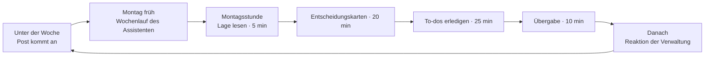

# Research · IST-Ablauf des Pilot-Beirats als Storymap

**Ergebnis:** Der Pilot-Beirat arbeitet heute ohne das Plugin. Er nutzt einen KI-Assistenten und allgemeine Werkzeuge: Mail, eine Tabelle, eine Cloud-Ablage und eine selbst gebaute Arbeitsseite, die Beiratsmappe des WCS. Der Assistent bereitet am Montag früh alles vor. Der Beirat entscheidet in einer festen Wochenstunde an einer Stelle und sendet selbst. Die größte Reibung liegt nicht im Entscheiden. Sie liegt im Übergang von der Entscheidung zum Versand und in der Eskalation von Zusagen ohne Termin.

## Auftrag, Methode und Evidenzgrenze

- **Auftrag:** Die Note wurde am 17.11.2026 erbeten, um den Anwendungsfall des Piloten zu verstehen. Sie kam als Pull Request #36 ins Projekt. Übernommen ist sie hier ohne Namen und mit den Begriffen nach [[K-20 - WCS-Datenmodell als fachliche Grundlage]].
- **Grundlage:** die Selbstbeschreibung des Piloten und seine Ablaufnotiz, Stand 17.11.2026. Es gibt keine Beobachtung durch Dritte und keine Zeitmessung über mehrere Wochen.
- **Umfang:** ein Pilot mit zwei Gemeinschaften, einer WEG und der zugehörigen Tiefgarage. Die Note enthält keine echten Namen, Adressen, Beträge oder Inhalte von Vorgängen.
- **Beobachtung** steht für das, was der Pilot heute tut. **Ableitung** steht für ein vorgeschlagenes Produktverständnis, das keine Vorgabe ist.

## Ablauf im Überblick

## Storymap

Jede Zeile ist ein Schritt des Ablaufs, in der Reihenfolge der Woche. Die Spalten trennen:
- was der Beirat tut,
- was der Assistent oder eine Automatik tut,
- welche Werkzeuge im Spiel sind,
- wo es heute hakt.

| Schritt | Beirat (Beobachtung) | Assistent / Automatik (Beobachtung) | Werkzeuge | Reibung heute |
| --- | --- | --- | --- | --- |
| **Unter der Woche: Post kommt an** | Bekommt eine Push-Nachricht bei neuer Mail im Beirats-Postfach. Startet bei Bedarf einen Lagecheck, sonst bleibt die Post bis Montag liegen. | Ein Skript legt Anhänge in einen Eingangsordner der Ablage. Der Lagecheck fragt: Wo war ich? Was ist passiert? Kann es bis Montag warten? | Mail-Postfach des Beirats, Skript, Assistent | Der Posteingang ist ungewollt zur Aufgabenliste geworden. |
| **Montag früh: Wochenlauf** | Nichts zu tun. | Liest Mails, Vorgangsregister und Arbeitsseite. Pflegt das Register und legt Dateien ab. Hebt Eskalationen eine Stufe an. Schreibt die Lage, höchstens sieben Entscheidungskarten mit Empfehlung und fertigem Entwurf und dazu To-dos. Räumt das Postfach auf. | Geplanter Lauf, Tabelle (Vorgangsregister), Ablage, Mail, Arbeitsseite | Der Lauf machte anfangs nur Vorschläge, statt zu handeln. Die Ablage staute sich wochenlang. Fehler sieht man nur, wenn man die Lage liest. |
| **Montagsstunde: Lage lesen (5 min)** | Öffnet die Arbeitsseite. Er sieht den Modus der Woche, Neuigkeiten, Fristen und den Stand der Eskalationen. | Lage, Fristen und Notiz zur Eskalation kommen fertig aus dem Wochenlauf. | Arbeitsseite | Die Lage ist ein Stand vom frühen Morgen. Was danach kam, fehlt. |
| **Entscheidungskarten (20 min)** | Wählt je Karte eine Option, auf Wunsch mit Notiz, etwa „als Verständnisfrage formulieren“. Schickt die Wahl ab. | Macht aus Wahl und Notiz Entwürfe, einen je Gemeinschaft und Empfänger. Dazu kommen Eigentümer-Infos auf Deutsch und Englisch und To-dos. | Karten auf der Arbeitsseite, Mail-Entwürfe | Der automatische Start nach dem Abschicken ist noch nicht verlässlich. Notizen verweisen oft auf ein Gespräch außerhalb der Arbeitsseite. |
| **To-dos erledigen (25 min)** | Arbeitet die To-dos ab: Entwurf öffnen, Absender auf die Beirats-Adresse stellen, senden. Kopiert Texte für Messenger, prüft vor Ort und sieht den Rest im Postfach an. | Liefert je To-do den Link zum Entwurf oder den Text zum Kopieren. Sendet nie selbst. | Mail, Messenger, Ablage, Vorgangsregister | Der Absender muss jedes Mal von Hand umgestellt werden. Es gibt viele Kanäle. To-dos ohne Rückmeldung bleiben liegen. |
| **Übergabe (10 min)** | Wählt bis zu drei Schwerpunkte für die Woche und schreibt die Übergabe („wo war ich“). | Die Übergabe ist der Startpunkt für den nächsten Lagecheck und den nächsten Wochenlauf. Die Zeilen im Register bekommen einen Vermerk. | Arbeitsseite, Vorgangsregister | Wissen verteilt sich auf Arbeitsseite, Register, Projektdokumente und persönliche Notizen. |
| **Danach: Reaktion der Verwaltung** | Eine Antwort kommt mit Push-Nachricht. Er macht einen Lagecheck oder parkt sie bis Montag. | Gleicht die Antwort mit dem Vorgangsregister ab. Zusagen ohne Termin steigen jede Woche eine Stufe der Eskalationsleiter: Termin erfragen, Frist setzen, förmlich erinnern, im Bericht an die Eigentümer vormerken. | Vorgangsregister, Eskalationen auf der Arbeitsseite | Es gibt viele Zusagen ohne Termin. Die Eskalation ist der größte Aufwand. |

## Begriffe: IST-Ablauf und WEG Manager

Der Pilot hat für seine Werkzeuge eigene Namen. Die Tabelle ordnet sie den Begriffen aus [[00 - Fachliches Domänenmodell]] zu.

| Im IST-Ablauf des Piloten | Im WEG Manager | Hinweis |
| --- | --- | --- |
| WEG und Tiefgarage | [[ENT-01 - Gemeinschaft]] mit der Art „WEG“ bzw. „Tiefgarage“ | Formal getrennt, aber ein gemeinsames Postfach. |
| Arbeitsseite mit Datenbank („Mappe“) | Beiratsmappe des WCS; im Plugin die Ansichten Lage, Wochenarbeit und Postausgang | Heute eine selbst gebaute Seite statt des Vaults. |
| Register (Tabelle, eine Zeile je Zusage) | Vorgangsregister, je Zeile ein [[ENT-04 - Vorgang]] | Eine Zeile ist ein einzeln erledigbarer Vorgang. |
| Morgenlauf des Assistenten | Wochenlauf | Im Plugin ohne KI-Pflicht vorgesehen ([[H-06 - Vorbereitete Wochenarbeit ist ohne verpflichtende KI nützlich]]). |
| Lage | Lage | |
| Entscheidungskarte mit Empfehlung und Entwurf | [[ENT-09 - Entscheidungskarte]] | Höchstens sieben je Woche ([[H-04 - Sieben Entscheidungen sind ein brauchbares Arbeitsbudget]]). |
| Notiz zur Wahl | Notiz der Entscheidungskarte (`wahl / notiz`) | |
| „Entscheidungen abschicken“ | Wahl bestätigen, To-dos und Entwürfe vorbereiten | |
| To-do mit Entwurfslink oder Kopiertext | [[ENT-12 - To-do]], [[ENT-10 - Nachrichtenentwurf]] im Postausgang | Versand bleibt beim Menschen. |
| Nachfass-Leiter (Stufen 1 bis 4) | Eskalationsleiter, [[ENT-13 - Eskalation]] | Nur für Zusagen der Verwaltung. |
| Lagecheck | Lagecheck | |
| Übergabe („wo war ich“), Schwerpunkte | [[ENT-14 - Übergabe]] | |
| Eingangsordner der Ablage | Eingang, Quellen zuordnen ([[ENT-07 - Quelle]]) | |

## Ableitungen für das Produkt

- **Ableitung:** Der Engpass liegt zwischen Bestätigen und Versand. Ein Postausgang könnte Absender und Empfänger je Gemeinschaft vorbelegen und den tatsächlichen Versand mit einem Klick erfassen. Das spart dem Piloten am meisten Zeit ([[ENT-10 - Nachrichtenentwurf]], [[ENT-11 - Versanddokumentation]]).
- **Ableitung:** Die Wochenstunde passt in den heutigen Ablauf, aber nur, weil die Vorbereitung vorher stattfindet. Ohne vorbereitete Wochenarbeit ist [[H-03 - Wochenarbeit bleibt innerhalb einer Stunde]] für diesen Piloten nicht zu halten.
- **Ableitung:** Kontext, der heute im Gespräch mit dem Assistenten steckt, sollte in der Notiz der Entscheidungskarte oder im Verlauf des Vorgangs landen. Sonst ist eine Übergabe ohne Hintergrundwissen nicht verständlich.
- **Ableitung:** Die Eskalation ist wiederkehrende Hauptarbeit. Für diesen Piloten ist es wichtiger, Stufen und Fristen je Vorgang sichtbar zu machen, als neue Erfassungswege zu bauen.
- **Ableitung:** Ein Lauf, der nur Vorschläge macht, staut Arbeit auf. Das stützt die Nachprüfung vorbereiteter Aktionen ([[ENT-33 - Vorbereitete Aktion]]). Senden bleibt beim Menschen.
